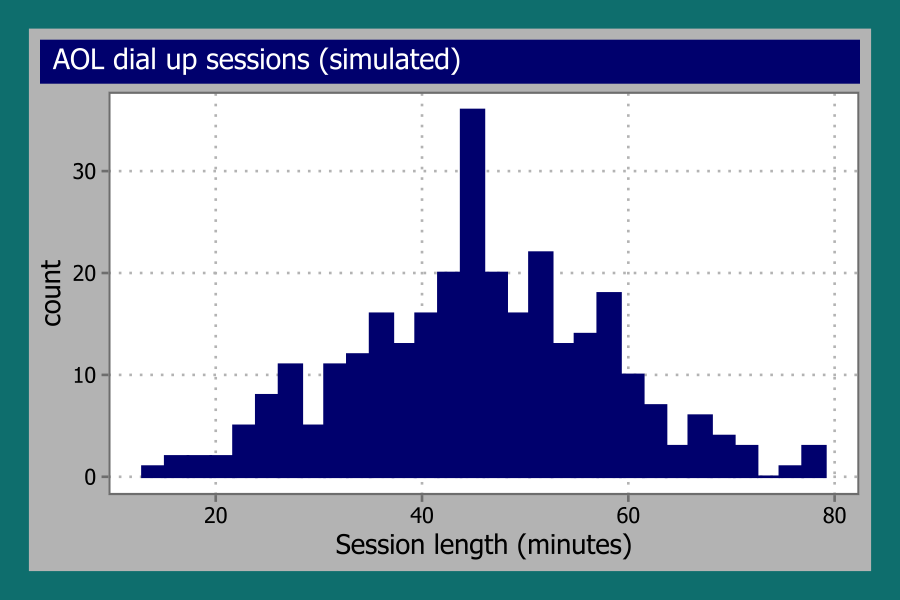
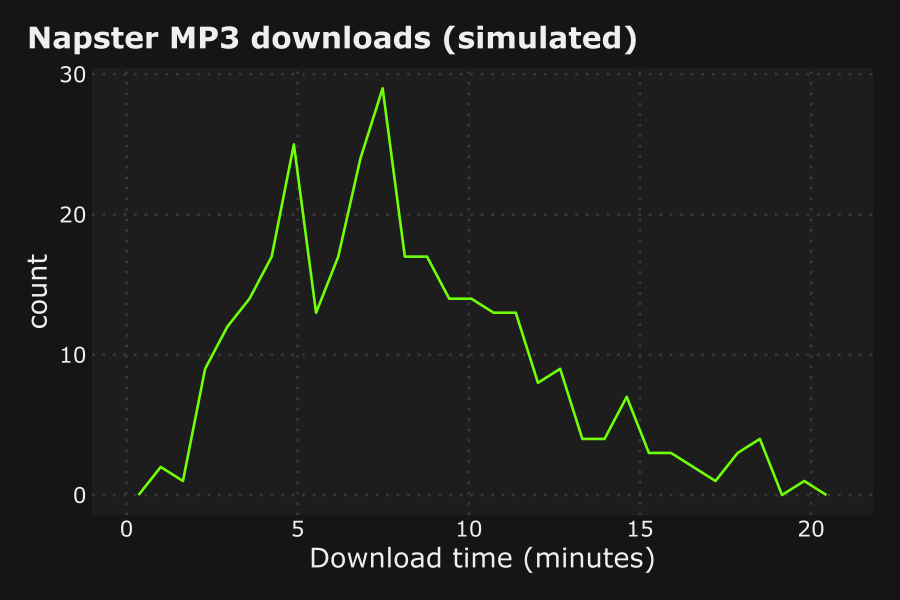

# fmggp2

<!-- badges: start -->

<!-- badges: end -->

`fmggp2` is the support package for [*ggplot2: field
manual*](https://mjfrigaard.github.io/fm-ggp2/). It holds the late 90s
`ggplot2` themes and the small helpers the book uses, so every chapter
loads the same tested code.

## Installation

Install the development version from GitHub:

``` r
# install.packages("pak")
pak::pak("mjfrigaard/fmggp2")
```

## Themes

Every example in the book uses simulated data with a 90s throwback, and
each dataset gets a theme to match.

| Theme | Reference | Chapter |
|----|----|----|
| `theme_doom()` | Doom | Scatter plots (frame rate by CPU speed) |
| `theme_rugrats()` | Rugrats | Instance charts (baby names by year) |
| `theme_y2k()` | Y2K | Alluvial charts (Y2K prep surveys) |
| `theme_hypercolor()` | Hypercolor | Stream plots (90s fad sales) |
| `theme_savedbythebell()` | Saved by the Bell | Slope graphs (Bayside quiz averages) |
| `theme_boyband()` | Boy bands | Bump charts (weekly radio spins) |
| `theme_snick()` | SNICK | Grouped line graphs (nightly Nickelodeon ratings) |
| `theme_batman()` | Batman (1989) | Line graphs (weekly box office) |
| `theme_magiceye()` | Magic Eye | Raincloud plots (seconds to see the hidden image) |
| `theme_aim()` | AOL Instant Messenger | Grouped violin plots (buddy list sizes) |
| `theme_oregontrail()` | The Oregon Trail | Grouped box plots (days to reach Oregon) |
| `theme_trl()` | MTV TRL | Ridgeline plots (days on the countdown) |
| `theme_furby()` | Furby | Overlapping and stacked densities (Furby chatter) |
| `theme_tetris()` | Tetris | Beeswarm plots (lines cleared by player) |
| `theme_goosebumps()` | Goosebumps books | Overlapping dot plots (books read by grade) |
| `theme_supersoaker()` | Super Soaker | Overlapping frequency polygons (range by model) |
| `theme_tamagotchi()` | Tamagotchi | Overlapping histograms (virtual pet lifespans) |
| `theme_toysrus()` | Toys”R”Us | Treemaps (1998 toy sales) |
| `theme_lisafrank()` | Lisa Frank school supplies | Pie charts (Trapper Keeper designs) |
| `theme_titanic()` | Titanic (1997) | Mosaic plots (moviegoers and viewings) |
| `theme_netscape()` | Netscape Navigator | Stacked filled densities (modem speeds) |
| `theme_encarta()` | Microsoft Encarta / Britannica | Diverging bar graphs (encyclopedia survey) |
| `theme_walkman()` | Sony Walkman Sports | Cleveland dot plots (battery life by model) |
| `theme_pogs()` | Pogs milk caps | Waffle charts (a collection of 100 Pogs) |
| `theme_freshprince()` | The Fresh Prince of Bel-Air | Heatmaps (running gags per season) |
| `theme_friends()` | Friends (Monica’s apartment) | Overlapping bar graphs (viewers per episode) |
| `theme_happymeal()` | McDonald’s Happy Meal box | Summary bar graphs (Happy Meals sold per promotion) |
| `theme_jurassic()` | Jurassic Park (1993) | Grouped bar graphs (dinosaur weights per paddock) |
| `theme_n64()` | Nintendo 64 | Box plots (Mario Kart 64 lap times) |
| `theme_beanie()` | Beanie Babies heart tag | Violin plots (resale prices) |
| `theme_spice()` | Spice Girls era pop | Density plots (Spice World tour fan ages) |
| `theme_blockbuster()` | Blockbuster Video | Dot plots (weekly rentals) |
| `theme_gameboy()` | Original Game Boy screen | Bar graphs (Pokémon starters) |
| `theme_win98()` | Windows 98 desktop | Histograms (AOL dial up sessions) |
| `theme_napster()` | 1999 Napster client | Frequency polygons (Napster downloads) |
| `theme_fmggp2()` | Original book theme | Chapters not yet converted |

``` r
library(fmggp2)
library(ggplot2)
showtext::showtext_auto()
set.seed(1014)
aol_sessions <- data.frame(minutes = round(rnorm(300, mean = 45, sd = 12)))
ggplot(aol_sessions, aes(x = minutes)) +
  geom_histogram(bins = 30) +
  labs(title = "AOL dial up sessions (simulated)",
       x = "Session length (minutes)") +
  theme_win98(base_size = 13)
```



``` r
set.seed(1999)
napster_downloads <- data.frame(minutes = round(rgamma(300, shape = 4, rate = 0.5), 1))
ggplot(napster_downloads, aes(x = minutes)) +
  geom_freqpoly(bins = 30) +
  labs(title = "Napster MP3 downloads (simulated)",
       x = "Download time (minutes)") +
  theme_napster(base_size = 13)
```



## Book helpers

| Function   | What it does                                           |
|------------|--------------------------------------------------------|
| `co_box()` | Prints a Quarto callout box (use with `results: asis`) |
| `status()` | Prints a chapter status callout                        |
| `%nin%`    | The negation of `%in%`                                 |

## How the chapters teach distributions

Each chapter simulates its data from a known distribution, then connects
that distribution to the graph in a “Distribution” section. The section
follows the concrete, pictorial, abstract sequence from [Singapore
math](https://en.wikipedia.org/wiki/Singapore_math):

1.  **Count it** (concrete): print a handful of simulated values and a
    small count table.
2.  **Draw it** (pictorial): draw a bar model (parts of a whole), then
    the graph with reference lines.
3.  **Name it** (abstract): state the generating distribution (e.g.,
    $X \sim \text{Normal}(45, 12)$) and show how each parameter maps to
    the graph.
