# 90s themes

Every converted chapter in [*ggplot2: field
manual*](https://mjfrigaard.github.io/fm-ggp2/) uses simulated data with
a late 90s theme, and each dataset gets a `ggplot2` theme to match. This
vignette shows each theme with the data from the chapter that introduced
it.

Themes with a dark background also have a light version. Set
`mode = "light"` to get a light background with darker text and marks.
Dark is the default. Each dark theme’s section below shows both
versions.

``` r

library(fmggp2)
library(ggplot2)
showtext::showtext_auto()
```

## 3Com Audrey

[`theme_audrey()`](https://mjfrigaard.github.io/fmggp2/reference/theme_audrey.md)
uses a 3Com Audrey on a kitchen counter: a white plastic background, a
black tile frame, a teal title, teal, navy, tan, brown, and aqua marks,
and an Arial Rounded title. Below we simulate what 300 households used
their Audrey for.

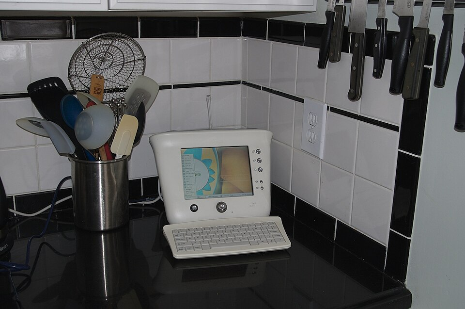

Image: Andrew Turner, [Wikimedia
Commons](https://commons.wikimedia.org/wiki/File:3Com_Audrey.jpg), CC BY
2.0.

``` r

set.seed(2000)
uses <- data.frame(month = rep(c("Oct", "Nov", "Dec"), each = 300),
  task = sample(c("Email", "Weather", "Recipes", "Calendar", "Browsing"), 900, replace = TRUE))
uses$month <- factor(uses$month, levels = c("Oct", "Nov", "Dec"))
ggplot(uses, aes(x = month, fill = task)) +
  geom_bar(position = "fill") +
  labs(title = "Audrey at home", caption = "Simulated data", x = NULL, y = "Share of households", fill = NULL) +
  theme_audrey(base_size = 13)
```

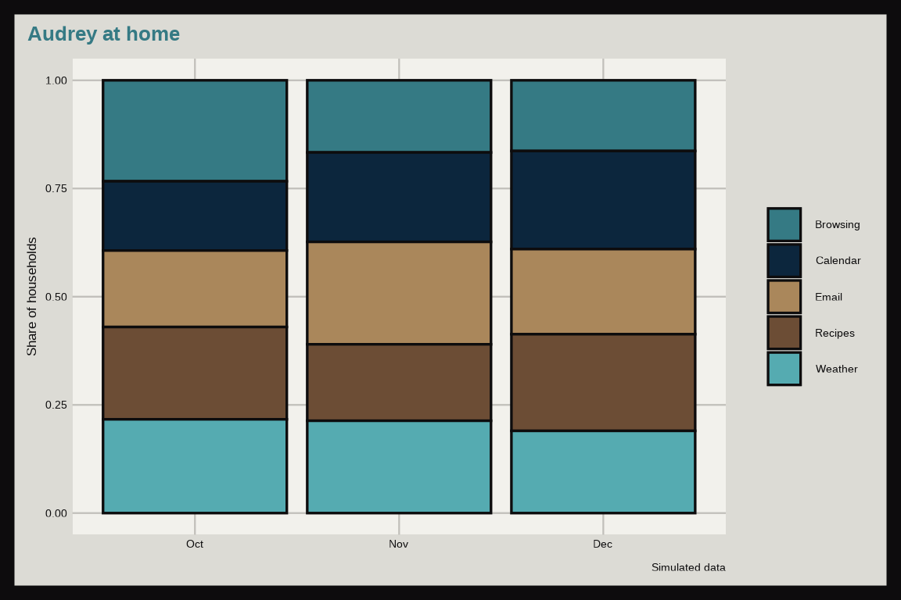

## AIM

[`theme_aim()`](https://mjfrigaard.github.io/fmggp2/reference/theme_aim.md):
the sign on window’s gray, AOL blue, sky blue, and the yellow running
man. Below we simulate buddy list sizes with different shapes.


Image: [Wikimedia
Commons](https://commons.wikimedia.org/wiki/File:AIM_logo.svg), public
domain.

``` r

set.seed(1997)
buddies <- data.frame(school = rep(c("Middle school", "College"), each = 150))
buddies$n <- ifelse(buddies$school == "Middle school", rpois(300, 20), ifelse(runif(300) < 0.7, rnorm(300, 60, 10), rnorm(300, 150, 20)))
ggplot(buddies, aes(x = school, y = n, fill = school)) +
  geom_violin(alpha = 2/3, show.legend = FALSE) +
  labs(title = "AIM buddy lists (simulated)", x = NULL, y = "Buddies") +
  theme_aim(base_size = 13)
```


## Batman

[`theme_batman()`](https://mjfrigaard.github.io/fmggp2/reference/theme_batman.md)
comes in three versions. The default, `version = "movie"`, uses the
Batman (1989) palette: black, gold, orange, and steel. Below we simulate
bat signal sightings over a week.

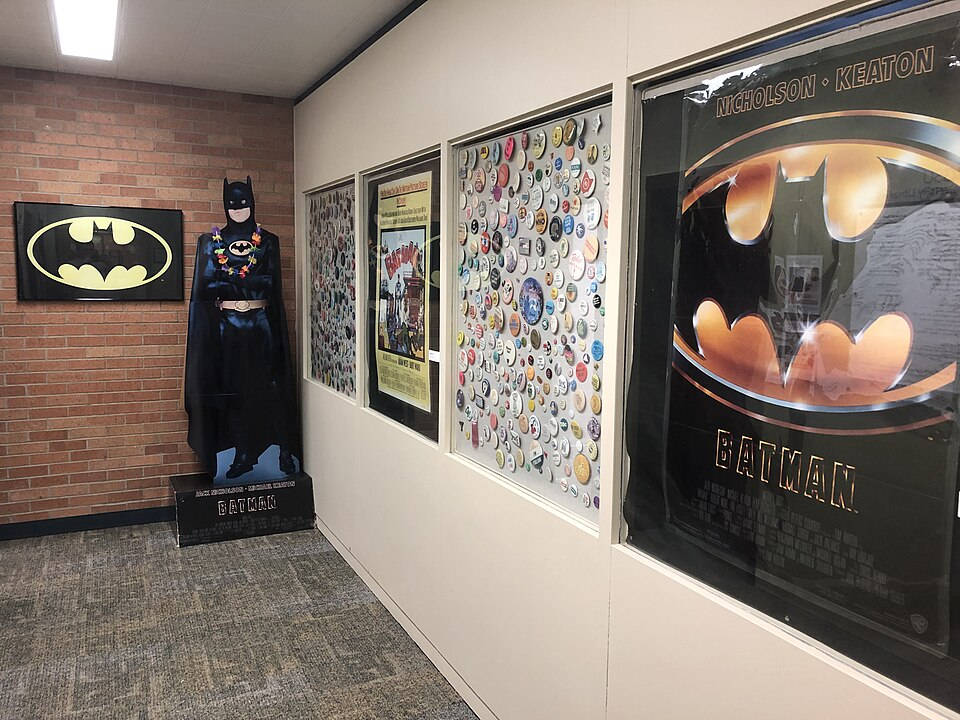

Image: Mbrickn, [Wikimedia
Commons](https://commons.wikimedia.org/wiki/File:Pop_Culture_Library_Batman_Conference.jpg),
CC BY-SA 4.0.

``` r

set.seed(1989)
signals <- data.frame(night = factor(c("Mon", "Tue", "Wed", "Thu", "Fri", "Sat", "Sun"), levels = c("Mon", "Tue", "Wed", "Thu", "Fri", "Sat", "Sun")), sightings = rpois(7, 12))
ggplot(signals, aes(x = night, y = sightings)) +
  geom_col() +
  labs(title = "Bat signal sightings (simulated)", x = NULL, y = "Sightings") +
  theme_batman(base_size = 13)
```


With `mode = "light"`:

``` r

last_plot() + theme_batman(base_size = 13, mode = "light")
```

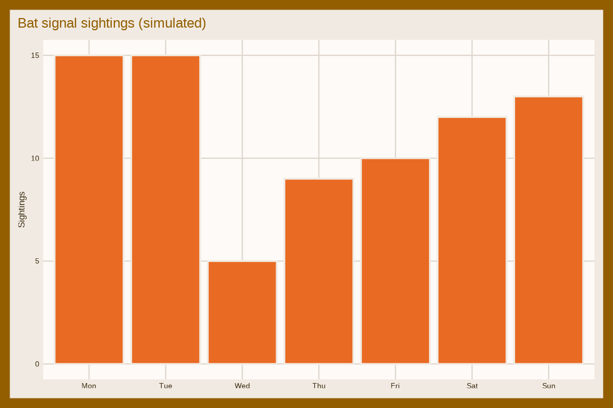

`version = "classic"` uses the 1966 TV series palette: gray, blue,
yellow, black, and cream.


``` r

ggplot(signals, aes(x = night, y = sightings)) +
  geom_col() +
  labs(title = "Bat signal sightings (simulated)", x = NULL, y = "Sightings") +
  theme_batman(base_size = 13, version = "classic")
```

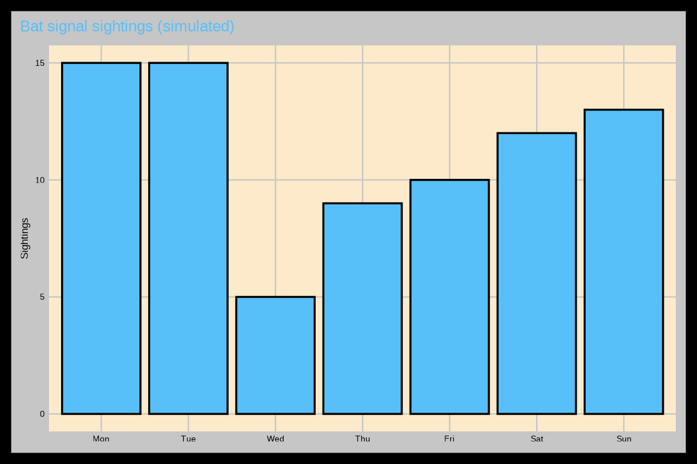

`version = "darknight"` uses The Dark Knight palette: yellow, olive,
charcoal, navy, and slate.

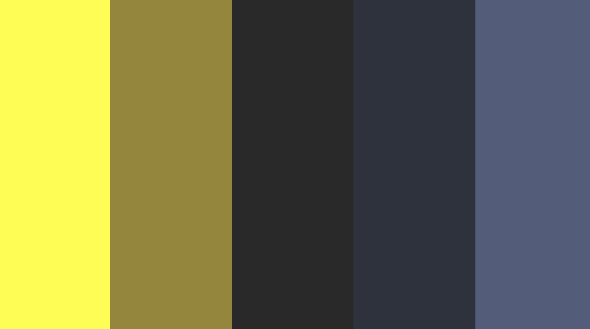

``` r

ggplot(signals, aes(x = night, y = sightings)) +
  geom_col() +
  labs(title = "Bat signal sightings (simulated)", x = NULL, y = "Sightings") +
  theme_batman(base_size = 13, version = "darknight")
```

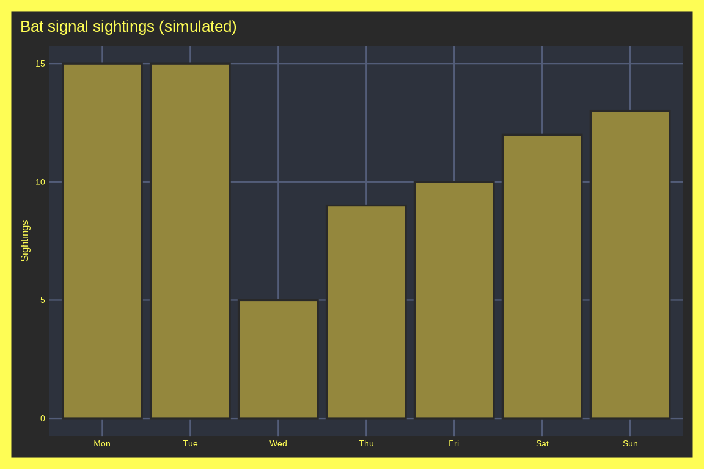

With `mode = "light"`:

``` r

last_plot() + theme_batman(base_size = 13, version = "darknight", mode = "light")
```

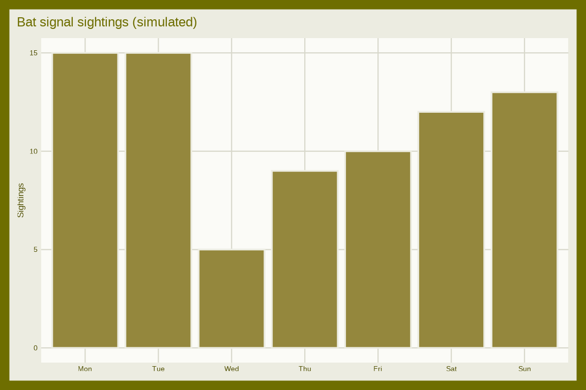

## Blockbuster

[`theme_blockbuster()`](https://mjfrigaard.github.io/fmggp2/reference/theme_blockbuster.md)
uses Blockbuster Video blue and yellow. Below we simulate weekly rentals
for 60 households from a Poisson distribution.

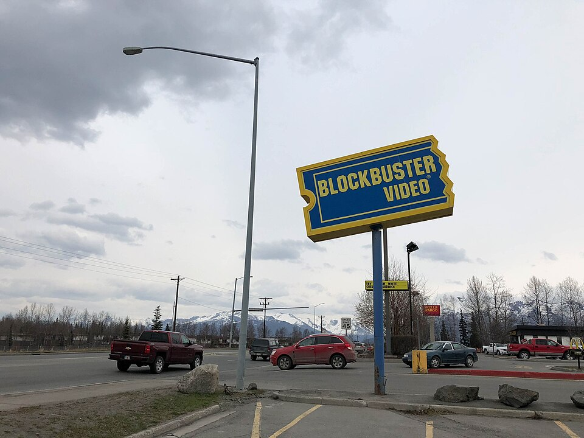

Image: Jon Konrath from Oakland, USA, [Wikimedia
Commons](https://commons.wikimedia.org/wiki/File:Anchorage_Blockbuster_video_store_sign_(41219885734).jpg),
CC BY 2.0.

``` r

set.seed(1993)
blockbuster_rentals <- data.frame(rentals = rpois(n = 60, lambda = 3))
ggplot(blockbuster_rentals, aes(x = rentals)) +
  geom_dotplot(binwidth = 1, dotsize = 0.3) +
  labs(title = "Blockbuster Video (simulated)",
       x = "Number of rentals") +
  theme_blockbuster(base_size = 13)
```


With `mode = "light"`:

``` r

last_plot() + theme_blockbuster(base_size = 13, mode = "light")
```

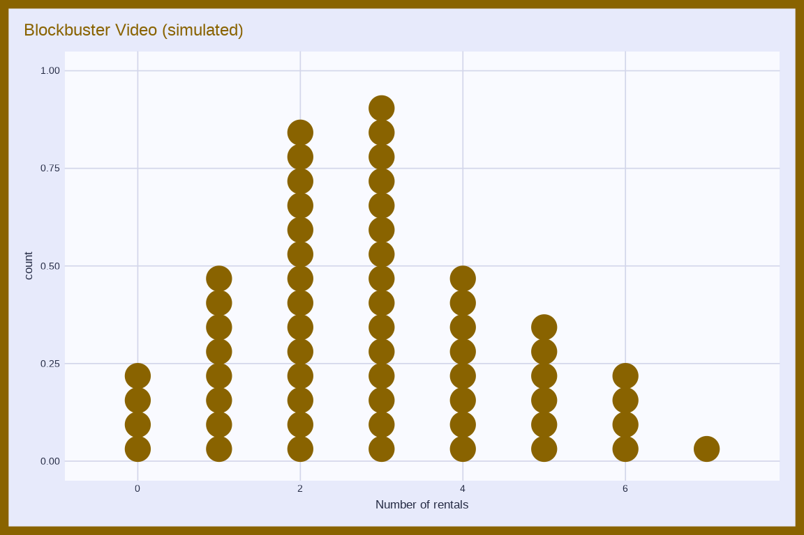

## Bop It

[`theme_bopit()`](https://mjfrigaard.github.io/fmggp2/reference/theme_bopit.md):
Bop It yellow on deep purple, with a purple to yellow continuous scale.
Below we simulate reaction times to two commands.

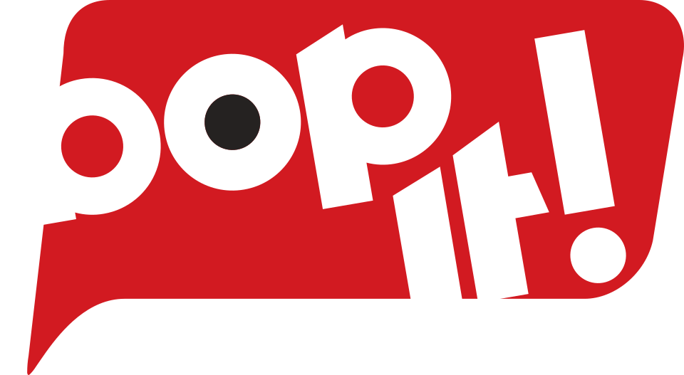

Image: [Wikimedia
Commons](https://commons.wikimedia.org/wiki/File:Bop_It_logo.svg),
public domain.

``` r

set.seed(1996)
players <- data.frame(bop = rnorm(300, 450, 60))
players$twist <- 60 + 0.9 * players$bop + rnorm(300, 0, 40)
ggplot(players, aes(x = bop, y = twist)) +
  geom_point(aes(color = twist), show.legend = FALSE) +
  labs(title = "Bop It reaction times", caption = "Simulated data", x = "Bop it! (ms)", y = "Twist it! (ms)") +
  theme_bopit(base_size = 13)
```


With `mode = "light"`:

``` r

last_plot() + theme_bopit(base_size = 13, mode = "light")
```

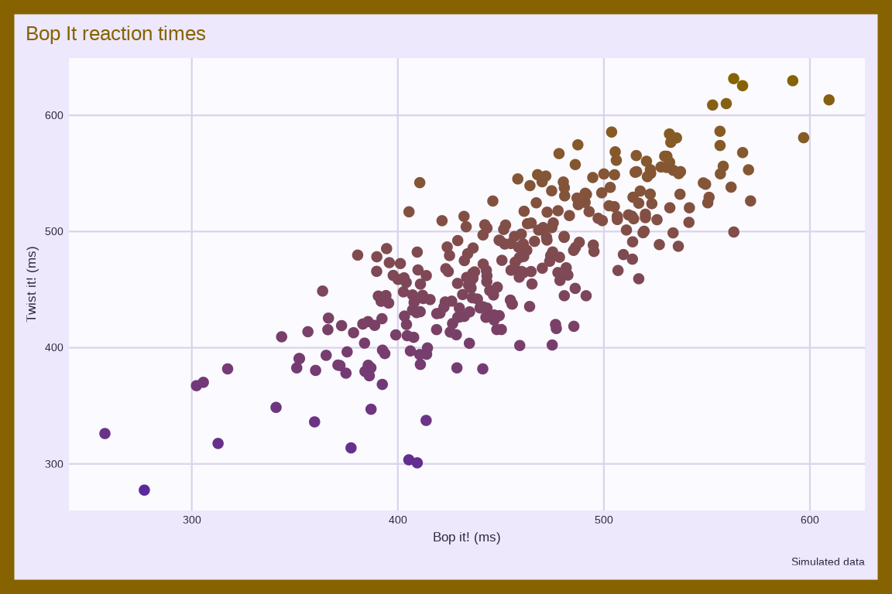

## Console wars

[`theme_consolewars()`](https://mjfrigaard.github.io/fmggp2/reference/theme_consolewars.md):
Sega blue vs. Nintendo red on charcoal. Below we simulate games owned
and hours played for two consoles.

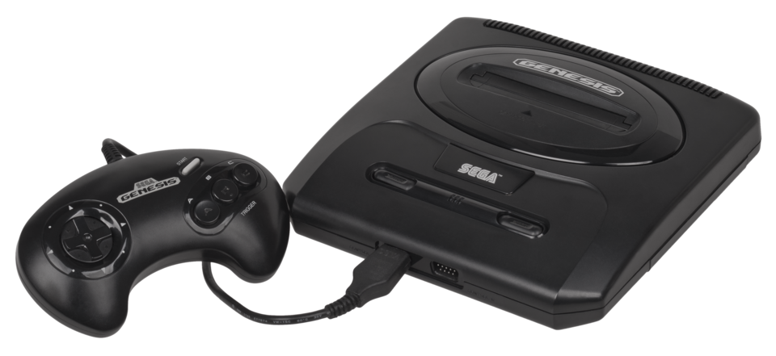

Image: [Wikimedia
Commons](https://commons.wikimedia.org/wiki/File:Sega-Genesis-NA-Mk2-Console-Set.png),
public domain.

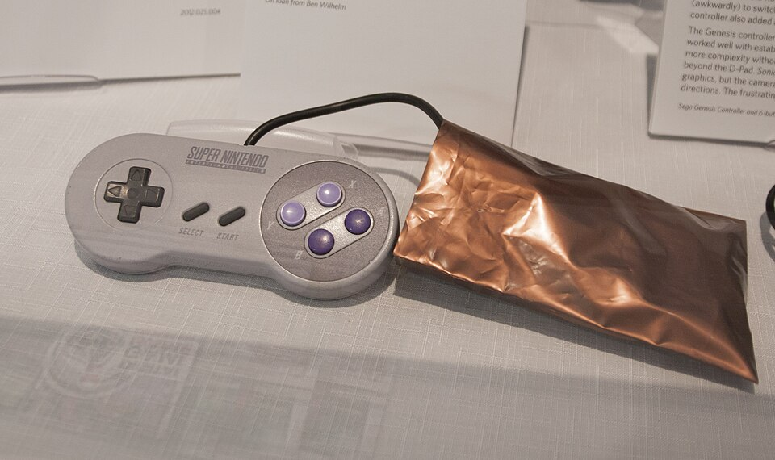

Image: Digital Game Museum, [Wikimedia
Commons](https://commons.wikimedia.org/wiki/File:Super_Nintendo_(7973380020).jpg),
CC BY 2.0.

``` r

set.seed(1991)
kids <- data.frame(console = rep(c("Genesis", "SNES"), each = 60), games = rnorm(120, 11, 3))
kids$hours <- 2 + 0.6 * kids$games + ifelse(kids$console == "SNES", 2, 0) + rnorm(120, 0, 2)
ggplot(kids, aes(x = games, y = hours, color = console)) +
  geom_point() +
  labs(title = "The console wars", caption = "Simulated data", x = "Games owned", y = "Hours per week", color = NULL) +
  theme_consolewars(base_size = 13)
```


With `mode = "light"`:

``` r

last_plot() + theme_consolewars(base_size = 13, mode = "light")
```

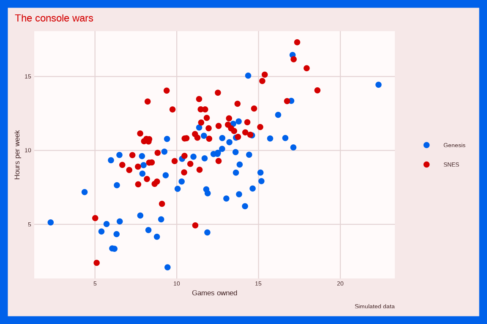

## Crystal Pepsi

[`theme_crystalpepsi()`](https://mjfrigaard.github.io/fmggp2/reference/theme_crystalpepsi.md)
uses the clear bottle and its label: a cream background, a navy frame,
Pepsi red and navy marks, and a Futura title. Below we simulate the ages
of 400 people at a 1992 mall taste test as a mix of kids and parents.

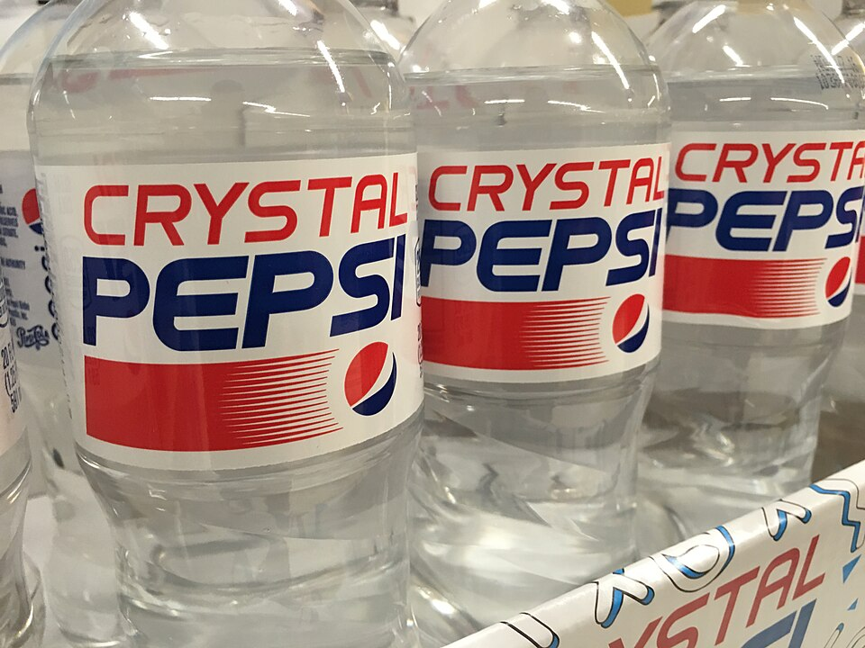

Image: Mike Mozart, [Wikimedia
Commons](https://commons.wikimedia.org/wiki/File:Crystal_Pepsi_(29001084616).jpg),
CC BY 2.0.

``` r

set.seed(1998)
kid <- runif(400) < 0.65
tasters <- data.frame(group = ifelse(kid, "Kid", "Parent"),
  age = round(ifelse(kid, rnorm(400, 11, 2.5), rnorm(400, 37, 6))))
ggplot(tasters, aes(x = age, fill = group)) +
  geom_density(alpha = 2/3) +
  labs(title = "Crystal Pepsi", caption = "Simulated data",
       x = "Age (years)", fill = NULL) +
  theme_crystalpepsi(base_size = 13)
```

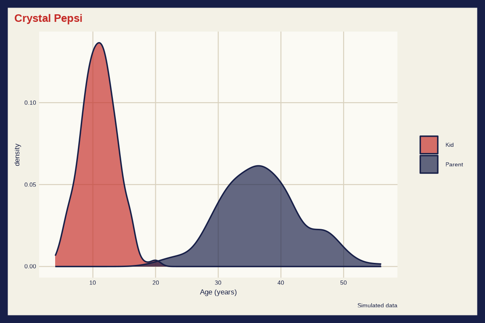

## CU-SeeMe

[`theme_cuseeme()`](https://mjfrigaard.github.io/fmggp2/reference/theme_cuseeme.md)
uses the CU-SeeMe phone book window: a dithered gray background, a black
frame, a white panel, black, magenta, and gray marks, and a magenta
Tahoma title. Below we simulate video call frame rates over three kinds
of connections.

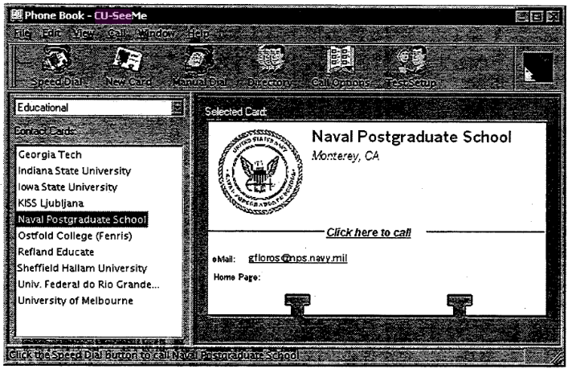

Image: Lt Georgios Floros, HN, [Wikimedia
Commons](https://commons.wikimedia.org/wiki/File:CU-SeeMe_application_screenshot.png),
public domain.

``` r

set.seed(1995)
calls <- data.frame(connection = rep(c("28.8k modem", "ISDN", "T1"), each = 60))
calls$fps <- pmax(0.5, rnorm(180, c("28.8k modem" = 2, "ISDN" = 6, "T1" = 14)[calls$connection], 1.5))
ggplot(calls, aes(x = connection, y = fps, color = connection)) +
  geom_jitter(width = 0.2, show.legend = FALSE) +
  labs(title = "CU-SeeMe frame rates", caption = "Simulated data", x = NULL, y = "Frames per second") +
  theme_cuseeme(base_size = 13)
```

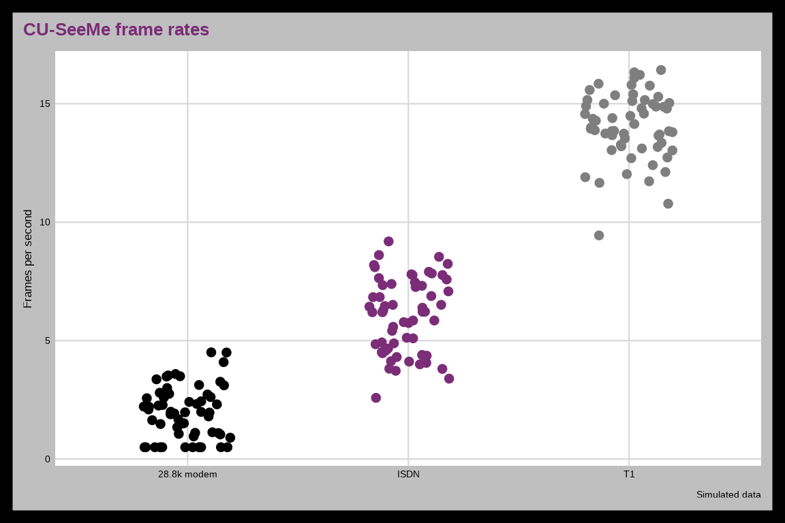

## CueCat

[`theme_cuecat()`](https://mjfrigaard.github.io/fmggp2/reference/theme_cuecat.md)
uses the :CueCat barcode scanner: a pale paper background, a putty
frame, a red title, red, ink, LED orange, and putty marks, and a Marker
Felt title. Below we simulate weekly barcode scans after the free
scanners shipped in 2000.

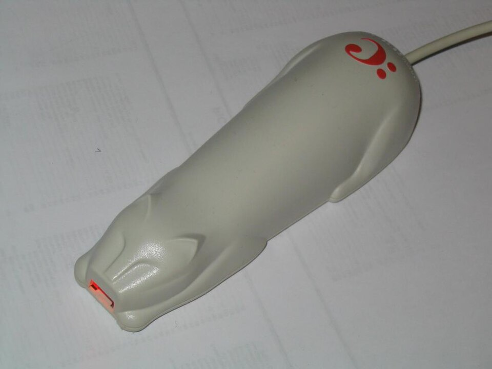

Image: Shaddack, [Wikimedia
Commons](https://commons.wikimedia.org/wiki/File:CueCat-upside.jpg),
public domain.

``` r

set.seed(2000)
scans <- data.frame(week = 1:52)
scans$scans <- rpois(52, 5000 * exp(-scans$week / 10))
ggplot(scans, aes(x = week, y = scans)) +
  geom_area(alpha = 0.8) +
  labs(title = "CueCat scans", caption = "Simulated data", x = "Week", y = "Barcodes scanned") +
  theme_cuecat(base_size = 13)
```

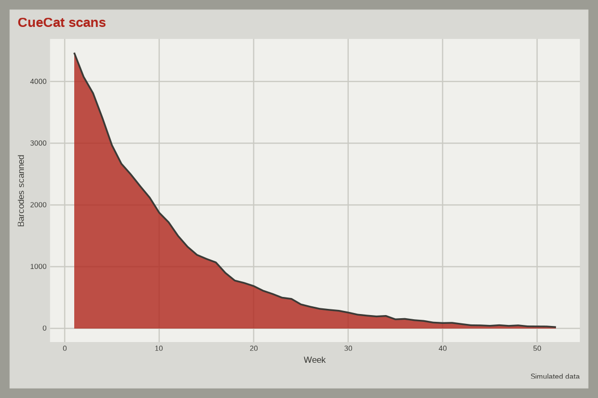

## Doom

[`theme_doom()`](https://mjfrigaard.github.io/fmggp2/reference/theme_doom.md):
hellfire red and orange on scorched brown. Below we simulate Doom frame
rates by processor speed.

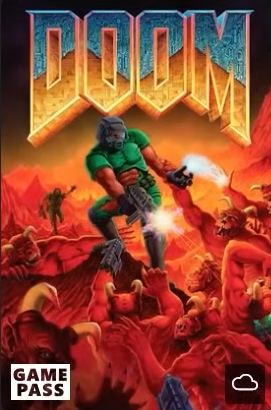

Image: Bethesda, Copyright Microsoft, [Wikimedia
Commons](https://commons.wikimedia.org/wiki/File:Doom_classic_box_art.png),
CC BY 3.0.

``` r

set.seed(1993)
pcs <- data.frame(mhz = runif(100, 25, 100))
pcs$fps <- pmin(35, 0.45 * pcs$mhz + rnorm(100, 0, 3))
ggplot(pcs, aes(x = mhz, y = fps)) +
  geom_point() +
  labs(title = "Doom frame rates", caption = "Simulated data", x = "CPU (MHz)", y = "Frames per second") +
  theme_doom(base_size = 13)
```


With `mode = "light"`:

``` r

last_plot() + theme_doom(base_size = 13, mode = "light")
```

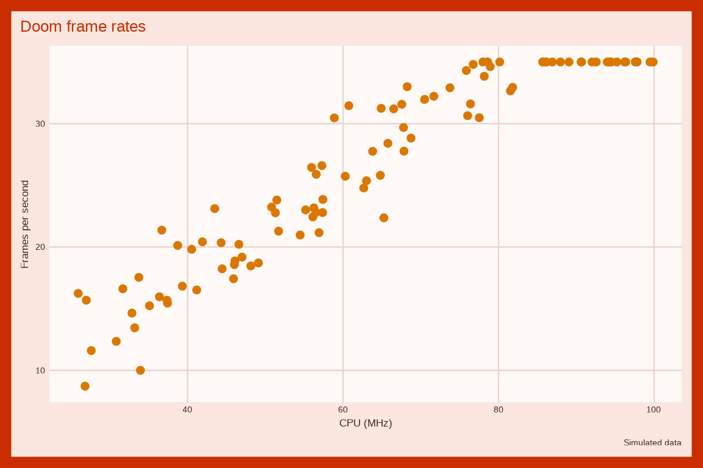

## Fresh Prince

[`theme_freshprince()`](https://mjfrigaard.github.io/fmggp2/reference/theme_freshprince.md)
uses the logo: graffiti greens on a pink glow, and its continuous fill
runs from teal to lime. Below we simulate how often the Carlton dance
shows up each season.

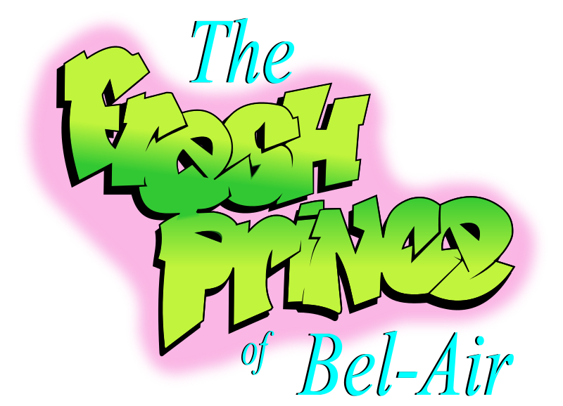

Image: [Wikimedia
Commons](https://commons.wikimedia.org/wiki/File:Fresh_Prince_Bel_Aire_logo.png),
public domain.

``` r

set.seed(1990)
fp <- expand.grid(season = 1:6, gag = c("Will flirts", "Carlton dance"))
fp$occurrences <- rbinom(12, 24, ifelse(fp$gag == "Will flirts", 0.9, plogis(-2.2 + 0.5 * (fp$season - 3.5))))
ggplot(fp, aes(x = season, y = gag, fill = occurrences)) +
  geom_tile() +
  labs(title = "Fresh Prince (simulated)", x = "Season", y = NULL, fill = "Episodes") +
  theme_freshprince(base_size = 13)
```


## Fruit Gushers

[`theme_gushers()`](https://mjfrigaard.github.io/fmggp2/reference/theme_gushers.md)
uses a pile of Fruit Gushers on a white plate: a red frame and title,
red, green, teal, orange, and pink marks, and a Chalkboard title. Below
we simulate fruit snack trades at one lunch table before and after
Gushers arrived in 1991.

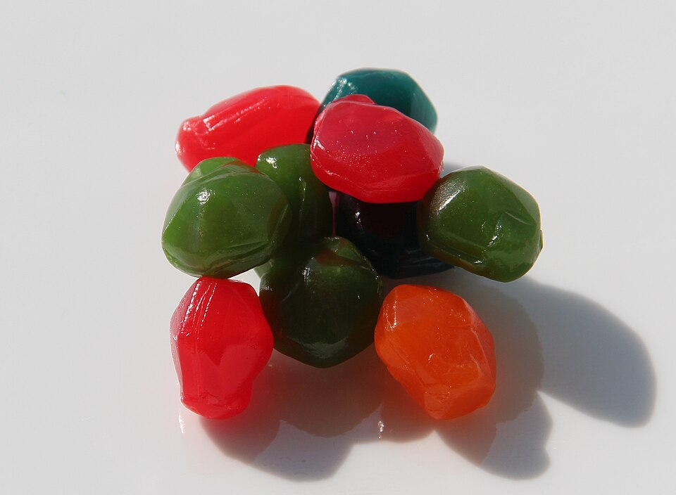

Image: Thomson200, [Wikimedia
Commons](https://commons.wikimedia.org/wiki/File:Betty_Crocker_Fruit_Gushers_pieces.jpg),
CC0.

``` r

set.seed(1993)
trades <- expand.grid(year = 1985:2000, flavor = c("Strawberry", "Lime", "Blue raspberry"))
trades$n <- rpois(nrow(trades), ifelse(trades$year < 1991, 0.5, 3))
ggplot(subset(trades, n > 0), aes(x = year, y = flavor, color = flavor, alpha = n)) +
  geom_point(shape = 124, size = 6, show.legend = FALSE) +
  labs(title = "Fruit Gushers", caption = "Simulated data", x = NULL, y = NULL) +
  theme_gushers(base_size = 13)
```

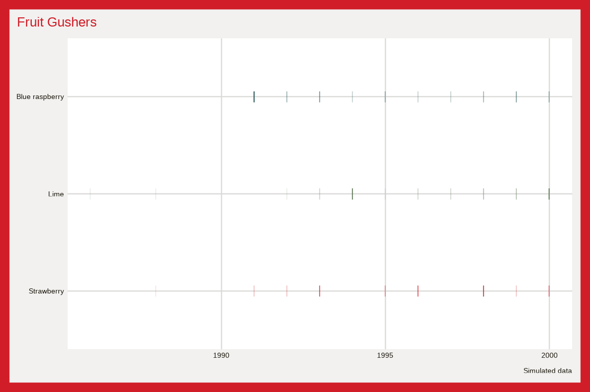

## Game Boy

[`theme_gameboy()`](https://mjfrigaard.github.io/fmggp2/reference/theme_gameboy.md)
uses the four shades of green from the original Game Boy screen and the
pixel font Press Start 2P, which ships with `fmggp2`. Below we simulate
the starter chosen by 300 *Pokémon Red and Blue* players.

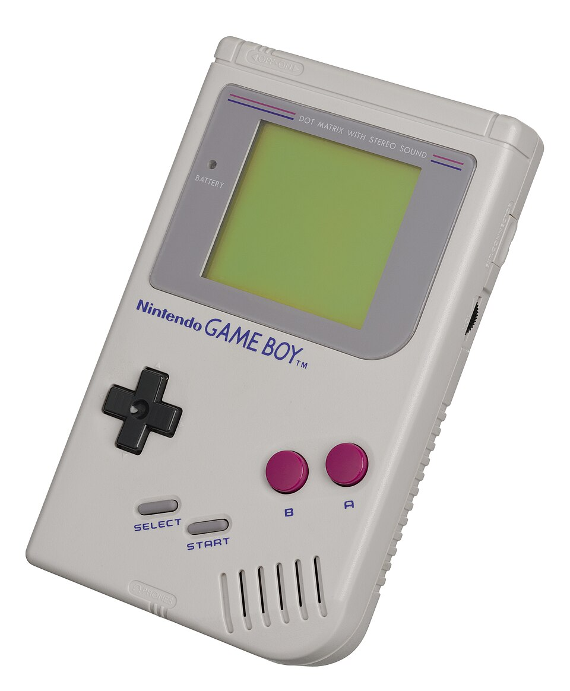

Image: [Wikimedia
Commons](https://commons.wikimedia.org/wiki/File:Game-Boy-FL.jpg),
public domain.

``` r

set.seed(1998)
pokemon_starters <- data.frame(
  starter = sample(c("Bulbasaur", "Charmander", "Squirtle"),
    size = 300, replace = TRUE, prob = c(0.30, 0.42, 0.28))
)
ggplot(pokemon_starters, aes(x = starter, fill = starter)) +
  geom_bar(show.legend = FALSE) +
  labs(title = "Pokemon Red and Blue (simulated)",
       subtitle = "Starter chosen by 300 players",
       x = "Starter", y = "Count") +
  theme_gameboy(base_size = 13)
```


## GeoCities

[`theme_geocities()`](https://mjfrigaard.github.io/fmggp2/reference/theme_geocities.md):
lime text and a yellow Comic Sans title on a dark navy panel. Below we
simulate GeoCities page loads.

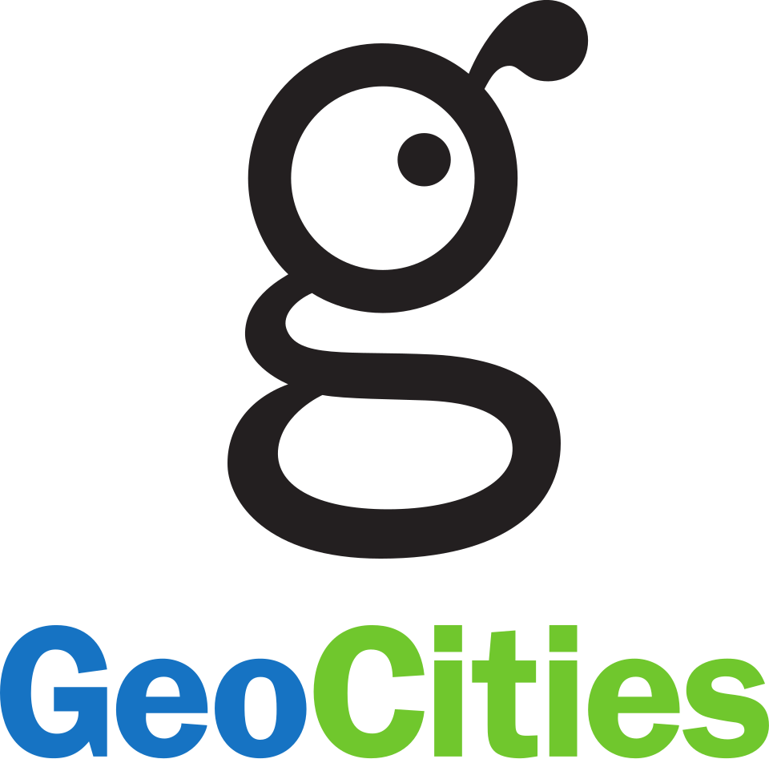

Image: [Wikimedia
Commons](https://commons.wikimedia.org/wiki/File:GeoCities_logo.svg),
public domain.

``` r

set.seed(1997)
pages <- data.frame(kb = rlnorm(2000, log(60), 0.45))
pages$seconds <- 2 + pages$kb * 8 / 44 + rnorm(2000, 0, 1.5)
ggplot(pages, aes(x = kb, y = seconds)) +
  geom_bin2d(bins = 25) +
  labs(title = "GeoCities page loads", caption = "Simulated data", x = "Page size (KB)", y = "Seconds to load") +
  theme_geocities(base_size = 13)
```


With `mode = "light"`:

``` r

last_plot() + theme_geocities(base_size = 13, mode = "light")
```

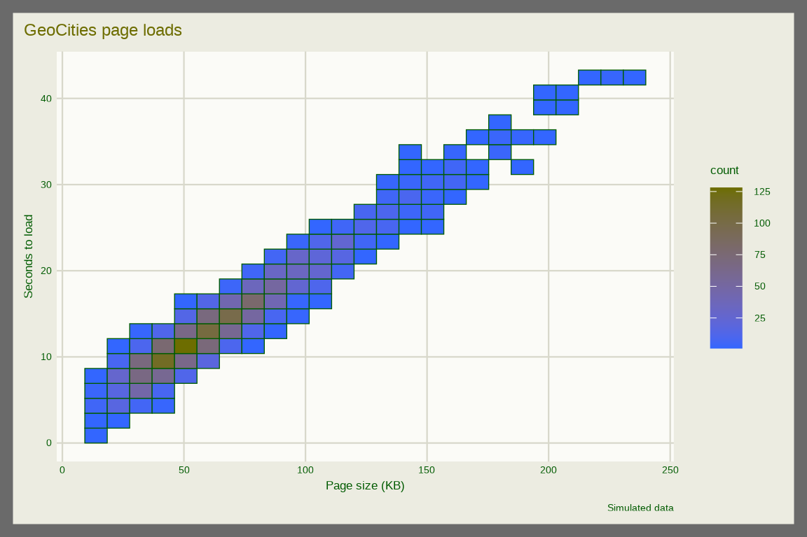

## Goosebumps

[`theme_goosebumps()`](https://mjfrigaard.github.io/fmggp2/reference/theme_goosebumps.md):
the slime green logo and purple covers of the Goosebumps books on black,
with a Trattatello title. Below we simulate Goosebumps books read by two
grades.

``` r

set.seed(1992)
readers <- data.frame(grade = rep(c("3rd grade", "5th grade"), each = 40))
readers$books <- rpois(80, ifelse(readers$grade == "3rd grade", 3, 9))
ggplot(readers, aes(x = books, fill = grade)) +
  geom_dotplot(method = "histodot", binwidth = 1, stackgroups = TRUE, binpositions = "all") +
  labs(title = "Goosebumps (simulated)", x = "Books read", fill = "Grade") +
  theme_goosebumps(base_size = 13)
```


With `mode = "light"`:

``` r

last_plot() + theme_goosebumps(base_size = 13, mode = "light")
```

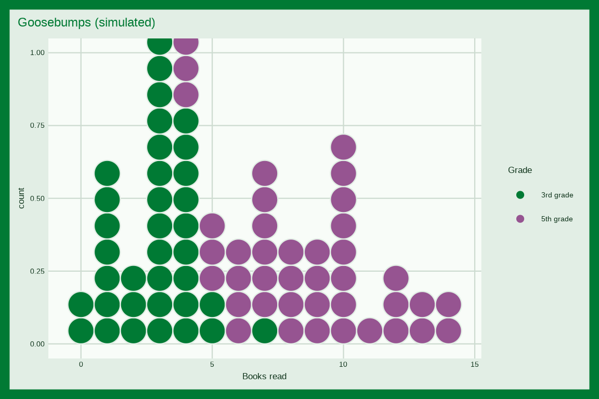

## Handspring Visor

[`theme_visor()`](https://mjfrigaard.github.io/fmggp2/reference/theme_visor.md)
uses a green Handspring Visor Deluxe: a pale lavender background, a
translucent green frame, a gray LCD panel, green, gray, mint, and silver
marks, and a Trebuchet MS title. Below we simulate sales of four
Springboard modules.

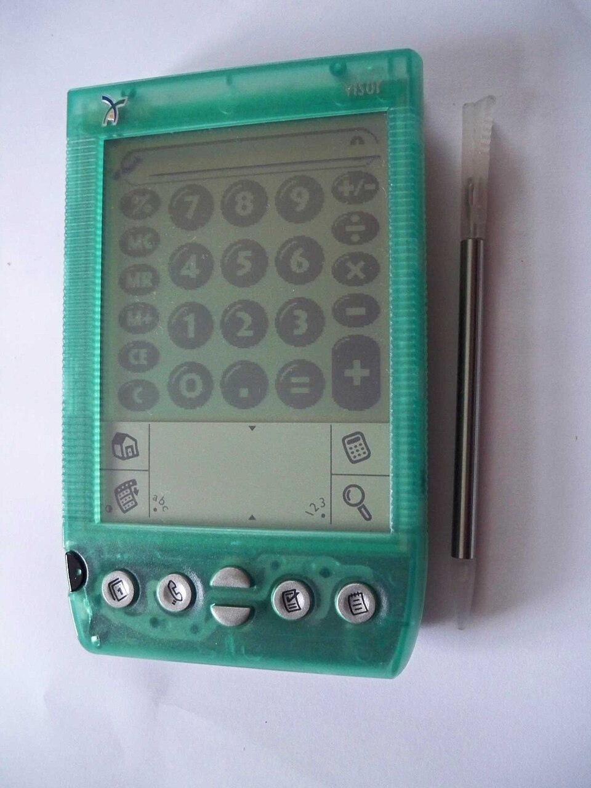

Image: Waldohreule, [Wikimedia
Commons](https://commons.wikimedia.org/wiki/File:Handspring_Visor_DeLuxe_Green.jpg),
CC BY-SA 3.0.

``` r

set.seed(2000)
modules <- data.frame(module = sample(c("Games", "MP3 player", "Modem", "Phone"),
  size = 500, replace = TRUE, prob = c(0.35, 0.25, 0.25, 0.15)))
ggplot(modules, aes(y = module, fill = module)) +
  geom_bar(show.legend = FALSE) +
  labs(title = "Springboard modules", caption = "Simulated data", x = "Modules sold", y = NULL) +
  theme_visor(base_size = 13)
```

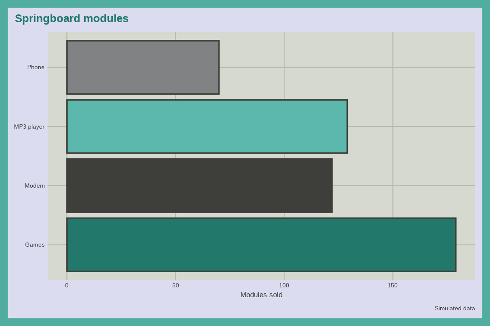

## Happy Meals

[`theme_happymeal()`](https://mjfrigaard.github.io/fmggp2/reference/theme_happymeal.md)
uses the red and yellow of a Happy Meal box. Below we simulate average
daily Happy Meal sales for four toy promotions.

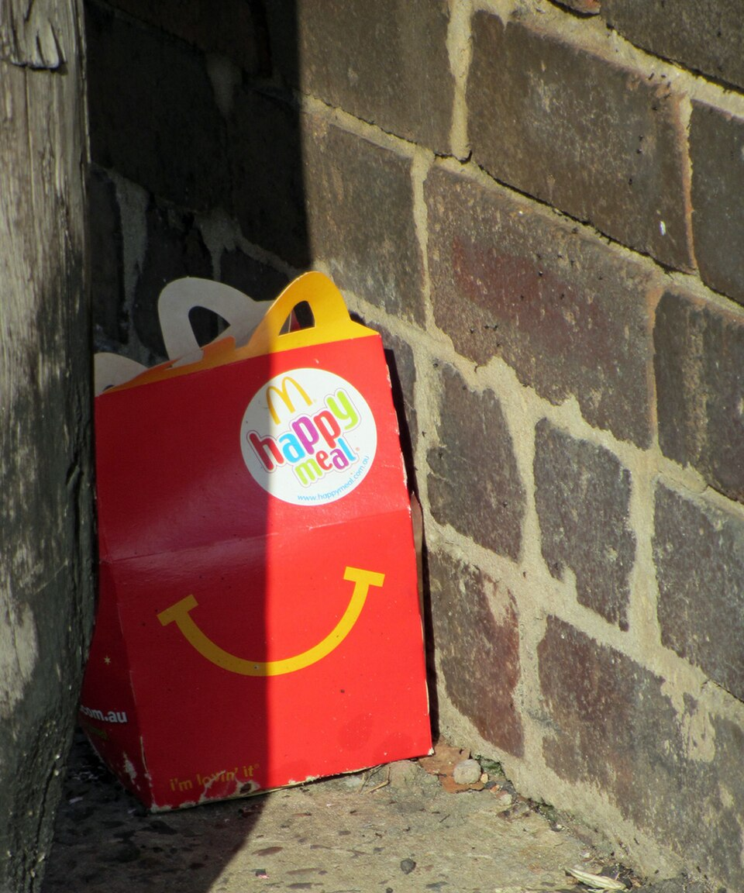

Image: Newtown grafitti from Sydney, Australia, [Wikimedia
Commons](https://commons.wikimedia.org/wiki/File:Happy_meal_(6955434713).jpg),
CC BY 2.0.

``` r

set.seed(1997)
happy_meals <- data.frame(promotion = c("Teenie Beanie Babies", "Furby", "Hot Wheels", "Inspector Gadget"),
  avg_sold = sapply(c(420, 310, 220, 180), function(l) mean(rpois(28, l))))
ggplot(happy_meals, aes(x = promotion, y = avg_sold, fill = promotion)) +
  geom_col(show.legend = FALSE) +
  labs(title = "Happy Meals (simulated)", x = "Toy promotion", y = "Average sold per day") +
  theme_happymeal(base_size = 13)
```


## Hypercolor

[`theme_hypercolor()`](https://mjfrigaard.github.io/fmggp2/reference/theme_hypercolor.md):
heat changing magenta, orange, purple, and blue. Below we simulate
monthly sales for two fads.

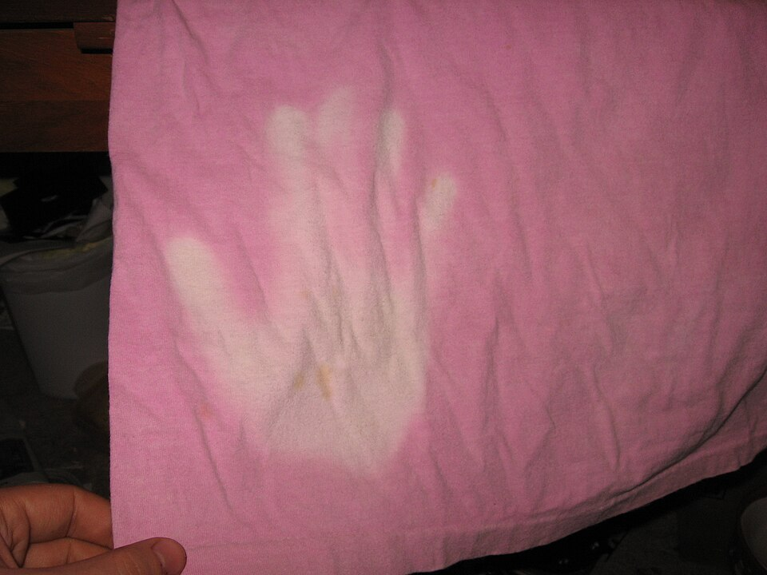

Image: [Wikimedia
Commons](https://commons.wikimedia.org/wiki/File:Generra_Hypercolor_2.jpg),
public domain.

``` r

months <- seq(1990, 1995, by = 1 / 12)
fads <- data.frame(month = rep(months, 2),
                   fad = rep(c("Hypercolor", "Slap bracelets"), each = length(months)))
fads$sales <- ifelse(fads$fad == "Hypercolor",
                     4000 * dnorm(fads$month, 1991.5, 0.6),
                     3000 * dnorm(fads$month, 1990.8, 0.4)) / 12
ggplot(fads, aes(x = month, y = sales, fill = fad)) +
  geom_area(alpha = 0.8) +
  labs(title = "90s fads (simulated)", x = NULL, y = "Sales (thousands)", fill = NULL) +
  theme_hypercolor(base_size = 13)
```


With `mode = "light"`:

``` r

last_plot() + theme_hypercolor(base_size = 13, mode = "light")
```

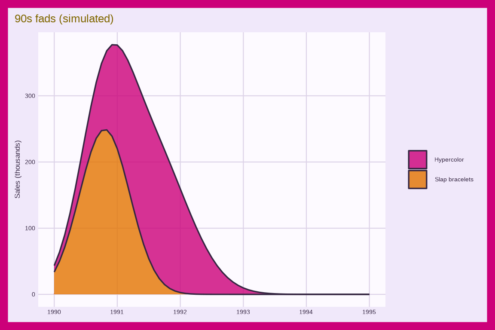

## IBM Microdrive

[`theme_microdrive()`](https://mjfrigaard.github.io/fmggp2/reference/theme_microdrive.md)
uses an IBM and a Hitachi Microdrive on a tan desk: a black frame, a red
title, IBM blue, red, navy, and Hitachi sky blue marks, and a Times New
Roman title. Below we simulate photo file sizes from three digital
cameras that wrote to a Microdrive.

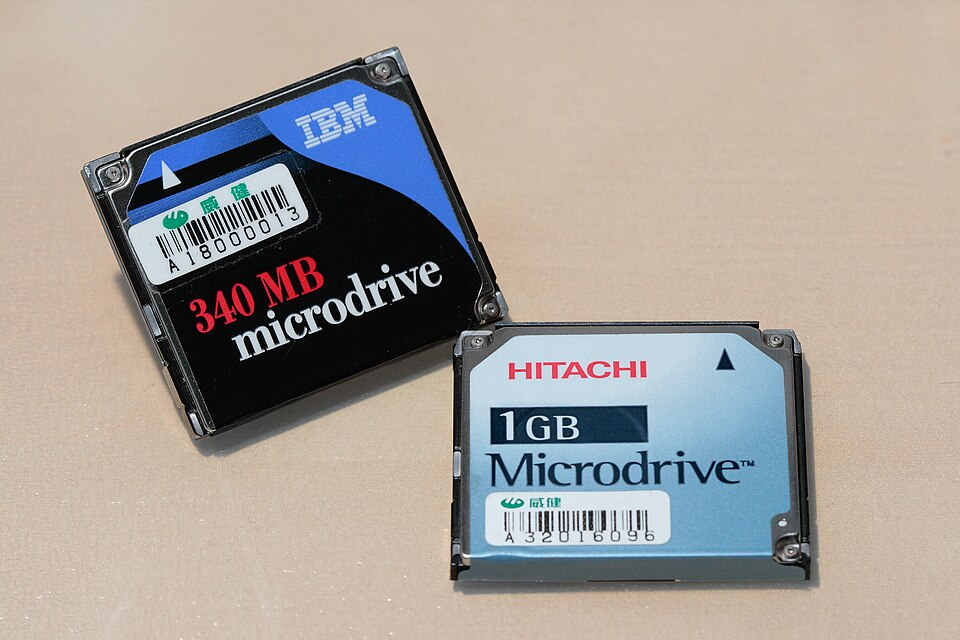

Image: MiNe, [Wikimedia
Commons](https://commons.wikimedia.org/wiki/File:IBM_340MB_Microdrive_and_Hitachi_1GB_Microdrive_sold_from_Weikeng_Industrial_20080327.jpg),
CC BY 2.0.

``` r

set.seed(1999)
photos <- data.frame(camera = rep(c("2 MP", "3 MP", "4 MP"), each = 100))
photos$mb <- rlnorm(300, log(c("2 MP" = 0.9, "3 MP" = 1.4, "4 MP" = 2)[photos$camera]), 0.25)
ggplot(photos, aes(x = camera, y = mb, fill = camera)) +
  geom_boxplot(show.legend = FALSE) +
  labs(title = "Microdrive photos", caption = "Simulated data", x = NULL, y = "Photo size (MB)") +
  theme_microdrive(base_size = 13)
```

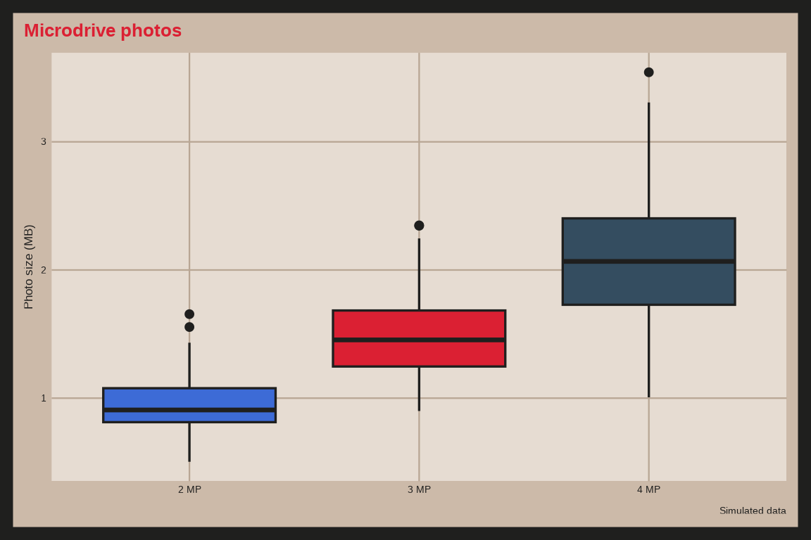

## J2ME

[`theme_j2me()`](https://mjfrigaard.github.io/fmggp2/reference/theme_j2me.md)
uses a Nokia N73 running a J2ME app: a black phone background, a silver
frame, a pale screen panel, Ushahidi red, tan, brown, and black marks,
and an Arial Narrow title. Below we simulate monthly downloads of four
kinds of phone games.

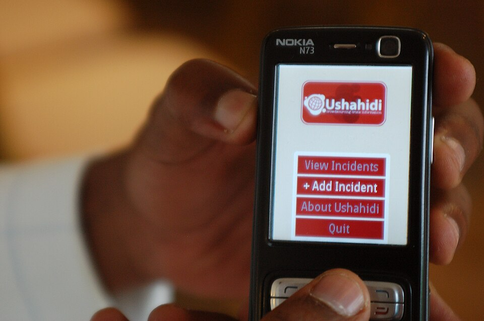

Image: Erik (HASH) Hersman, [Wikimedia
Commons](https://commons.wikimedia.org/wiki/File:Ushahidi_J2ME_App.jpg),
CC BY 2.0.

``` r

set.seed(2003)
games <- expand.grid(month = 1:24, genre = c("Puzzle", "Racing", "Sports", "Arcade"))
games$downloads <- rpois(nrow(games), c(Puzzle = 60, Racing = 40, Sports = 30, Arcade = 20)[games$genre] * (1 + games$month / 12))
ggplot(games, aes(x = month, y = downloads, color = genre)) +
  geom_line(linewidth = 1) +
  labs(title = "J2ME game downloads", caption = "Simulated data", x = "Month", y = "Downloads (thousands)", color = NULL) +
  theme_j2me(base_size = 13)
```

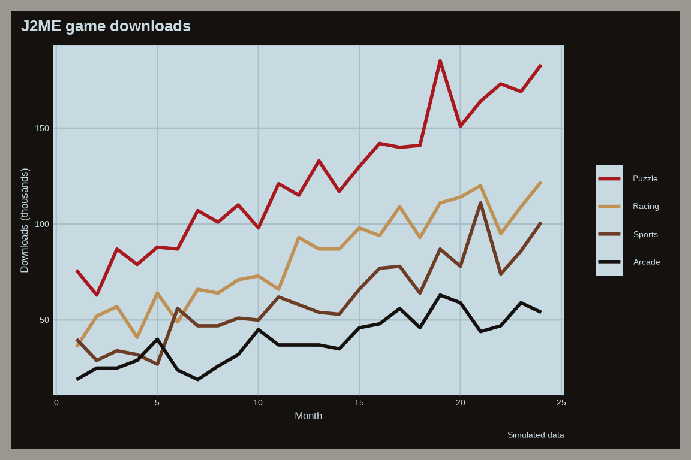

## Java applets

[`theme_javaapplet()`](https://mjfrigaard.github.io/fmggp2/reference/theme_javaapplet.md)
uses a Java AWT applet window: a gray window background, a gray frame, a
white panel, red, blue, purple, and gray marks, and a blue Verdana
title. Like the applet in the screenshot, below we simulate measurements
with error bars and a fitted curve.

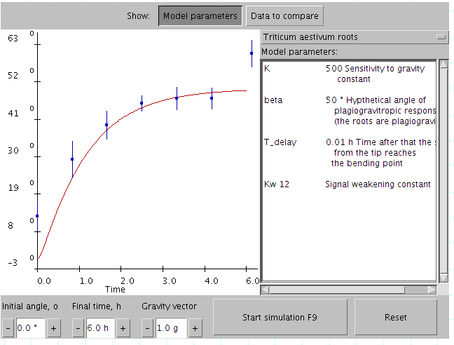

Image: Audrius Meskauskas, [Wikimedia
Commons](https://commons.wikimedia.org/wiki/File:Java_applet.png),
public domain.

``` r

set.seed(1995)
model <- data.frame(time = seq(0, 6, by = 0.1))
model$angle <- 48 * (1 - exp(-model$time / 1.2))
obs <- data.frame(time = seq(0, 6, by = 0.8))
obs$angle <- 48 * (1 - exp(-obs$time / 1.2)) + rnorm(nrow(obs), 0, 4)
ggplot(obs, aes(x = time, y = angle)) +
  geom_line(data = model, aes(color = "Model")) +
  geom_pointrange(aes(ymin = angle - 6, ymax = angle + 6, color = "Observed")) +
  labs(title = "Root bending angle", caption = "Simulated data", x = "Time (h)", y = "Angle (degrees)", color = NULL) +
  theme_javaapplet(base_size = 13)
```

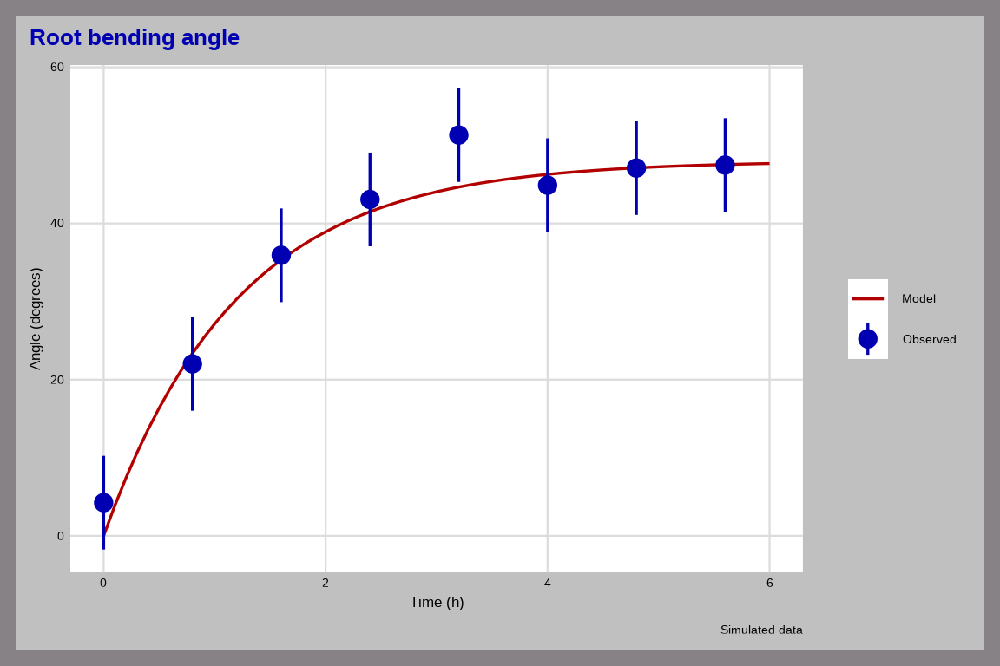

## Jurassic Park

[`theme_jurassic()`](https://mjfrigaard.github.io/fmggp2/reference/theme_jurassic.md)
uses the Jurassic Park Post Office souvenir sheet: black, logo red,
stamp yellow, and sunset orange. Below we simulate the total weight of
the dinosaurs in each paddock.


Image: [Wikimedia
Commons](https://commons.wikimedia.org/wiki/File:Jurassic_Park_icon.svg),
CC0.

``` r

set.seed(1993)
jp_paddocks <- data.frame(species = c("Brachiosaurus", "Triceratops", "Tyrannosaurus"),
  total_tons = c(sum(rnorm(3, 40, 5)), sum(rnorm(5, 9, 1.2)), sum(rnorm(2, 8, 1))))
ggplot(jp_paddocks, aes(x = species, y = total_tons, fill = species)) +
  geom_col(show.legend = FALSE) +
  labs(title = "Jurassic Park (simulated)", x = "Paddock", y = "Total weight (tons)") +
  theme_jurassic(base_size = 13)
```


With `mode = "light"`:

``` r

last_plot() + theme_jurassic(base_size = 13, mode = "light")
```

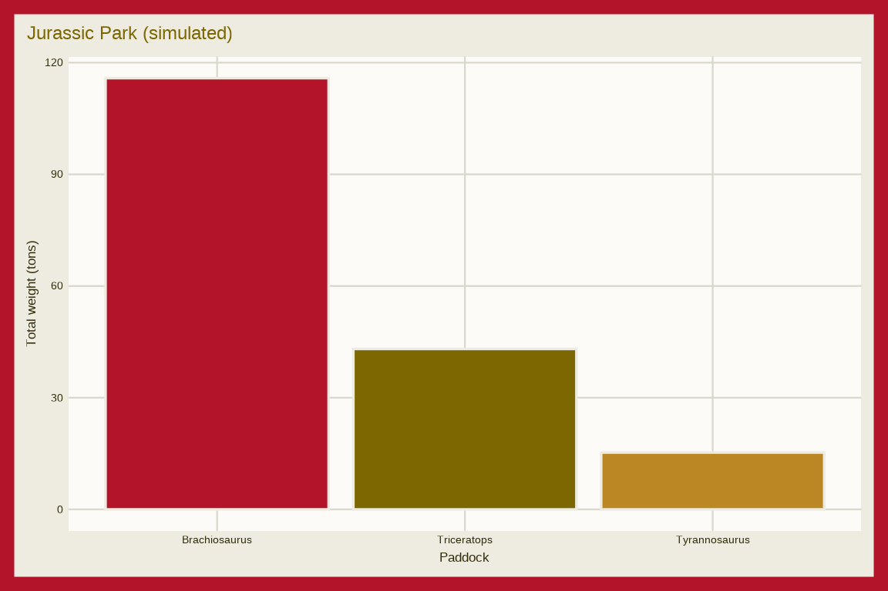

## Koosh ball

[`theme_koosh()`](https://mjfrigaard.github.io/fmggp2/reference/theme_koosh.md)
uses a tri color Koosh ball: a white background, an orange frame,
orange, purple, and black marks, and an Arial Rounded title. Below we
simulate the styles of 200 Koosh balls sold at a toy store.

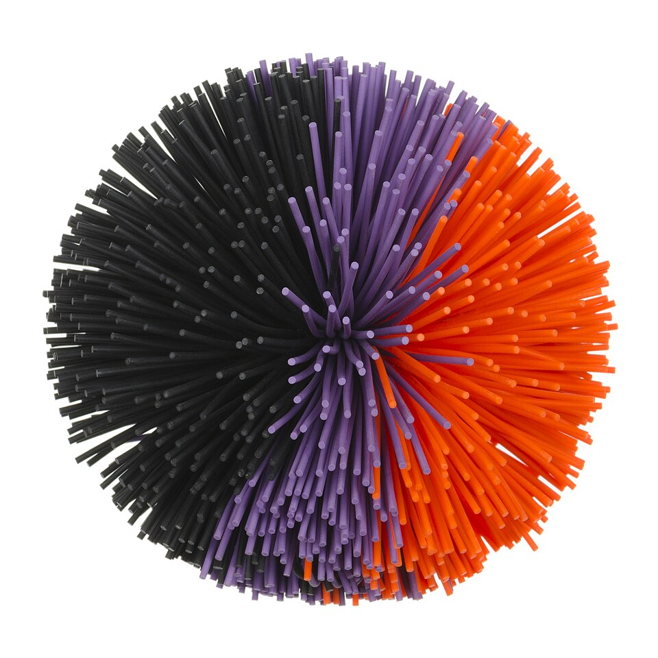

Image: Evan-Amos, [Wikimedia
Commons](https://commons.wikimedia.org/wiki/File:Koosh-Ball-TriColor.jpg),
public domain.

``` r

set.seed(1993)
koosh_balls <- data.frame(style = factor(sample(c("Tri color", "Rainbow", "Neon", "Glow"),
  200, replace = TRUE, prob = c(1/2, 1/4, 1/8, 1/8)),
  levels = c("Tri color", "Rainbow", "Neon", "Glow")))
ggplot(koosh_balls, aes(x = style, fill = style)) +
  geom_bar(show.legend = FALSE) +
  labs(title = "Koosh balls", caption = "Simulated data", x = NULL, y = "Sold") +
  theme_koosh(base_size = 13)
```

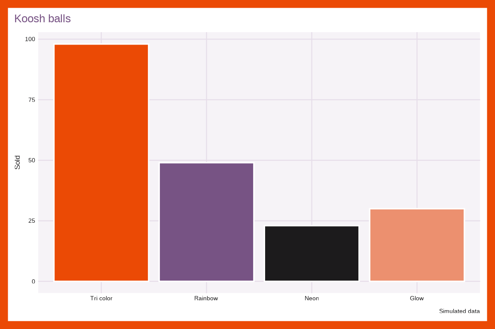

## Netscape

[`theme_netscape()`](https://mjfrigaard.github.io/fmggp2/reference/theme_netscape.md):
the Netscape Navigator logo, with a night sky and teal, aurora green,
sea glass, and deep teal marks, and a Times New Roman title.


Image: [Wikimedia
Commons](https://commons.wikimedia.org/wiki/File:Netscape_Navigator_Icon.svg),
CC0.

``` r

set.seed(1996)
modem <- sample(c("14.4k", "28.8k", "56k"), 600, replace = TRUE, prob = c(0.25, 0.45, 0.30))
speeds <- data.frame(modem = modem,
  kbps = rnorm(600, c(`14.4k` = 13, `28.8k` = 26, `56k` = 44)[modem], c(`14.4k` = 1.2, `28.8k` = 2.5, `56k` = 5)[modem]))
ggplot(speeds, aes(x = kbps, after_stat(count), fill = modem)) +
  geom_density(position = "fill") +
  labs(title = "Dial up speeds (simulated)", x = "Speed (kbps)", fill = "Modem") +
  theme_netscape(base_size = 13)
```


With `mode = "light"`:

``` r

last_plot() + theme_netscape(base_size = 13, mode = "light")
```

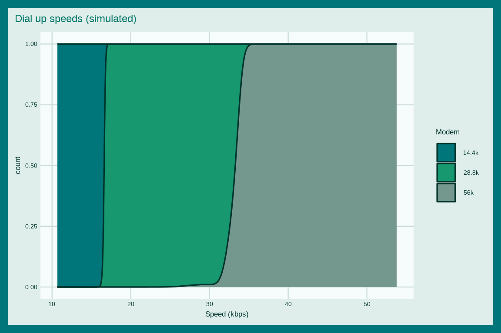

## Nintendo 64

[`theme_n64()`](https://mjfrigaard.github.io/fmggp2/reference/theme_n64.md)
uses controller gray and the four logo colors. Below we simulate 200
Mario Kart 64 lap times from a heavy tailed t distribution.

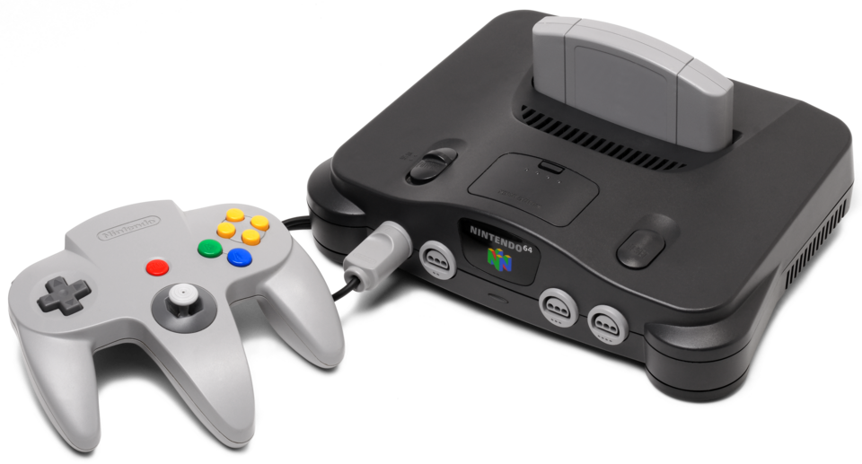

Image: [Wikimedia
Commons](https://commons.wikimedia.org/wiki/File:N64-Console-Set.png),
public domain.

``` r

set.seed(64)
mario_kart_laps <- data.frame(seconds = 45 + 2 * rt(n = 200, df = 3))
ggplot(mario_kart_laps, aes(x = "", y = seconds)) +
  geom_boxplot() +
  labs(title = "Mario Kart 64 (simulated)",
       x = NULL, y = "Lap time (seconds)") +
  theme_n64(base_size = 13)
```


## Novell NetWare

[`theme_netware()`](https://mjfrigaard.github.io/fmggp2/reference/theme_netware.md)
uses three NetWare 2.0 boxes: a pale blush background with dark ink
text, a NetWare red frame and title, maroon, red, rose, and blush marks,
and a Gill Sans title. Below we simulate the file servers running each
NetWare version from 1990 to 1998.

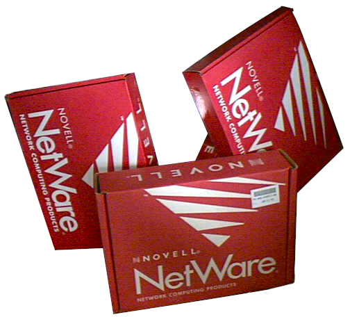

Image: diaper on Flickr, [Wikimedia
Commons](https://commons.wikimedia.org/wiki/File:Novell_NetWare_2.0_packages.jpg),
CC BY 2.0.

``` r

set.seed(1990)
servers <- expand.grid(year = 1990:1998, version = c("2.x", "3.x", "4.x"))
servers$peak <- c("2.x" = 1990, "3.x" = 1994, "4.x" = 1998)[servers$version]
servers$n <- rpois(nrow(servers), 400 * exp(-((servers$year - servers$peak) / 2.5)^2))
ggplot(servers, aes(x = year, y = n, fill = version)) +
  geom_col() +
  labs(title = "NetWare servers", caption = "Simulated data", x = NULL, y = "Servers", fill = "Version") +
  theme_netware(base_size = 13)
```

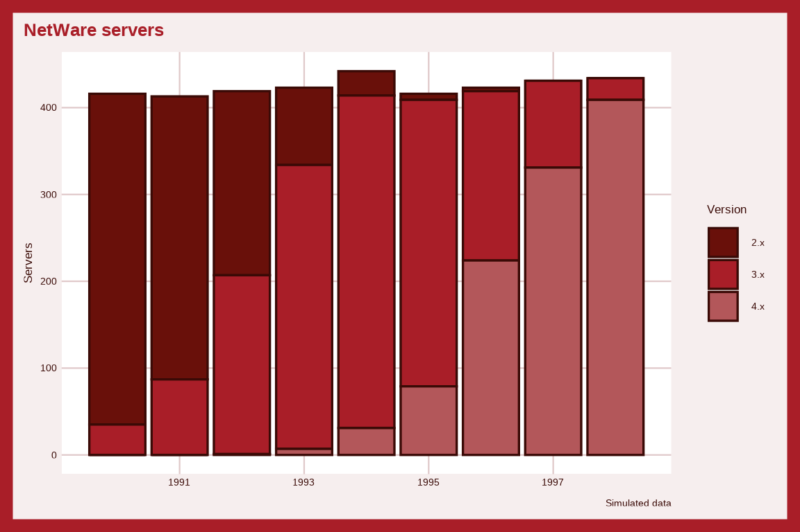

## OK Soda

[`theme_oksoda()`](https://mjfrigaard.github.io/fmggp2/reference/theme_oksoda.md)
uses the gray comic book cans Coca-Cola sold from 1993 to 1995: brushed
silver, black ink, OK red bars and title, and slate and brick accents,
with a Courier New title. Below we simulate one day of sales at 300 test
market stores from a normal distribution.

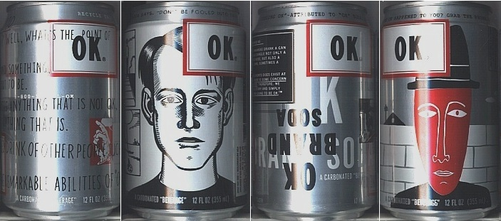

Image: TeemPlayer, [Wikimedia
Commons](https://commons.wikimedia.org/wiki/File:OK_Soda_Original_4.jpg),
CC BY-SA 3.0.

``` r

set.seed(1014)
ok_soda_sales <- data.frame(
  cans = round(rnorm(n = 300, mean = 45, sd = 12))
)
ggplot(ok_soda_sales, aes(x = cans)) +
  geom_histogram(bins = 30) +
  labs(title = "OK Soda", caption = "Simulated data",
       subtitle = "Cans sold per store in one day",
       x = "Cans sold") +
  theme_oksoda(base_size = 13)
```

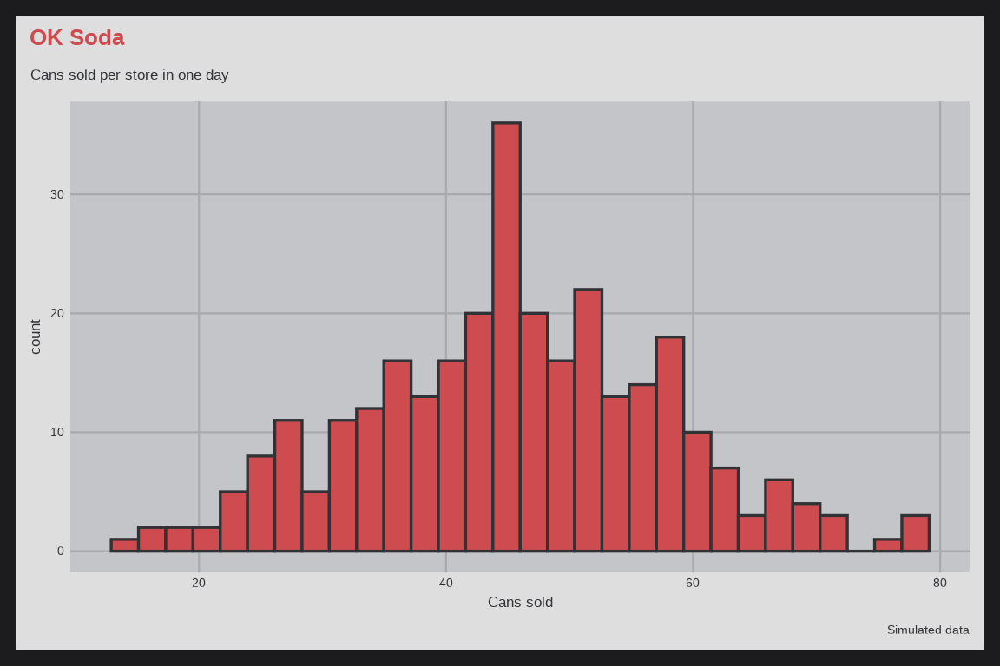

## Orbitz

[`theme_orbitz()`](https://mjfrigaard.github.io/fmggp2/reference/theme_orbitz.md)
uses a bottle of Orbitz, the 1997 drink with floating gel balls: a black
background, a gold frame, gold and magenta marks, and a Marker Felt
title. Below we compare the share of kids buying Orbitz and Surge each
week after Orbitz arrived.


Image: Jesse! S?, [Wikimedia
Commons](https://commons.wikimedia.org/wiki/File:Bottle_of_Orbitz_drink.jpg),
CC BY 2.0.

``` r

p_surge <- 0.8 * plogis(-2 + 0.6 * (0:6))
drinks <- data.frame(week = factor(rep(1:7, 2)),
  choice = factor(rep(c("Surge", "Orbitz"), each = 7), levels = c("Surge", "Orbitz")),
  share = c(p_surge, -(0.8 - p_surge)))
ggplot(drinks, aes(x = week, y = share, fill = choice)) +
  geom_col(width = 0.5) +
  labs(title = "Orbitz vs. Surge", caption = "Simulated data",
       x = "Week", y = "Share of kids", fill = NULL) +
  theme_orbitz(base_size = 13)
```


With `mode = "light"`:

``` r

last_plot() + theme_orbitz(base_size = 13, mode = "light")
```


## Oregon Trail

[`theme_oregontrail()`](https://mjfrigaard.github.io/fmggp2/reference/theme_oregontrail.md):
The Oregon Trail running in an Apple II emulator, with a gray window
frame, a black screen, and three shades of phosphor green. Below we
simulate days to reach Oregon from a log normal distribution.


Image: The Pug Father,
[Flickr](https://www.flickr.com/photos/fleur-design/1155468051), CC BY
2.0.

``` r

set.seed(1985)
trips <- data.frame(profession = rep(c("Banker", "Carpenter", "Farmer"), each = 100))
trips$days <- rlnorm(300, log(c(Banker = 140, Carpenter = 155, Farmer = 170)[trips$profession]), 0.2)
ggplot(trips, aes(x = profession, y = days, fill = profession)) +
  geom_boxplot(alpha = 2/3, show.legend = FALSE) +
  labs(title = "The Oregon Trail (simulated)", x = NULL, y = "Days") +
  theme_oregontrail(base_size = 13)
```


With `mode = "light"`:

``` r

last_plot() + theme_oregontrail(base_size = 13, mode = "light")
```


## Palm Pilot

[`theme_palmpilot()`](https://mjfrigaard.github.io/fmggp2/reference/theme_palmpilot.md)
uses a PalmPilot Professional: a charcoal case background, a HotSync
teal frame, a white title, a green LCD panel, ink, LCD green, plum, and
teal marks, and a Futura title. Below we simulate how Graffiti accuracy
improves over a user’s first ten weeks.


Image: Museo8bits, [Wikimedia
Commons](https://commons.wikimedia.org/wiki/File:Palm_Pilot_Professional_01.JPG),
CC BY-SA 3.0.

``` r

set.seed(1997)
graffiti <- data.frame(week = runif(200, 0, 10))
graffiti$accuracy <- pmin(100, 98 - 30 * exp(-graffiti$week / 2) + rnorm(200, 0, 3))
ggplot(graffiti, aes(x = week, y = accuracy)) +
  geom_point(alpha = 1 / 2) +
  geom_smooth(method = "loess", formula = y ~ x, se = FALSE) +
  labs(title = "Learning Graffiti", caption = "Simulated data", x = "Weeks of use", y = "Characters recognized (%)") +
  theme_palmpilot(base_size = 13)
```


## Pogs

[`theme_pogs()`](https://mjfrigaard.github.io/fmggp2/reference/theme_pogs.md)
uses a cardboard background and the red, sky blue, yellow, teal, purple,
and rust milk cap prints. Below we simulate a collection of 100 Pogs.


Image: “[Remember
Pogs?](https://www.flickr.com/photos/mtsofan/6077181975/)” by MTSOfan,
[CC BY-NC-SA 2.0](https://creativecommons.org/licenses/by-nc-sa/2.0/).

``` r

set.seed(1993)
pogs <- data.frame(type = sample(c("Milk caps", "Printed pogs", "Holographic", "Slammers"),
  100, replace = TRUE, prob = c(0.45, 0.30, 0.15, 0.10)))
ggplot(pogs, aes(x = type, fill = type)) +
  geom_bar(show.legend = FALSE) +
  labs(title = "A Pogs collection (simulated)", x = NULL, y = "Pieces") +
  theme_pogs(base_size = 13)
```


## Power Rangers

[`theme_powerrangers()`](https://mjfrigaard.github.io/fmggp2/reference/theme_powerrangers.md):
the six Ranger suits on light gray. Below we simulate putties defeated
by each Ranger.


Image: [Wikimedia
Commons](https://commons.wikimedia.org/wiki/File:Power_Rangers_logo.svg),
public domain.

``` r

set.seed(1993)
fights <- data.frame(ranger = factor(rep(c("Red", "Blue", "Yellow", "Pink", "Black"), each = 20), levels = c("Red", "Blue", "Yellow", "Pink", "Black")), minutes = rgamma(100, 4, 1))
fights$putties <- rpois(100, 1.6 * fights$minutes)
ggplot(fights, aes(x = minutes, y = putties, fill = ranger)) +
  geom_point(shape = 21, size = 3, color = "#000000") +
  labs(title = "Power Rangers", caption = "Simulated data", x = "Fight minutes", y = "Putties defeated", fill = NULL) +
  theme_powerrangers(base_size = 13)
```


## Saved by the Bell

[`theme_savedbythebell()`](https://mjfrigaard.github.io/fmggp2/reference/theme_savedbythebell.md):
the logo’s sky blue, pink, yellow, and orange on black. Below we
simulate fall and spring quiz averages for three students.


Image: [Wikimedia
Commons](https://commons.wikimedia.org/wiki/File:Saved_by_the_Bell_(original_series)_logo_(2).svg),
public domain.

``` r

set.seed(1989)
grades <- data.frame(student = rep(c("Zack", "Kelly", "Screech"), 2),
                     semester = rep(c("Fall", "Spring"), each = 3))
grades$score <- c(70, 82, 93, 80, 82, 95) + rnorm(6, 0, 2)
ggplot(grades, aes(x = semester, y = score, group = student, color = student)) +
  geom_line(linewidth = 2) +
  geom_point(size = 4) +
  labs(title = "Bayside quizzes (simulated)", x = NULL, y = "Average score", color = NULL) +
  theme_savedbythebell(base_size = 13)
```


## Seinfeld

[`theme_seinfeld()`](https://mjfrigaard.github.io/fmggp2/reference/theme_seinfeld.md):
the Seinfeld logo, with a yellow frame and a red title on the black drop
shadow. The light version puts the plot on the yellow oval. Below we
simulate laughs and viewers for 60 episodes.


Image: [Wikimedia
Commons](https://commons.wikimedia.org/wiki/File:Seinfeld.svg), public
domain.

``` r

set.seed(1989)
eps <- data.frame(kramer = rgamma(60, 6, 1.5), viewers = rlnorm(60, log(20), 0.3))
eps$laughs <- 2 + 0.3 * eps$kramer + rnorm(60, 0, 0.5)
ggplot(eps, aes(x = kramer, y = laughs, size = viewers)) +
  geom_point(alpha = 1 / 2) +
  labs(title = "Seinfeld episodes", caption = "Simulated data", x = "Kramer minutes", y = "Laughs per minute", size = "Viewers") +
  theme_seinfeld(base_size = 13)
```


With `mode = "light"`:

``` r

last_plot() + theme_seinfeld(base_size = 13, mode = "light")
```


## SNICK

[`theme_snick()`](https://mjfrigaard.github.io/fmggp2/reference/theme_snick.md):
Nickelodeon orange and slime green on a night purple sky. Below we
simulate 20 weeks of ratings for three nights.


Image: [Wikimedia
Commons](https://commons.wikimedia.org/wiki/File:SNICK_logo.svg), public
domain.

``` r

set.seed(1992)
nights <- expand.grid(week = 1:20, night = c("Fri", "Sat", "Sun"))
nights$rating <- c(Fri = 2.8, Sat = 4.2, Sun = 3.0)[as.character(nights$night)] + rnorm(60, 0, 0.3)
ggplot(nights, aes(x = week, y = rating, color = night)) +
  geom_line(linewidth = 1) +
  labs(title = "SNICK ratings (simulated)", x = "Week", y = "Rating", color = NULL) +
  theme_snick(base_size = 13)
```


With `mode = "light"`:

``` r

last_plot() + theme_snick(base_size = 13, mode = "light")
```


## Sony Walkman

[`theme_walkman()`](https://mjfrigaard.github.io/fmggp2/reference/theme_walkman.md)
uses the Sports Walkman: a sports yellow body, blue buttons, a charcoal
display, and an orange SPORTS label. Below we simulate median battery
life for three models and two battery types.


Image: Itsramon, [Wikimedia
Commons](https://commons.wikimedia.org/wiki/File:Sony_Walkman02.jpg), CC
BY-SA 3.0.

``` r

set.seed(1979)
walkman <- data.frame(model = rep(c("WM-2", "WM-F45 Sports", "WM-EX194 Mega Bass"), times = 2),
  battery = rep(c("Alkaline", "Rechargeable"), each = 3), hours = c(10, 16, 22, 7, 12, 17) + rnorm(6, 0, 0.5))
ggplot(walkman, aes(x = hours, y = model)) +
  geom_line(aes(group = model)) +
  geom_point(aes(color = battery), size = 3) +
  labs(title = "Sony Walkman (simulated)", x = "Median battery life (hours)", y = NULL, color = "Battery") +
  theme_walkman(base_size = 13)
```


## Squeezit

[`theme_squeezit()`](https://mjfrigaard.github.io/fmggp2/reference/theme_squeezit.md)
uses Squeezit bottles standing in gravel: a gravel background, a red
frame and title, red, orange, green, pink, blue, and gold marks, and a
Skia title. Below we simulate the seconds it took to squeeze out three
flavors from a gamma distribution.


Image: ZolHaj, [Wikimedia
Commons](https://commons.wikimedia.org/wiki/File:Squeezeit-flavours.jpg),
CC BY-SA 4.0.

``` r

set.seed(1998)
bottles <- data.frame(flavor = factor(rep(c("Cherry", "Orange", "Green punch"), each = 60),
  levels = c("Cherry", "Orange", "Green punch")))
bottles$seconds <- rgamma(180, shape = 2.5,
  scale = c(Cherry = 12, Orange = 18, `Green punch` = 22)[as.character(bottles$flavor)] / 2.5)
ggplot(bottles, aes(x = seconds, fill = flavor)) +
  geom_density(alpha = 2/3) +
  labs(title = "Squeezit", caption = "Simulated data",
       x = "Seconds to finish", fill = "Flavor") +
  theme_squeezit(base_size = 13)
```


## Super Soaker

[`theme_supersoaker()`](https://mjfrigaard.github.io/fmggp2/reference/theme_supersoaker.md):
neon orange plastic, water blue, and neon green. Below we simulate Super
Soaker ranges for two models.


Image: [Wikimedia
Commons](https://commons.wikimedia.org/wiki/File:Cps2000front.jpg), CC
BY-SA 3.0.

``` r

set.seed(1990)
shots <- data.frame(model = rep(c("SS 50", "CPS 2000"), each = 200))
shots$feet <- rnorm(400, ifelse(shots$model == "SS 50", 25, 45), ifelse(shots$model == "SS 50", 3, 5.4))
ggplot(shots, aes(x = feet, color = model)) +
  geom_freqpoly(binwidth = 2, linewidth = 1) +
  labs(title = "Super Soaker range (simulated)", x = "Range (feet)", color = "Model") +
  theme_supersoaker(base_size = 13)
```


## Surge

[`theme_surge()`](https://mjfrigaard.github.io/fmggp2/reference/theme_surge.md):
Surge green on black, with a dark to bright green continuous scale.
Below we simulate cans of Surge and hours of video games.


Image: theimpulsivebuy, [Wikimedia
Commons](https://commons.wikimedia.org/wiki/File:Burger_King_Frozen_Surge_(22789420399).jpg),
CC BY-SA 2.0.

``` r

set.seed(1996)
teens <- data.frame(cans = rgamma(2000, 2, 0.5))
teens$hours <- 3 + 1.5 * teens$cans + rnorm(2000, 0, 3)
ggplot(teens, aes(x = cans, y = hours)) +
  geom_bin2d(bins = 20) +
  labs(title = "Surge and video games", caption = "Simulated data", x = "Cans per week", y = "Gaming hours") +
  theme_surge(base_size = 13)
```


With `mode = "light"`:

``` r

last_plot() + theme_surge(base_size = 13, mode = "light")
```


## Talkboy

[`theme_talkboy()`](https://mjfrigaard.github.io/fmggp2/reference/theme_talkboy.md)
uses the Deluxe Talkboy from *Home Alone 2* sitting on a walnut table: a
silver panel, button blue marks, and a Brush Script title. Below we
simulate the length of 300 recorded messages from a right skewed gamma
distribution.


Image: Y2kcrazyjoker4, [Wikimedia
Commons](https://commons.wikimedia.org/wiki/File:Deluxe_Talkboy_on_table.jpg),
CC BY-SA 4.0.

``` r

set.seed(1999)
talkboy_clips <- data.frame(
  seconds = round(rgamma(n = 300, shape = 4, rate = 0.5), 1)
)
ggplot(talkboy_clips, aes(x = seconds)) +
  geom_freqpoly(bins = 30) +
  labs(title = "Talkboy", caption = "Simulated data",
       subtitle = "Length of 300 recorded messages",
       x = "Message length (seconds)") +
  theme_talkboy(base_size = 13)
```


## Tamagotchi

[`theme_tamagotchi()`](https://mjfrigaard.github.io/fmggp2/reference/theme_tamagotchi.md):
a lilac egg shell and a gray green LCD screen. Below we simulate
Tamagotchi lifespans from a Weibull distribution.


Image: Dex Vintage, [Wikimedia
Commons](https://commons.wikimedia.org/wiki/File:Various_Tamagotchi_virtual_pet_devices.png),
CC BY 3.0.

``` r

set.seed(1997)
pets <- data.frame(care = rep(c("Neglected", "Pampered"), each = 150))
pets$days <- rweibull(300, shape = 2.2, scale = ifelse(pets$care == "Neglected", 6, 21))
ggplot(pets, aes(x = days, fill = care)) +
  geom_histogram(alpha = 2/3, position = "identity", bins = 40) +
  labs(title = "Tamagotchi lifespans (simulated)", x = "Days", fill = "Care") +
  theme_tamagotchi(base_size = 13)
```


## Tetris

[`theme_tetris()`](https://mjfrigaard.github.io/fmggp2/reference/theme_tetris.md):
a black well and the seven tetromino colors. Below we simulate lines
cleared from a negative binomial distribution.


Image: [Wikimedia
Commons](https://commons.wikimedia.org/wiki/File:Tetrominoes_IJLO_STZ_Worlds.svg),
public domain.

``` r

set.seed(1989)
games <- data.frame(player = rep(c("Casual", "Expert"), each = 80))
games$lines <- rnbinom(160, size = 5, mu = ifelse(games$player == "Casual", 25, 120))
ggplot(games, aes(x = player, y = lines, color = player)) +
  geom_jitter(width = 0.2, show.legend = FALSE) +
  labs(title = "Tetris (simulated)", x = NULL, y = "Lines cleared") +
  theme_tetris(base_size = 13)
```


With `mode = "light"`:

``` r

last_plot() + theme_tetris(base_size = 13, mode = "light")
```


## Tiger R-Zone

[`theme_rzone()`](https://mjfrigaard.github.io/fmggp2/reference/theme_rzone.md)
uses Tiger’s 1995 R-Zone headset: black plastic, a red frame and title,
red LCD, purple, and pink marks, pale blue visor text, and an Arial
Narrow title. Below we simulate the seconds 100 players needed to clear
the first level on two tries.


Image: Evan-Amos, [Wikimedia
Commons](https://commons.wikimedia.org/wiki/File:Tiger-RZone-Headset.jpg),
public domain.

``` r

set.seed(1993)
tries <- data.frame(try = rep(c("First", "Second"), each = 100))
tries$seconds <- rlnorm(200, log(ifelse(tries$try == "First", 40, 20)), 0.5)
ggplot(tries, aes(x = seconds, y = try, fill = try)) +
  geom_boxplot(width = 0.3, show.legend = FALSE) +
  labs(title = "Tiger R-Zone", caption = "Simulated data",
       x = "Seconds to clear the first level", y = NULL) +
  theme_rzone(base_size = 13)
```


With `mode = "light"`:

``` r

last_plot() + theme_rzone(base_size = 13, mode = "light")
```


## Titanic

[`theme_titanic()`](https://mjfrigaard.github.io/fmggp2/reference/theme_titanic.md):
the Vallejo Titanic Colors paint set (black, yellow, canvas,
anti-fouling red, faded yellow, stone, and wood deck) with a Big Caslon
title.


Image: [Wikimedia
Commons](https://commons.wikimedia.org/wiki/File:Titanic_in_color.png),
public domain.

``` r

set.seed(1997)
fans <- data.frame(age_group = sample(c("Teen", "Adult"), 300, replace = TRUE),
  viewings = sample(c("Once", "Twice", "3+ times"), 300, replace = TRUE))
ggplot(fans, aes(x = age_group, fill = viewings)) +
  geom_bar(position = "fill") +
  labs(title = "Titanic (simulated)", x = NULL, y = "Share", fill = "Viewings") +
  theme_titanic(base_size = 13)
```


## Two-way pagers

[`theme_pager()`](https://mjfrigaard.github.io/fmggp2/reference/theme_pager.md)
uses a RIM 950 pager on concrete: a charcoal frame and title, a pale LCD
panel, charcoal, orange, and slate marks, and an Arial Black title.
Below we simulate the messages one pager received in each hour of a
workday.


Image: Ruben de Rijcke, [Wikimedia
Commons](https://commons.wikimedia.org/wiki/File:RIM_BlackBerry_950.jpg),
CC BY-SA 4.0.

``` r

set.seed(1998)
pages <- data.frame(hour = 7:20)
pages$messages <- rpois(nrow(pages), 2 + 10 * dnorm(pages$hour, 13, 3) / dnorm(0, 0, 3))
ggplot(pages, aes(x = hour, y = messages)) +
  geom_col() +
  labs(title = "Messages by hour", caption = "Simulated data", x = "Hour", y = "Messages") +
  theme_pager(base_size = 13)
```


## VRML

[`theme_vrml()`](https://mjfrigaard.github.io/fmggp2/reference/theme_vrml.md)
uses a VRML living room: a tan wall background, a floor brown frame, a
pale panel, sofa red, lamp green, black, and glass marks, and an Andale
Mono title. Below we simulate render times for four VRML scenes.


Image: Jan Křivka, [Wikimedia
Commons](https://commons.wikimedia.org/wiki/File:Interior.png), public
domain.

``` r

set.seed(1996)
scenes <- data.frame(scene = rep(c("Living room", "Garden", "Office", "Museum"), each = 40),
  polygons = round(runif(160, 500, 20000)))
scenes$seconds <- 0.5 + scenes$polygons / 4000 + rnorm(160, 0, 0.4)
ggplot(scenes, aes(x = polygons, y = seconds, color = scene)) +
  geom_point() +
  labs(title = "VRML render times", caption = "Simulated data", x = "Polygons", y = "Seconds to render", color = NULL) +
  theme_vrml(base_size = 13)
```


## Y2K

[`theme_y2k()`](https://mjfrigaard.github.io/fmggp2/reference/theme_y2k.md):
LED red, terminal amber and green on black. Below we show how 300
households prepared for Y2K across three surveys.


Image: Bug de l’an 2000, [Wikimedia
Commons](https://commons.wikimedia.org/wiki/File:Bug_de_l%27an_2000.jpg),
CC BY-SA 3.0.

``` r

prep <- data.frame(
  survey = factor(rep(c("Jan", "Jul", "Dec"), each = 3), levels = c("Jan", "Jul", "Dec")),
  level = factor(rep(c("Not worried", "Some supplies", "Bunker ready"), 3),
                 levels = c("Not worried", "Some supplies", "Bunker ready")),
  households = c(163, 100, 37, 124, 119, 57, 108, 117, 75))
ggplot(prep, aes(x = survey, y = households, fill = level)) +
  geom_col() +
  labs(title = "Y2K prep (simulated)", x = NULL, y = "Households", fill = NULL) +
  theme_y2k(base_size = 13)
```


With `mode = "light"`:

``` r

last_plot() + theme_y2k(base_size = 13, mode = "light")
```


## Fonts

[`theme_gameboy()`](https://mjfrigaard.github.io/fmggp2/reference/theme_gameboy.md)
and
[`theme_tetris()`](https://mjfrigaard.github.io/fmggp2/reference/theme_tetris.md)
use Press Start 2P, which ships with `fmggp2`. The other themes use
fonts that ship with macOS and Windows.

These themes use Arial for the body text and a display font for the
title:

- Impact
  ([`theme_blockbuster()`](https://mjfrigaard.github.io/fmggp2/reference/theme_blockbuster.md))
- Arial Black
  ([`theme_n64()`](https://mjfrigaard.github.io/fmggp2/reference/theme_n64.md)
  and
  [`theme_freshprince()`](https://mjfrigaard.github.io/fmggp2/reference/theme_freshprince.md))
- Herculanum
  ([`theme_jurassic()`](https://mjfrigaard.github.io/fmggp2/reference/theme_jurassic.md))
- Arial Rounded
  ([`theme_happymeal()`](https://mjfrigaard.github.io/fmggp2/reference/theme_happymeal.md))
- Bradley Hand
  ([`theme_pogs()`](https://mjfrigaard.github.io/fmggp2/reference/theme_pogs.md))
- DIN Condensed
  ([`theme_walkman()`](https://mjfrigaard.github.io/fmggp2/reference/theme_walkman.md))
- Courier New
  ([`theme_oksoda()`](https://mjfrigaard.github.io/fmggp2/reference/theme_oksoda.md))
- Brush Script
  ([`theme_talkboy()`](https://mjfrigaard.github.io/fmggp2/reference/theme_talkboy.md))
- Futura
  ([`theme_crystalpepsi()`](https://mjfrigaard.github.io/fmggp2/reference/theme_crystalpepsi.md))
- Marker Felt
  ([`theme_orbitz()`](https://mjfrigaard.github.io/fmggp2/reference/theme_orbitz.md))
- Times New Roman
  ([`theme_netscape()`](https://mjfrigaard.github.io/fmggp2/reference/theme_netscape.md))
- Big Caslon
  ([`theme_titanic()`](https://mjfrigaard.github.io/fmggp2/reference/theme_titanic.md))
- Arial Rounded
  ([`theme_koosh()`](https://mjfrigaard.github.io/fmggp2/reference/theme_koosh.md))
- Futura
  ([`theme_tamagotchi()`](https://mjfrigaard.github.io/fmggp2/reference/theme_tamagotchi.md))
- Arial Black
  ([`theme_supersoaker()`](https://mjfrigaard.github.io/fmggp2/reference/theme_supersoaker.md))
- Trattatello
  ([`theme_goosebumps()`](https://mjfrigaard.github.io/fmggp2/reference/theme_goosebumps.md))
- Skia
  ([`theme_squeezit()`](https://mjfrigaard.github.io/fmggp2/reference/theme_squeezit.md))
- Andale Mono
  ([`theme_oregontrail()`](https://mjfrigaard.github.io/fmggp2/reference/theme_oregontrail.md))
- Arial Rounded
  ([`theme_aim()`](https://mjfrigaard.github.io/fmggp2/reference/theme_aim.md))
- Arial Narrow
  ([`theme_rzone()`](https://mjfrigaard.github.io/fmggp2/reference/theme_rzone.md))
- DIN Condensed
  ([`theme_batman()`](https://mjfrigaard.github.io/fmggp2/reference/theme_batman.md))
- Arial Black
  ([`theme_snick()`](https://mjfrigaard.github.io/fmggp2/reference/theme_snick.md))
- SignPainter
  ([`theme_savedbythebell()`](https://mjfrigaard.github.io/fmggp2/reference/theme_savedbythebell.md))
- Gill Sans
  ([`theme_hypercolor()`](https://mjfrigaard.github.io/fmggp2/reference/theme_hypercolor.md))
- PT Mono
  ([`theme_y2k()`](https://mjfrigaard.github.io/fmggp2/reference/theme_y2k.md))
- Chalkboard
  ([`theme_gushers()`](https://mjfrigaard.github.io/fmggp2/reference/theme_gushers.md))
- Impact
  ([`theme_doom()`](https://mjfrigaard.github.io/fmggp2/reference/theme_doom.md))
- Krungthep
  ([`theme_consolewars()`](https://mjfrigaard.github.io/fmggp2/reference/theme_consolewars.md))
- American Typewriter
  ([`theme_seinfeld()`](https://mjfrigaard.github.io/fmggp2/reference/theme_seinfeld.md))
- Copperplate
  ([`theme_powerrangers()`](https://mjfrigaard.github.io/fmggp2/reference/theme_powerrangers.md))
- Rockwell
  ([`theme_bopit()`](https://mjfrigaard.github.io/fmggp2/reference/theme_bopit.md))
- Comic Sans MS
  ([`theme_geocities()`](https://mjfrigaard.github.io/fmggp2/reference/theme_geocities.md))
- DIN Alternate
  ([`theme_surge()`](https://mjfrigaard.github.io/fmggp2/reference/theme_surge.md))
- Times New Roman
  ([`theme_microdrive()`](https://mjfrigaard.github.io/fmggp2/reference/theme_microdrive.md))
- Gill Sans
  ([`theme_netware()`](https://mjfrigaard.github.io/fmggp2/reference/theme_netware.md))
- Arial Narrow
  ([`theme_j2me()`](https://mjfrigaard.github.io/fmggp2/reference/theme_j2me.md))
- Futura
  ([`theme_palmpilot()`](https://mjfrigaard.github.io/fmggp2/reference/theme_palmpilot.md))
- Trebuchet MS
  ([`theme_visor()`](https://mjfrigaard.github.io/fmggp2/reference/theme_visor.md))
- Arial Black
  ([`theme_pager()`](https://mjfrigaard.github.io/fmggp2/reference/theme_pager.md))
- Tahoma
  ([`theme_cuseeme()`](https://mjfrigaard.github.io/fmggp2/reference/theme_cuseeme.md))
- Andale Mono
  ([`theme_vrml()`](https://mjfrigaard.github.io/fmggp2/reference/theme_vrml.md))
- Verdana
  ([`theme_javaapplet()`](https://mjfrigaard.github.io/fmggp2/reference/theme_javaapplet.md))
- Marker Felt
  ([`theme_cuecat()`](https://mjfrigaard.github.io/fmggp2/reference/theme_cuecat.md))
- Arial Rounded
  ([`theme_audrey()`](https://mjfrigaard.github.io/fmggp2/reference/theme_audrey.md))

When a font file can’t be found, the theme falls back to `"sans"`, so
the plots above still render on Linux. You can also pass any family
you’ve registered with
[`sysfonts::font_add()`](https://rdrr.io/pkg/sysfonts/man/font_add.html):

``` r

theme_oksoda(base_family = "sans", title_family = "sans")
```

## Using a theme for a whole chapter

Each chapter sets its theme once in the setup chunk with
[`theme_set()`](https://ggplot2.tidyverse.org/reference/get_theme.html),
so the plotting code in the chapter doesn’t need a `theme_*()` call.

``` r

ggplot2::theme_set(fmggp2::theme_oksoda(base_size = 15))
```

The same works for the light version of a dark theme:

``` r

ggplot2::theme_set(fmggp2::theme_doom(base_size = 15, mode = "light"))
```
