# 90s themes

Every converted chapter in [*ggplot2: field
manual*](https://mjfrigaard.github.io/fm-ggp2/) uses simulated data with
a late 90s theme, and each dataset gets a `ggplot2` theme to match. This
vignette shows each theme with the data from the chapter that introduced
it.

``` r

library(fmggp2)
library(ggplot2)
showtext::showtext_auto()
```

## Game Boy

[`theme_gameboy()`](https://mjfrigaard.github.io/fmggp2/reference/theme_gameboy.md)
uses the four shades of green from the original Game Boy screen and the
pixel font Press Start 2P, which ships with `fmggp2`. Below we simulate
the starter chosen by 300 *Pokémon Red and Blue* players.

``` r

set.seed(1998)
pokemon_starters <- data.frame(
  starter = sample(c("Bulbasaur", "Charmander", "Squirtle"),
    size = 300, replace = TRUE, prob = c(0.30, 0.42, 0.28))
)
ggplot(pokemon_starters, aes(x = starter, fill = starter)) +
  geom_bar(show.legend = FALSE) +
  labs(title = "Pokemon Red and Blue (simulated)",
       subtitle = "Starter chosen by 300 players",
       x = "Starter", y = "Count") +
  theme_gameboy(base_size = 13)
```

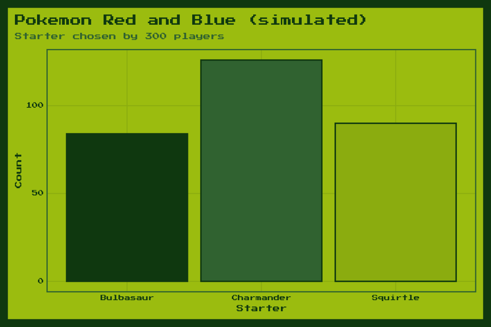

## Windows 98

[`theme_win98()`](https://mjfrigaard.github.io/fmggp2/reference/theme_win98.md)
draws the plot as a Windows 98 window sitting on the teal desktop. The
title sits in a navy title bar, the plot area is white, and bars and
lines are navy by default. Below we simulate 300 AOL dial up sessions
(in minutes) from a normal distribution.

``` r

set.seed(1014)
aol_sessions <- data.frame(
  minutes = round(rnorm(n = 300, mean = 45, sd = 12))
)
ggplot(aol_sessions, aes(x = minutes)) +
  geom_histogram(bins = 30) +
  labs(title = "AOL dial up sessions (simulated)",
       subtitle = "Distribution of session length",
       x = "Session length (minutes)") +
  theme_win98(base_size = 13)
```

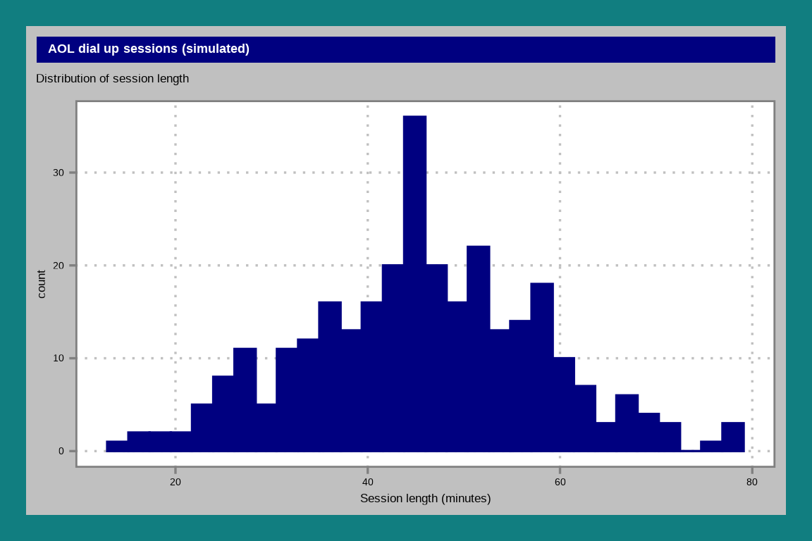

Discrete fills follow the desktop palette (gray, navy, then teal).

``` r

aol_ranges <- data.frame(
  range = factor(c("under 33", "33 to 56", "57 and over"),
                 levels = c("under 33", "33 to 56", "57 and over")),
  n = c(47, 193, 60)
)
ggplot(aol_ranges, aes(x = n, y = "300 sessions", fill = range)) +
  geom_col(position = position_stack(reverse = TRUE)) +
  labs(x = "Number of sessions", y = NULL, fill = "Minutes") +
  theme_win98(base_size = 13)
```

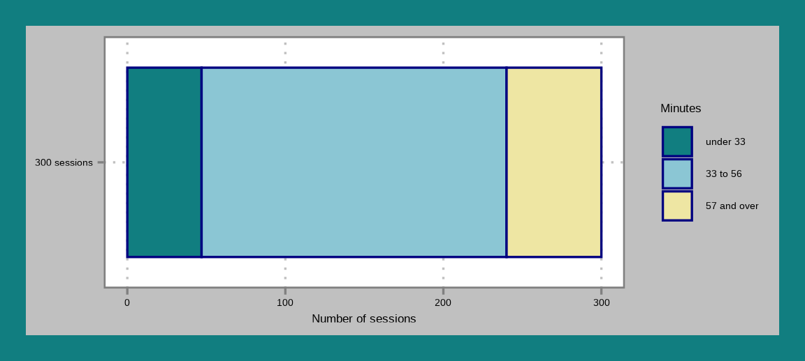

## Napster

[`theme_napster()`](https://mjfrigaard.github.io/fmggp2/reference/theme_napster.md)
borrows the dark 1999 Napster client: a near black window, white text, a
dotted gray grid, and lime marks. Below we simulate 300 MP3 downloads
over a 56k modem from a right skewed gamma distribution.

``` r

set.seed(1999)
napster_downloads <- data.frame(
  minutes = round(rgamma(n = 300, shape = 4, rate = 0.5), 1)
)
ggplot(napster_downloads, aes(x = minutes)) +
  geom_freqpoly(bins = 30) +
  labs(title = "Napster MP3 downloads (simulated)",
       subtitle = "Download time over a 56k modem",
       x = "Download time (minutes)") +
  theme_napster(base_size = 13)
```

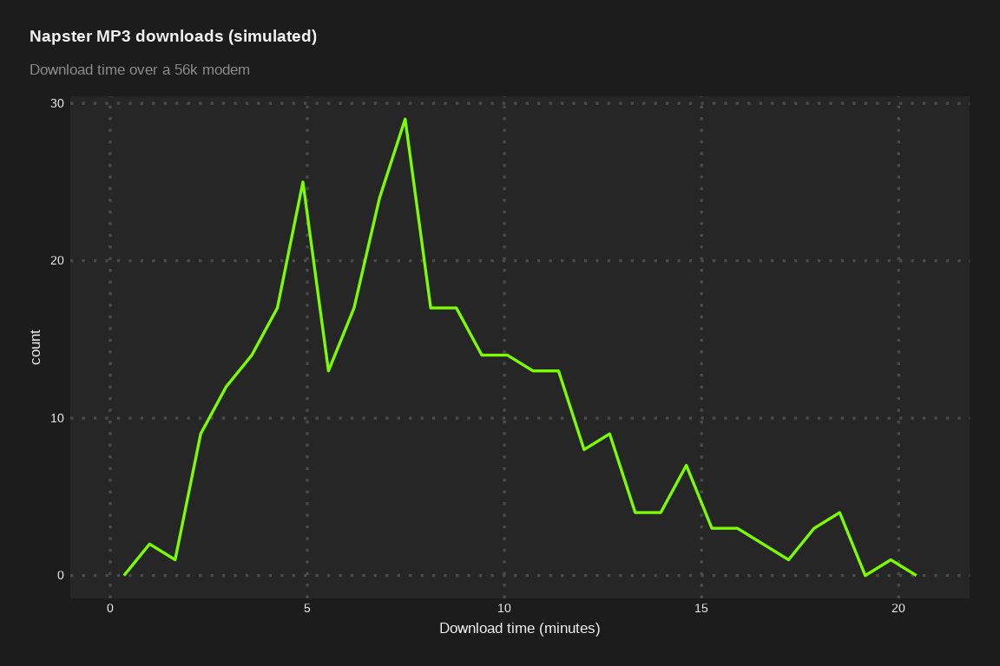

## Blockbuster

[`theme_blockbuster()`](https://mjfrigaard.github.io/fmggp2/reference/theme_blockbuster.md)
uses Blockbuster Video blue and yellow. Below we simulate weekly rentals
for 60 households from a Poisson distribution.

``` r

set.seed(1993)
blockbuster_rentals <- data.frame(rentals = rpois(n = 60, lambda = 3))
ggplot(blockbuster_rentals, aes(x = rentals)) +
  geom_dotplot(binwidth = 1, dotsize = 0.3) +
  labs(title = "Blockbuster Video (simulated)",
       x = "Number of rentals") +
  theme_blockbuster(base_size = 13)
```

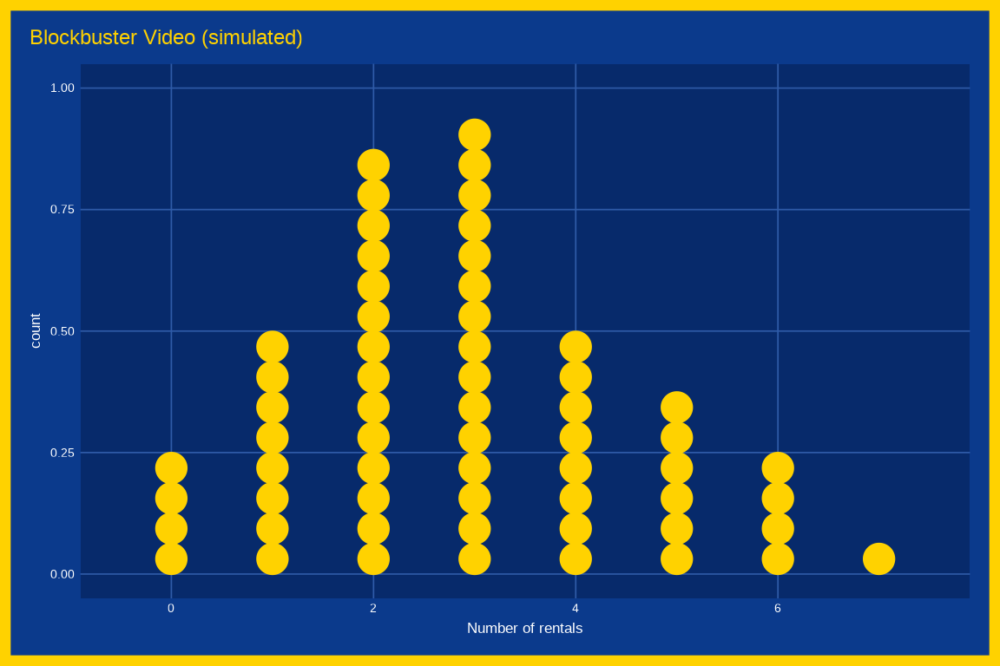

## Spice Girls

[`theme_spice()`](https://mjfrigaard.github.io/fmggp2/reference/theme_spice.md)
uses hot pink, purple, and gold. Below we simulate the ages of 400 fans
at a 1998 concert as a mix of kids and parents.

``` r

set.seed(1998)
kid <- runif(400) < 0.65
spice_fans <- data.frame(age = round(ifelse(kid, rnorm(400, 11, 2.5), rnorm(400, 37, 6))))
ggplot(spice_fans, aes(x = age)) +
  geom_density() +
  labs(title = "Spice World tour (simulated)",
       x = "Age (years)") +
  theme_spice(base_size = 13)
```

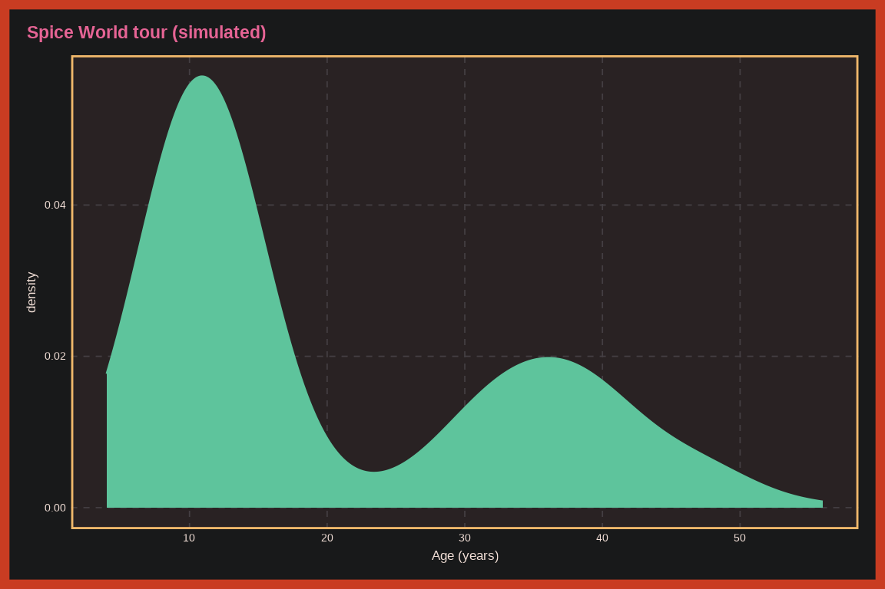

## Beanie Babies

[`theme_beanie()`](https://mjfrigaard.github.io/fmggp2/reference/theme_beanie.md)
uses the red and gold of a Beanie Babies heart tag. Below we simulate
300 resale prices from a log normal distribution.

``` r

set.seed(1996)
beanie_prices <- data.frame(price = rlnorm(n = 300, meanlog = log(15), sdlog = 0.8))
ggplot(beanie_prices, aes(x = "", y = price)) +
  geom_violin() +
  labs(title = "Beanie Babies resale prices (simulated)",
       x = NULL, y = "Price (USD)") +
  theme_beanie(base_size = 13)
```

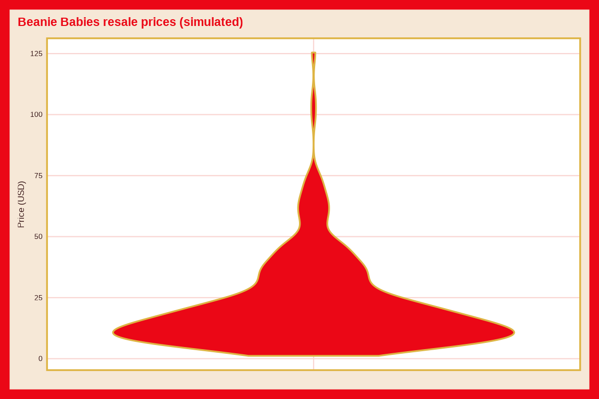

## Nintendo 64

[`theme_n64()`](https://mjfrigaard.github.io/fmggp2/reference/theme_n64.md)
uses controller gray and the four logo colors. Below we simulate 200
Mario Kart 64 lap times from a heavy tailed t distribution.

``` r

set.seed(64)
mario_kart_laps <- data.frame(seconds = 45 + 2 * rt(n = 200, df = 3))
ggplot(mario_kart_laps, aes(x = "", y = seconds)) +
  geom_boxplot() +
  labs(title = "Mario Kart 64 (simulated)",
       x = NULL, y = "Lap time (seconds)") +
  theme_n64(base_size = 13)
```

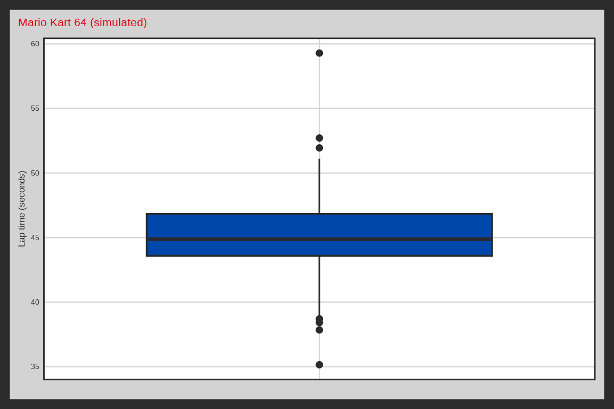

## Jurassic Park

[`theme_jurassic()`](https://mjfrigaard.github.io/fmggp2/reference/theme_jurassic.md)
uses the Jurassic Park Post Office souvenir sheet: black, logo red,
stamp yellow, and sunset orange. Below we simulate the total weight of
the dinosaurs in each paddock.

``` r

set.seed(1993)
jp_paddocks <- data.frame(species = c("Brachiosaurus", "Triceratops", "Tyrannosaurus"),
  total_tons = c(sum(rnorm(3, 40, 5)), sum(rnorm(5, 9, 1.2)), sum(rnorm(2, 8, 1))))
ggplot(jp_paddocks, aes(x = species, y = total_tons, fill = species)) +
  geom_col(show.legend = FALSE) +
  labs(title = "Jurassic Park (simulated)", x = "Paddock", y = "Total weight (tons)") +
  theme_jurassic(base_size = 13)
```

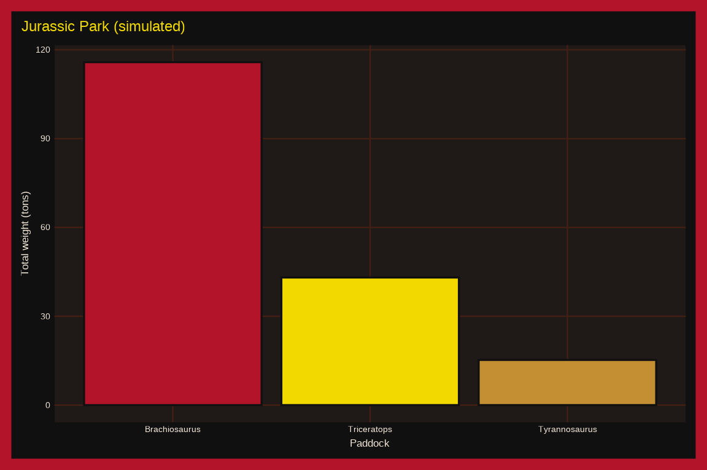

## Happy Meals

[`theme_happymeal()`](https://mjfrigaard.github.io/fmggp2/reference/theme_happymeal.md)
uses the red and yellow of a Happy Meal box. Below we simulate average
daily Happy Meal sales for four toy promotions.

``` r

set.seed(1997)
happy_meals <- data.frame(promotion = c("Teenie Beanie Babies", "Furby", "Hot Wheels", "Inspector Gadget"),
  avg_sold = sapply(c(420, 310, 220, 180), function(l) mean(rpois(28, l))))
ggplot(happy_meals, aes(x = promotion, y = avg_sold, fill = promotion)) +
  geom_col(show.legend = FALSE) +
  labs(title = "Happy Meals (simulated)", x = "Toy promotion", y = "Average sold per day") +
  theme_happymeal(base_size = 13)
```

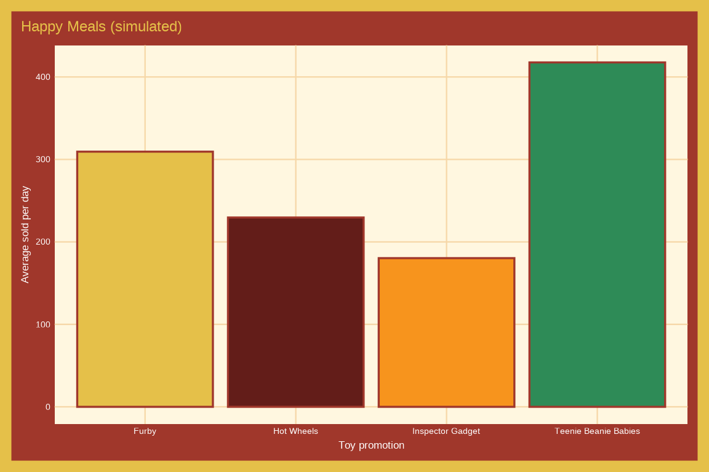

## Friends

[`theme_friends()`](https://mjfrigaard.github.io/fmggp2/reference/theme_friends.md)
uses Monica’s purple walls, a yellow frame, and the logo dot colors.
Below we simulate viewers per episode for three seasons.

``` r

set.seed(1994)
friends_episodes <- data.frame(season = rep(c("Season 1", "Season 3", "Season 5"), each = 24))
friends_episodes$viewers_m <- round(rnorm(72, rep(c(22, 27, 24), each = 24), 2.5))
ggplot(friends_episodes, aes(x = viewers_m, fill = season)) +
  geom_bar() +
  labs(title = "Friends (simulated)", x = "Viewers (millions)", y = "Episodes", fill = "Season") +
  theme_friends(base_size = 13)
```

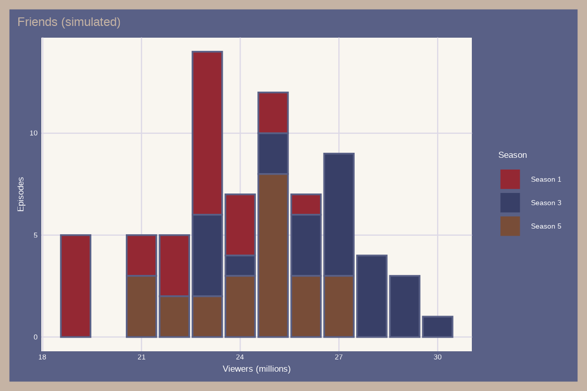

## Fresh Prince

[`theme_freshprince()`](https://mjfrigaard.github.io/fmggp2/reference/theme_freshprince.md)
puts graffiti neon on deep purple, and its continuous fill runs from
teal to hot pink. Below we simulate how often the Carlton dance shows up
each season.

``` r

set.seed(1990)
fp <- expand.grid(season = 1:6, gag = c("Will flirts", "Carlton dance"))
fp$occurrences <- rbinom(12, 24, ifelse(fp$gag == "Will flirts", 0.9, plogis(-2.2 + 0.5 * (fp$season - 3.5))))
ggplot(fp, aes(x = season, y = gag, fill = occurrences)) +
  geom_tile() +
  labs(title = "Fresh Prince (simulated)", x = "Season", y = NULL, fill = "Episodes") +
  theme_freshprince(base_size = 13)
```

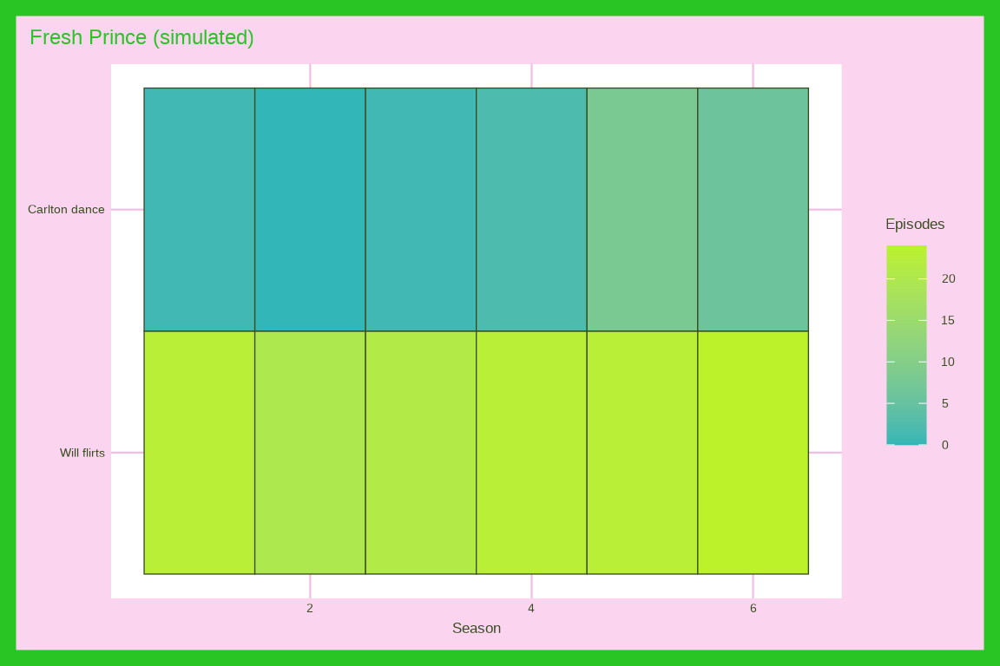

## Pogs

[`theme_pogs()`](https://mjfrigaard.github.io/fmggp2/reference/theme_pogs.md)
uses a cardboard background and bright milk cap prints. Below we
simulate a collection of 100 Pogs.

``` r

set.seed(1993)
pogs <- data.frame(type = sample(c("Milk caps", "Printed pogs", "Holographic", "Slammers"),
  100, replace = TRUE, prob = c(0.45, 0.30, 0.15, 0.10)))
ggplot(pogs, aes(x = type, fill = type)) +
  geom_bar(show.legend = FALSE) +
  labs(title = "A Pogs collection (simulated)", x = NULL, y = "Pieces") +
  theme_pogs(base_size = 13)
```

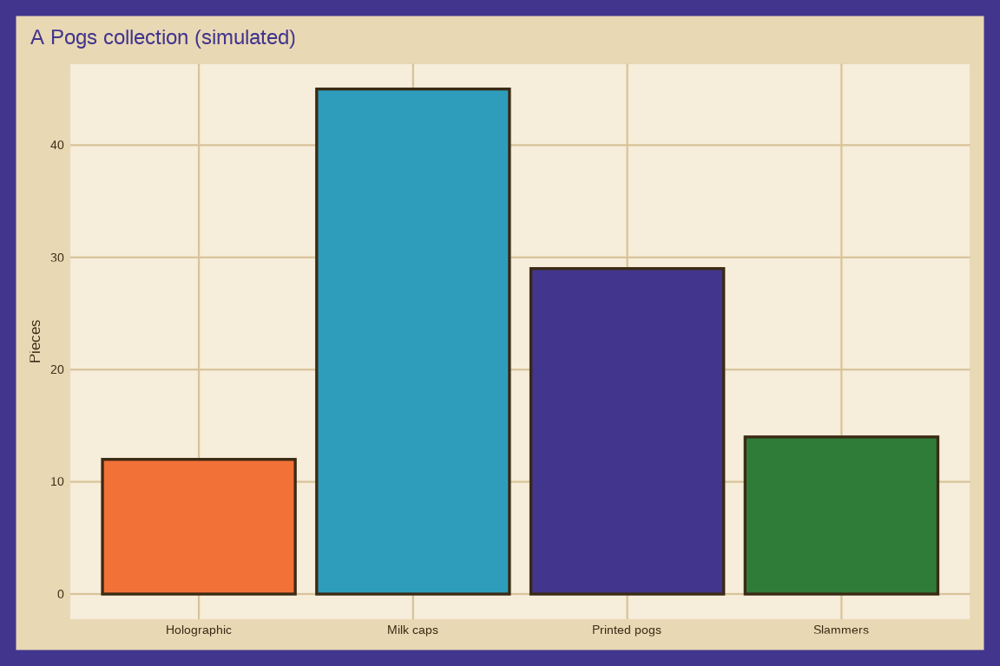

## Sony Walkman

[`theme_walkman()`](https://mjfrigaard.github.io/fmggp2/reference/theme_walkman.md)
uses the Sports Walkman photo: a cobalt blue backdrop with white grid
lines, sports yellow, and play button green. Below we simulate median
battery life for three models and two battery types.

``` r

set.seed(1979)
walkman <- data.frame(model = rep(c("WM-2", "WM-F45 Sports", "WM-EX194 Mega Bass"), times = 2),
  battery = rep(c("Alkaline", "Rechargeable"), each = 3), hours = c(10, 16, 22, 7, 12, 17) + rnorm(6, 0, 0.5))
ggplot(walkman, aes(x = hours, y = model)) +
  geom_line(aes(group = model)) +
  geom_point(aes(color = battery), size = 3) +
  labs(title = "Sony Walkman (simulated)", x = "Median battery life (hours)", y = NULL, color = "Battery") +
  theme_walkman(base_size = 13)
```

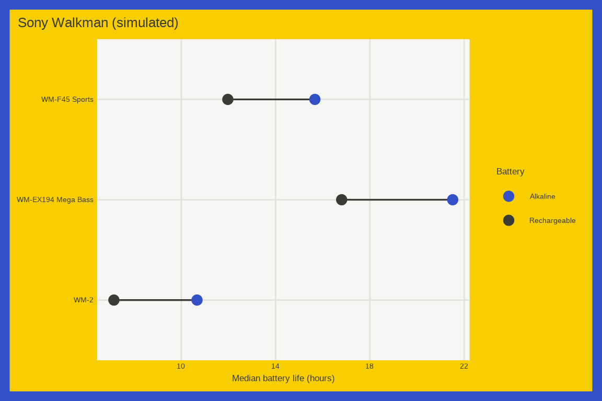

## Encarta and Britannica

[`theme_encarta()`](https://mjfrigaard.github.io/fmggp2/reference/theme_encarta.md):
MindMaze from Encarta 97, with slate stone, parchment, a carved brown
frame, and gold, and a Georgia title.

``` r

p_encarta <- 0.8 * plogis(-2 + 0.6 * (0:6))
enc <- data.frame(year = factor(rep(1993:1999, 2)),
  choice = rep(c("Encarta", "Britannica"), each = 7),
  share = c(p_encarta, -(0.8 - p_encarta)))
ggplot(enc, aes(x = year, y = share, fill = choice)) +
  geom_col(width = 0.5) +
  labs(title = "Encarta vs. Britannica (simulated)", x = NULL, y = "Share", fill = NULL) +
  theme_encarta(base_size = 13)
```

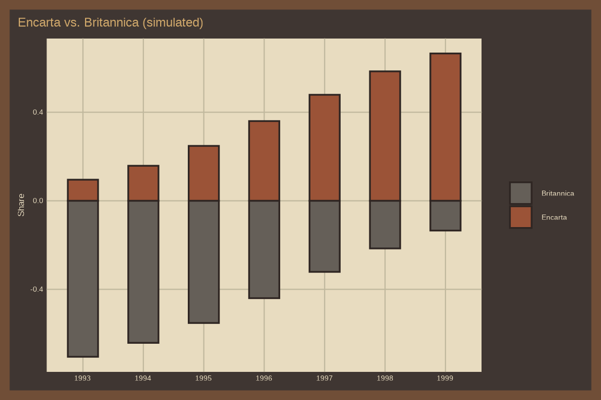

## Netscape

[`theme_netscape()`](https://mjfrigaard.github.io/fmggp2/reference/theme_netscape.md):
the Netscape Navigator night sky with star yellow, teal, magenta, and
meteor orange and a Times New Roman title.

``` r

set.seed(1996)
modem <- sample(c("14.4k", "28.8k", "56k"), 600, replace = TRUE, prob = c(0.25, 0.45, 0.30))
speeds <- data.frame(modem = modem,
  kbps = rnorm(600, c(`14.4k` = 13, `28.8k` = 26, `56k` = 44)[modem], c(`14.4k` = 1.2, `28.8k` = 2.5, `56k` = 5)[modem]))
ggplot(speeds, aes(x = kbps, after_stat(count), fill = modem)) +
  geom_density(position = "fill") +
  labs(title = "Dial up speeds (simulated)", x = "Speed (kbps)", fill = "Modem") +
  theme_netscape(base_size = 13)
```

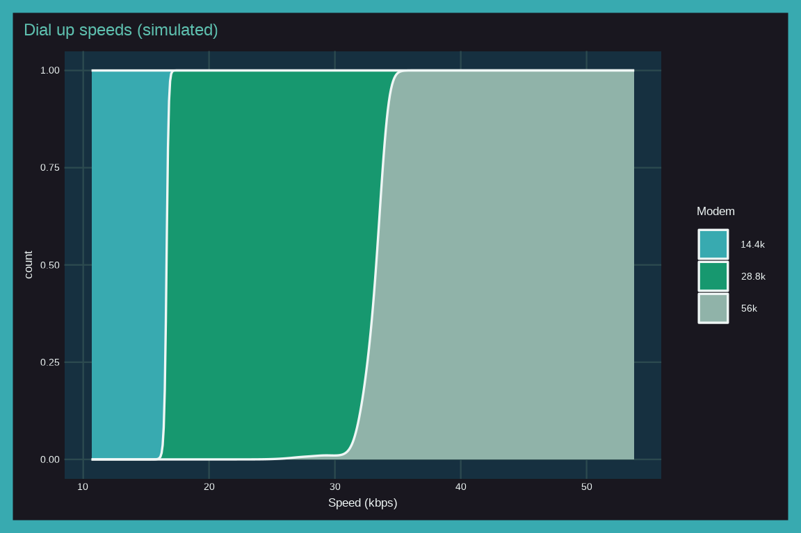

## Titanic

[`theme_titanic()`](https://mjfrigaard.github.io/fmggp2/reference/theme_titanic.md):
the Titanic’s original paint colors (hull black, hull stripe gold,
canvas, antifouling red, White Star buff, and funnel gray) with a Big
Caslon title.

``` r

set.seed(1997)
fans <- data.frame(age_group = sample(c("Teen", "Adult"), 300, replace = TRUE),
  viewings = sample(c("Once", "Twice", "3+ times"), 300, replace = TRUE))
ggplot(fans, aes(x = age_group, fill = viewings)) +
  geom_bar(position = "fill") +
  labs(title = "Titanic (simulated)", x = NULL, y = "Share", fill = "Viewings") +
  theme_titanic(base_size = 13)
```

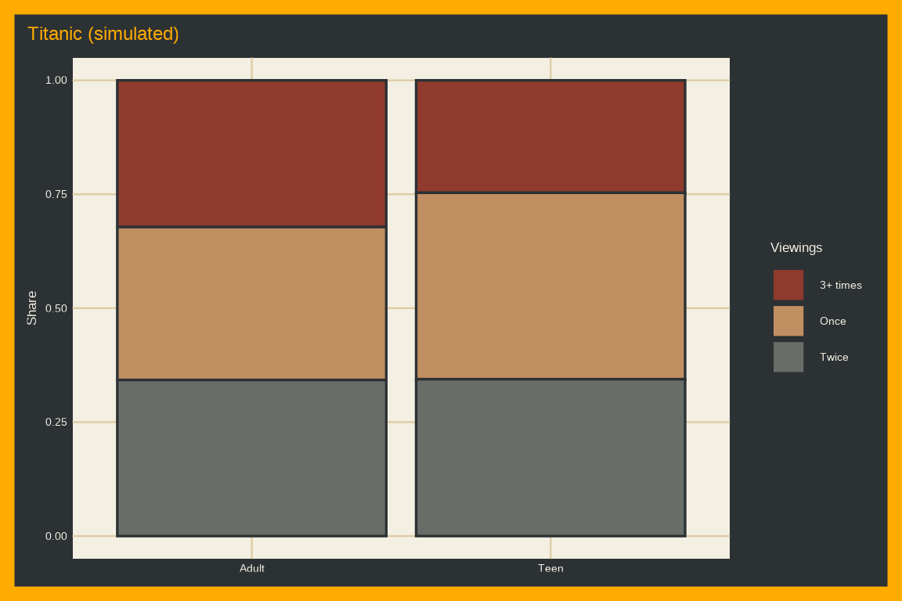

## Lisa Frank

[`theme_lisafrank()`](https://mjfrigaard.github.io/fmggp2/reference/theme_lisafrank.md):
the Lisa Frank folder palette (purple, magenta, orange, yellow, and
white) with a Chalkboard title.

``` r

set.seed(1993)
keepers <- data.frame(design = sample(c("Rainbow leopards", "Unicorns", "Dolphins", "Pandas"),
  200, replace = TRUE, prob = c(1/2, 1/4, 1/8, 1/8)))
ggplot(keepers, aes(x = design, fill = design)) +
  geom_bar(show.legend = FALSE) +
  labs(title = "Trapper Keepers (simulated)", x = NULL, y = "Sold") +
  theme_lisafrank(base_size = 13)
```

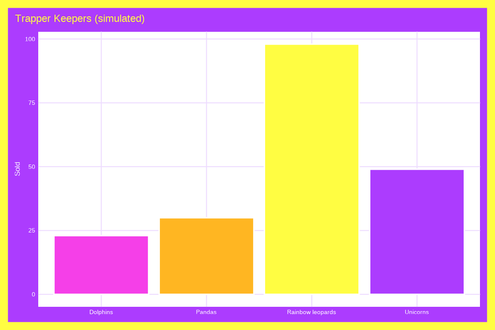

## Toys”R”Us

[`theme_toysrus()`](https://mjfrigaard.github.io/fmggp2/reference/theme_toysrus.md):
Toys”R”Us white and blue with the multicolored logo letters as marks and
a Phosphate title.

``` r

set.seed(1999)
toys <- data.frame(toy = c("Furby", "Beanie Babies", "Game Boy Color", "Nintendo 64"),
  units = rpois(4, c(1800, 2400, 1200, 1000)))
ggplot(toys, aes(x = toy, y = units, fill = toy)) +
  geom_col(show.legend = FALSE) +
  labs(title = "Toys\"R\"Us 1998 (simulated)", x = NULL, y = "Units sold") +
  theme_toysrus(base_size = 13)
```

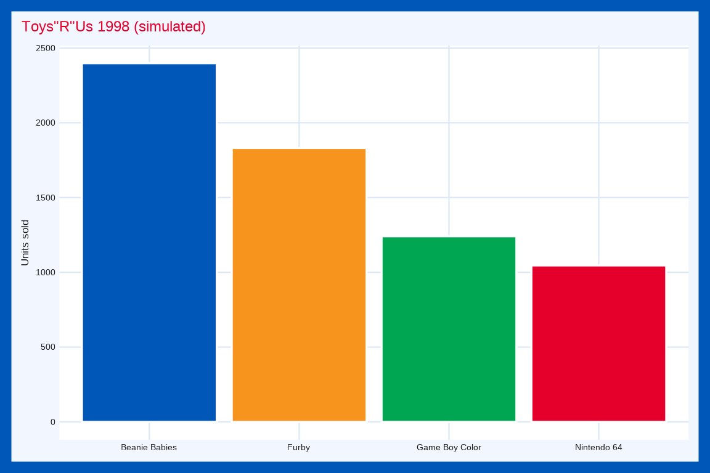

## Tamagotchi

[`theme_tamagotchi()`](https://mjfrigaard.github.io/fmggp2/reference/theme_tamagotchi.md):
a lilac egg shell and a gray green LCD screen. Below we simulate
Tamagotchi lifespans from a Weibull distribution.

``` r

set.seed(1997)
pets <- data.frame(care = rep(c("Neglected", "Pampered"), each = 150))
pets$days <- rweibull(300, shape = 2.2, scale = ifelse(pets$care == "Neglected", 6, 21))
ggplot(pets, aes(x = days, fill = care)) +
  geom_histogram(alpha = 2/3, position = "identity", bins = 40) +
  labs(title = "Tamagotchi lifespans (simulated)", x = "Days", fill = "Care") +
  theme_tamagotchi(base_size = 13)
```

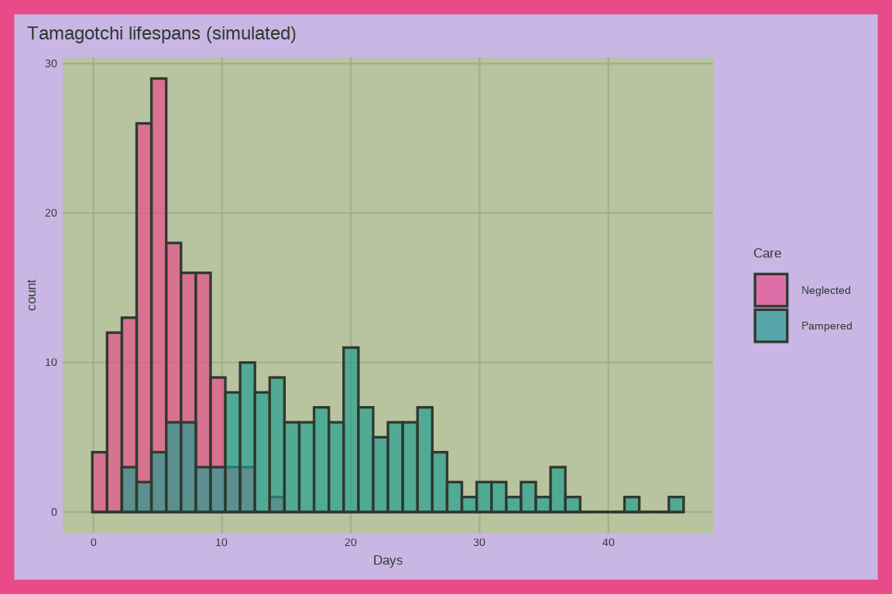

## Super Soaker

[`theme_supersoaker()`](https://mjfrigaard.github.io/fmggp2/reference/theme_supersoaker.md):
neon orange plastic, water blue, and neon green. Below we simulate Super
Soaker ranges for two models.

``` r

set.seed(1990)
shots <- data.frame(model = rep(c("SS 50", "CPS 2000"), each = 200))
shots$feet <- rnorm(400, ifelse(shots$model == "SS 50", 25, 45), ifelse(shots$model == "SS 50", 3, 5.4))
ggplot(shots, aes(x = feet, color = model)) +
  geom_freqpoly(binwidth = 2, linewidth = 1) +
  labs(title = "Super Soaker range (simulated)", x = "Range (feet)", color = "Model") +
  theme_supersoaker(base_size = 13)
```

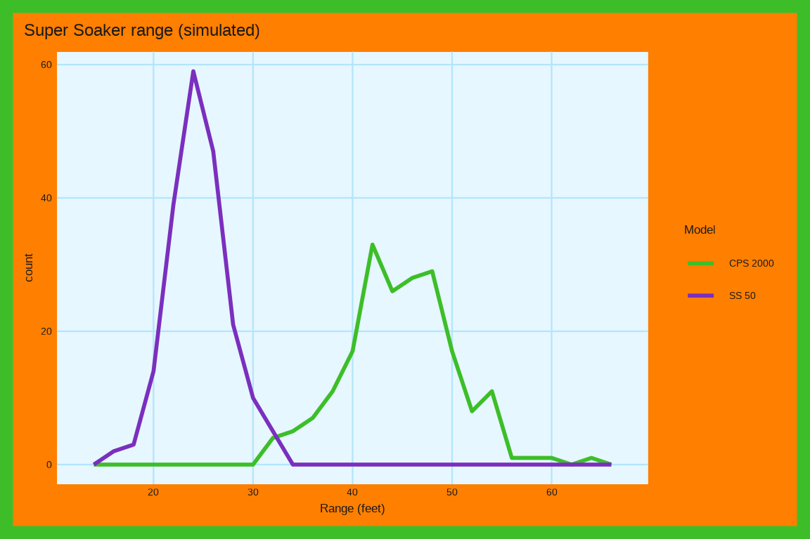

## Goosebumps

[`theme_goosebumps()`](https://mjfrigaard.github.io/fmggp2/reference/theme_goosebumps.md):
haunted purple and slime green. Below we simulate Goosebumps books read
by two grades.

``` r

set.seed(1992)
readers <- data.frame(grade = rep(c("3rd grade", "5th grade"), each = 40))
readers$books <- rpois(80, ifelse(readers$grade == "3rd grade", 3, 9))
ggplot(readers, aes(x = books, fill = grade)) +
  geom_dotplot(method = "histodot", binwidth = 1, stackgroups = TRUE, binpositions = "all") +
  labs(title = "Goosebumps (simulated)", x = "Books read", fill = "Grade") +
  theme_goosebumps(base_size = 13)
```

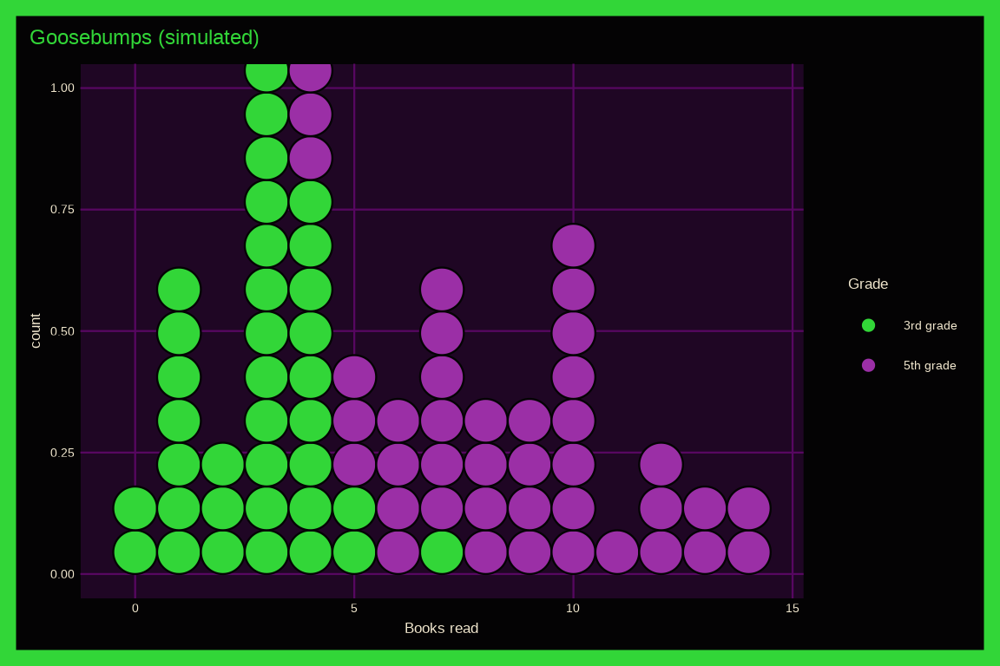

## Tetris

[`theme_tetris()`](https://mjfrigaard.github.io/fmggp2/reference/theme_tetris.md):
a black well and the seven tetromino colors. Below we simulate lines
cleared from a negative binomial distribution.

``` r

set.seed(1989)
games <- data.frame(player = rep(c("Casual", "Expert"), each = 80))
games$lines <- rnbinom(160, size = 5, mu = ifelse(games$player == "Casual", 25, 120))
ggplot(games, aes(x = player, y = lines, color = player)) +
  geom_jitter(width = 0.2, show.legend = FALSE) +
  labs(title = "Tetris (simulated)", x = NULL, y = "Lines cleared") +
  theme_tetris(base_size = 13)
```

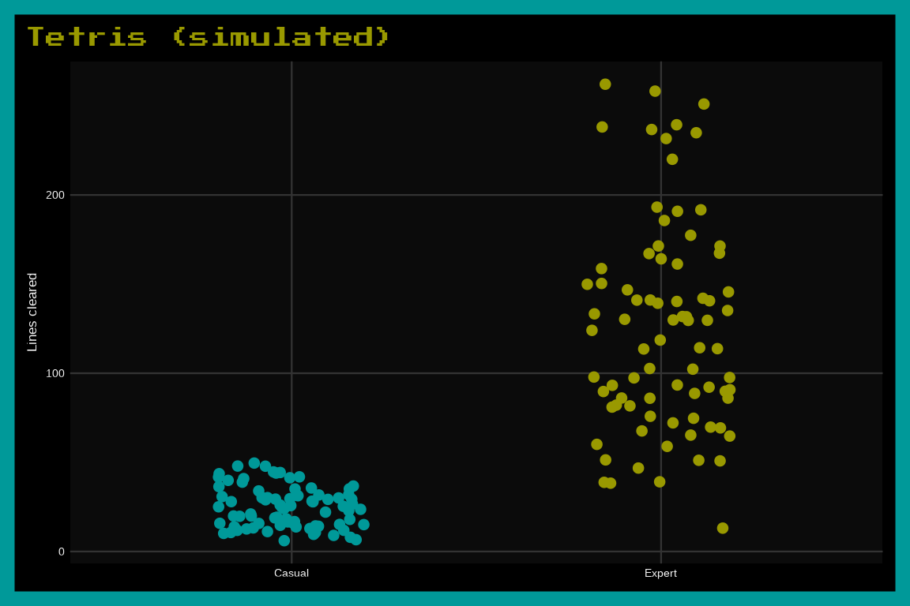

## Furby

[`theme_furby()`](https://mjfrigaard.github.io/fmggp2/reference/theme_furby.md):
purple fur, teal, orange, and pink. Below we simulate Furby chatter in
two languages.

``` r

set.seed(1998)
chatter <- data.frame(language = rep(c("Furbish", "English"), times = c(180, 120)))
chatter$words <- rnorm(300, ifelse(chatter$language == "Furbish", 45, 30), ifelse(chatter$language == "Furbish", 8, 10))
ggplot(chatter, aes(x = words, after_stat(count), fill = language)) +
  geom_density(alpha = 1/2) +
  labs(title = "Furby chatter (simulated)", x = "Words per hour", fill = "Language") +
  theme_furby(base_size = 13)
```

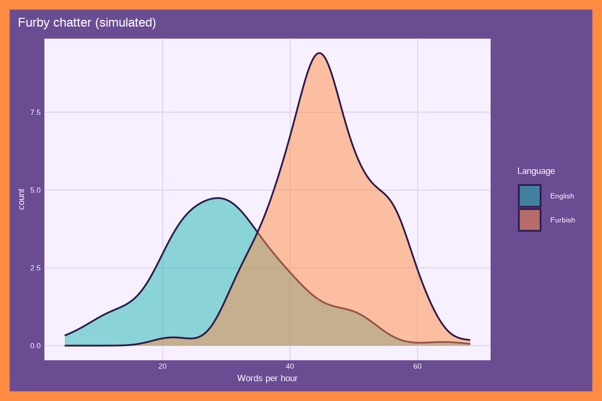

## MTV TRL

[`theme_trl()`](https://mjfrigaard.github.io/fmggp2/reference/theme_trl.md):
a black studio, MTV yellow, and neon colors. Below we simulate days on
the countdown from a gamma distribution.

``` r

set.seed(1998)
videos <- data.frame(genre = rep(c("Rock", "Rap", "Boy bands"), each = 60))
videos$days <- rgamma(180, shape = 2.5, scale = c(Rock = 12, Rap = 22, `Boy bands` = 40)[videos$genre] / 2.5)
ggplot(videos, aes(x = days, fill = genre)) +
  geom_density(alpha = 2/3) +
  labs(title = "MTV TRL (simulated)", x = "Days on the countdown", fill = "Genre") +
  theme_trl(base_size = 13)
```

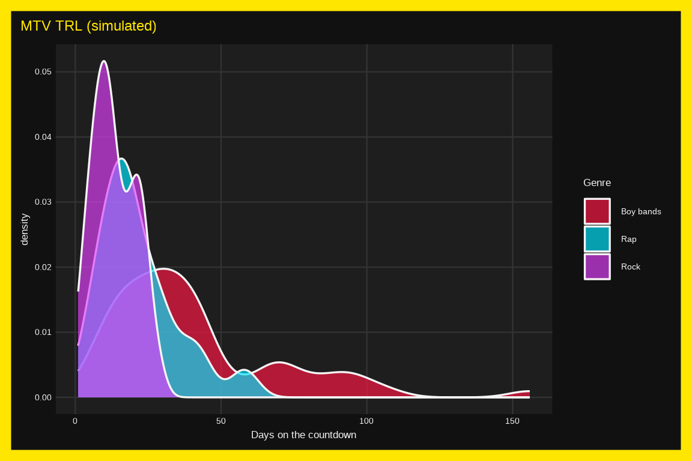

## Oregon Trail

[`theme_oregontrail()`](https://mjfrigaard.github.io/fmggp2/reference/theme_oregontrail.md):
an Apple II screen with phosphor green text. Below we simulate days to
reach Oregon from a log normal distribution.

``` r

set.seed(1985)
trips <- data.frame(profession = rep(c("Banker", "Carpenter", "Farmer"), each = 100))
trips$days <- rlnorm(300, log(c(Banker = 140, Carpenter = 155, Farmer = 170)[trips$profession]), 0.2)
ggplot(trips, aes(x = profession, y = days, fill = profession)) +
  geom_boxplot(alpha = 2/3, show.legend = FALSE) +
  labs(title = "The Oregon Trail (simulated)", x = NULL, y = "Days") +
  theme_oregontrail(base_size = 13)
```

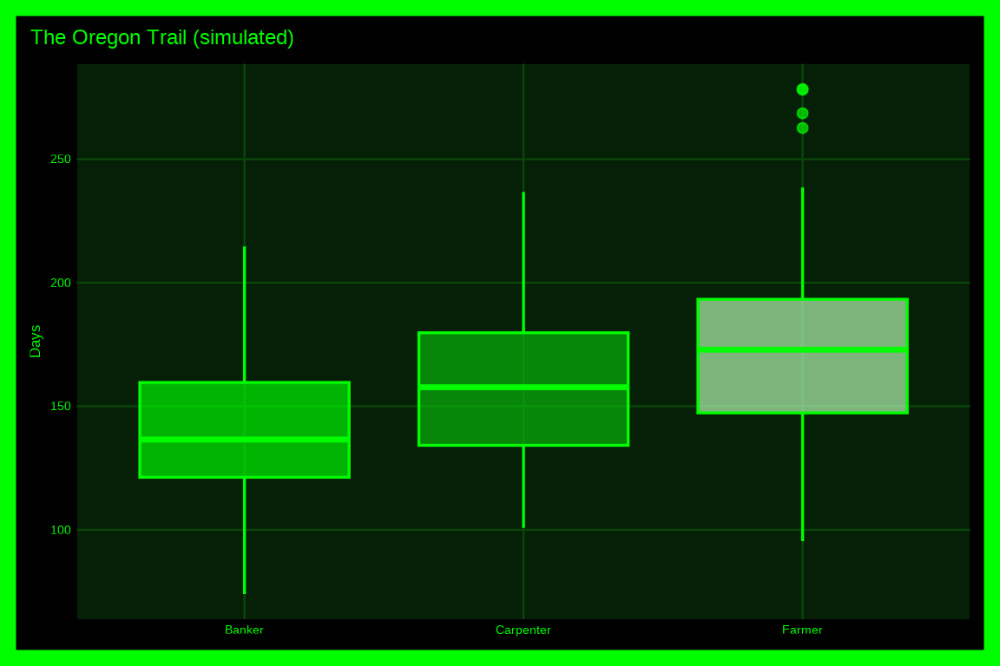

## AIM

[`theme_aim()`](https://mjfrigaard.github.io/fmggp2/reference/theme_aim.md):
the yellow running man, AOL blue, and a white chat window. Below we
simulate buddy list sizes with different shapes.

``` r

set.seed(1997)
buddies <- data.frame(school = rep(c("Middle school", "College"), each = 150))
buddies$n <- ifelse(buddies$school == "Middle school", rpois(300, 20), ifelse(runif(300) < 0.7, rnorm(300, 60, 10), rnorm(300, 150, 20)))
ggplot(buddies, aes(x = school, y = n, fill = school)) +
  geom_violin(alpha = 2/3, show.legend = FALSE) +
  labs(title = "AIM buddy lists (simulated)", x = NULL, y = "Buddies") +
  theme_aim(base_size = 13)
```

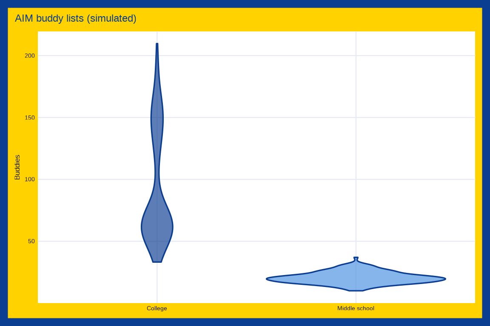

## Magic Eye

[`theme_magiceye()`](https://mjfrigaard.github.io/fmggp2/reference/theme_magiceye.md):
deep indigo and psychedelic magenta, teal, and orange. Below we simulate
seconds to see the hidden image on two tries.

``` r

set.seed(1993)
tries <- data.frame(try = rep(c("First", "Second"), each = 100))
tries$seconds <- rlnorm(200, log(ifelse(tries$try == "First", 40, 20)), 0.5)
ggplot(tries, aes(x = seconds, y = try, fill = try)) +
  geom_boxplot(width = 0.3, show.legend = FALSE) +
  labs(title = "Magic Eye (simulated)", x = "Seconds", y = NULL) +
  theme_magiceye(base_size = 13)
```

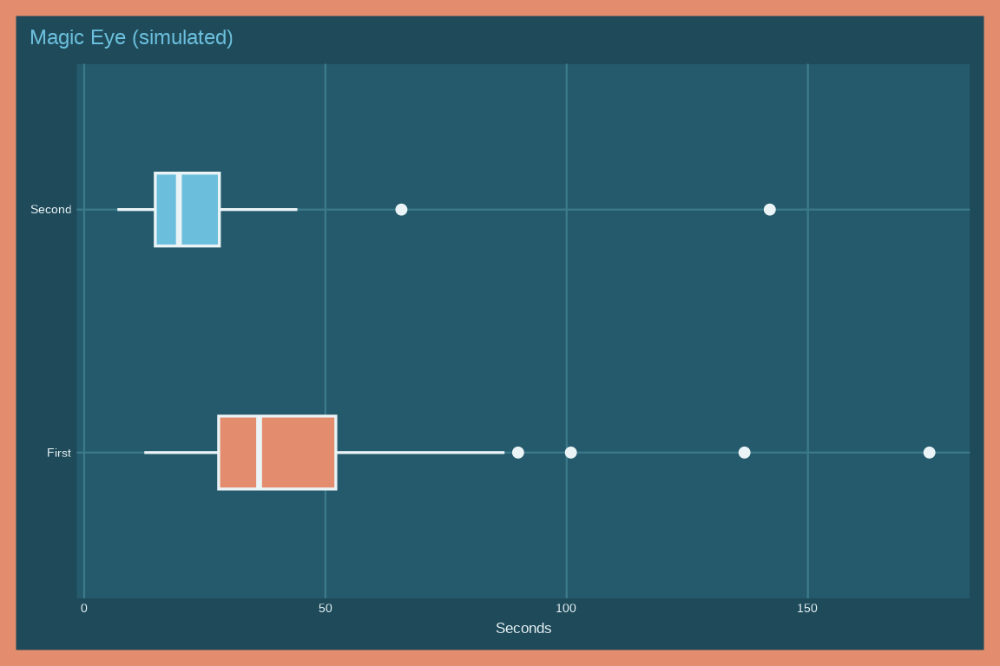

## Batman

[`theme_batman()`](https://mjfrigaard.github.io/fmggp2/reference/theme_batman.md):
the Batman (1989) palette: black, gold, orange, and steel. Below we
simulate bat signal sightings over a week.

``` r

set.seed(1989)
signals <- data.frame(night = factor(c("Mon", "Tue", "Wed", "Thu", "Fri", "Sat", "Sun"), levels = c("Mon", "Tue", "Wed", "Thu", "Fri", "Sat", "Sun")), sightings = rpois(7, 12))
ggplot(signals, aes(x = night, y = sightings)) +
  geom_col() +
  labs(title = "Bat signal sightings (simulated)", x = NULL, y = "Sightings") +
  theme_batman(base_size = 13)
```

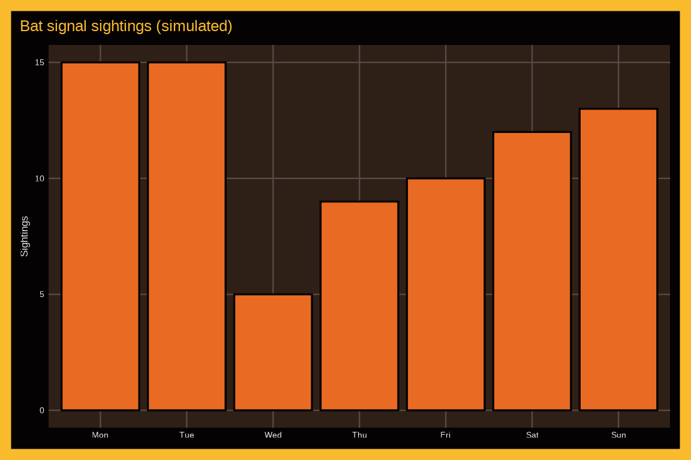

## SNICK

[`theme_snick()`](https://mjfrigaard.github.io/fmggp2/reference/theme_snick.md):
Nickelodeon orange and slime green on a night purple sky. Below we
simulate 20 weeks of ratings for three nights.

``` r

set.seed(1992)
nights <- expand.grid(week = 1:20, night = c("Fri", "Sat", "Sun"))
nights$rating <- c(Fri = 2.8, Sat = 4.2, Sun = 3.0)[as.character(nights$night)] + rnorm(60, 0, 0.3)
ggplot(nights, aes(x = week, y = rating, color = night)) +
  geom_line(linewidth = 1) +
  labs(title = "SNICK ratings (simulated)", x = "Week", y = "Rating", color = NULL) +
  theme_snick(base_size = 13)
```

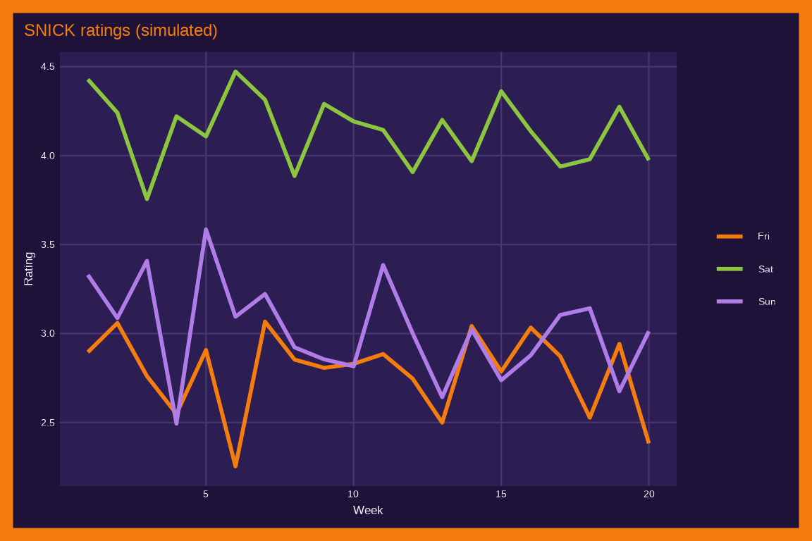

## Boy bands

[`theme_boyband()`](https://mjfrigaard.github.io/fmggp2/reference/theme_boyband.md):
midnight navy, chrome, and frosted tip colors. Below we simulate a week
of radio spins for four bands.

``` r

set.seed(1999)
spins <- data.frame(band = c("Backstreet Boys", "*NSYNC", "98 Degrees", "LFO"))
spins$spins <- rpois(4, c(420, 380, 330, 300))
ggplot(spins, aes(x = band, y = spins, fill = band)) +
  geom_col(show.legend = FALSE) +
  labs(title = "Boy band spins (simulated)", x = NULL, y = "Spins") +
  theme_boyband(base_size = 13)
```

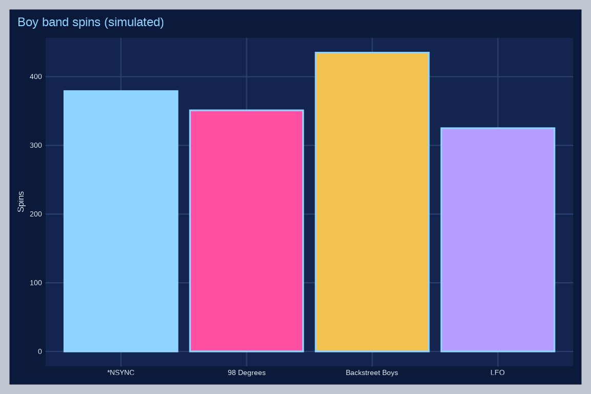

## Saved by the Bell

[`theme_savedbythebell()`](https://mjfrigaard.github.io/fmggp2/reference/theme_savedbythebell.md):
Memphis style teal, magenta, and yellow on black. Below we simulate fall
and spring quiz averages for three students.

``` r

set.seed(1989)
grades <- data.frame(student = rep(c("Zack", "Kelly", "Screech"), 2),
                     semester = rep(c("Fall", "Spring"), each = 3))
grades$score <- c(70, 82, 93, 80, 82, 95) + rnorm(6, 0, 2)
ggplot(grades, aes(x = semester, y = score, group = student, color = student)) +
  geom_line(linewidth = 2) +
  geom_point(size = 4) +
  labs(title = "Bayside quizzes (simulated)", x = NULL, y = "Average score", color = NULL) +
  theme_savedbythebell(base_size = 13)
```

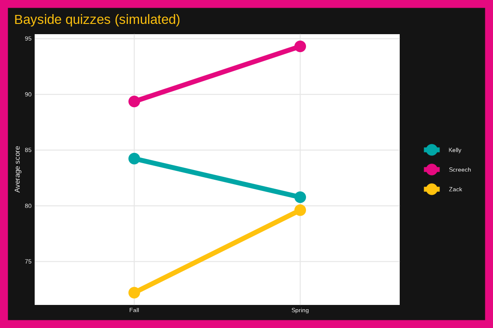

## Hypercolor

[`theme_hypercolor()`](https://mjfrigaard.github.io/fmggp2/reference/theme_hypercolor.md):
heat changing magenta, orange, purple, and blue. Below we simulate
monthly sales for two fads.

``` r

months <- seq(1990, 1995, by = 1 / 12)
fads <- data.frame(month = rep(months, 2),
                   fad = rep(c("Hypercolor", "Slap bracelets"), each = length(months)))
fads$sales <- ifelse(fads$fad == "Hypercolor",
                     4000 * dnorm(fads$month, 1991.5, 0.6),
                     3000 * dnorm(fads$month, 1990.8, 0.4)) / 12
ggplot(fads, aes(x = month, y = sales, fill = fad)) +
  geom_area(alpha = 0.8) +
  labs(title = "90s fads (simulated)", x = NULL, y = "Sales (thousands)", fill = NULL) +
  theme_hypercolor(base_size = 13)
```

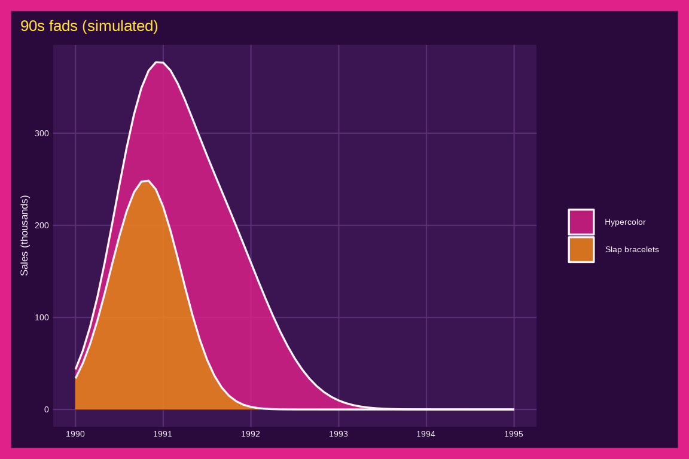

## Y2K

[`theme_y2k()`](https://mjfrigaard.github.io/fmggp2/reference/theme_y2k.md):
LED red, terminal amber and green on black. Below we show how 300
households prepared for Y2K across three surveys.

``` r

prep <- data.frame(
  survey = factor(rep(c("Jan", "Jul", "Dec"), each = 3), levels = c("Jan", "Jul", "Dec")),
  level = factor(rep(c("Not worried", "Some supplies", "Bunker ready"), 3),
                 levels = c("Not worried", "Some supplies", "Bunker ready")),
  households = c(163, 100, 37, 124, 119, 57, 108, 117, 75))
ggplot(prep, aes(x = survey, y = households, fill = level)) +
  geom_col() +
  labs(title = "Y2K prep (simulated)", x = NULL, y = "Households", fill = NULL) +
  theme_y2k(base_size = 13)
```

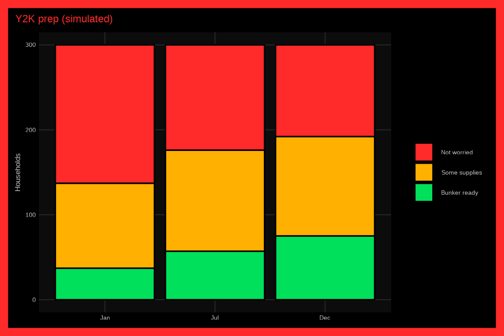

## Rugrats

[`theme_rugrats()`](https://mjfrigaard.github.io/fmggp2/reference/theme_rugrats.md):
playpen yellow with Tommy blue, Angelica pink, and Reptar green. Below
we simulate babies named after three characters.

``` r

set.seed(1993)
babies <- expand.grid(year = 1985:2000, name = c("Tommy", "Chuckie", "Angelica"))
babies$n <- rpois(nrow(babies), ifelse(babies$year < 1991, 0.5, 3))
ggplot(subset(babies, n > 0), aes(x = year, y = name, color = name, alpha = n)) +
  geom_point(shape = 124, size = 6, show.legend = FALSE) +
  labs(title = "Rugrats names (simulated)", x = NULL, y = NULL) +
  theme_rugrats(base_size = 13)
```

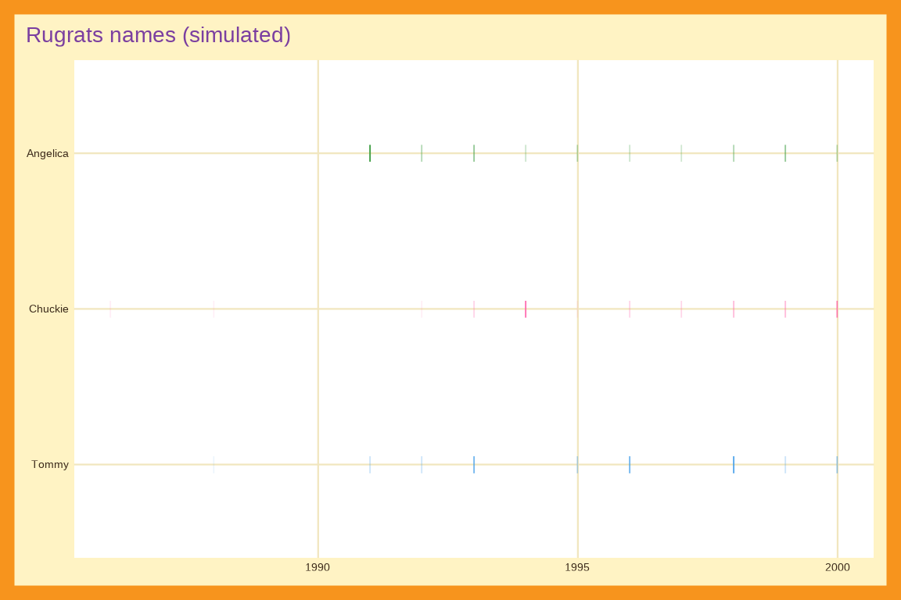

## Doom

[`theme_doom()`](https://mjfrigaard.github.io/fmggp2/reference/theme_doom.md):
hellfire red and orange on scorched brown. Below we simulate Doom frame
rates by processor speed.

``` r

set.seed(1993)
pcs <- data.frame(mhz = runif(100, 25, 100))
pcs$fps <- pmin(35, 0.45 * pcs$mhz + rnorm(100, 0, 3))
ggplot(pcs, aes(x = mhz, y = fps)) +
  geom_point() +
  labs(title = "Doom frame rates", caption = "Simulated data", x = "CPU (MHz)", y = "Frames per second") +
  theme_doom(base_size = 13)
```

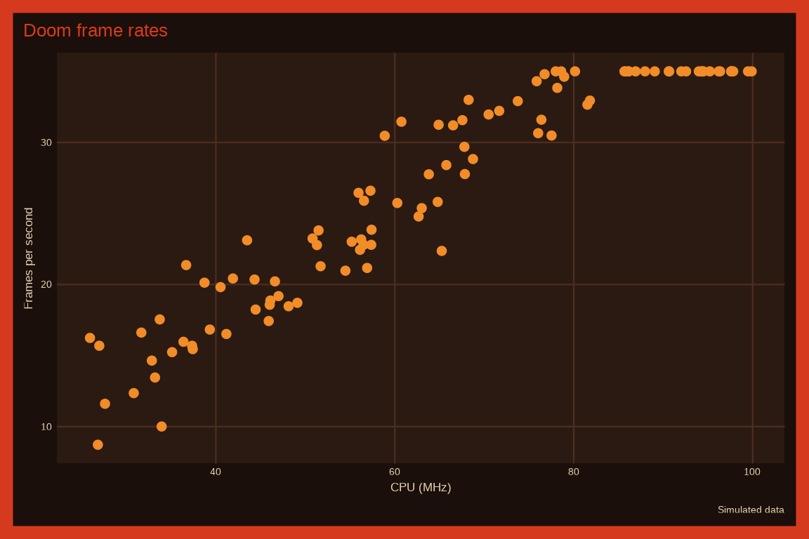

## Console wars

[`theme_consolewars()`](https://mjfrigaard.github.io/fmggp2/reference/theme_consolewars.md):
Sega blue vs. Nintendo red on charcoal. Below we simulate games owned
and hours played for two consoles.

``` r

set.seed(1991)
kids <- data.frame(console = rep(c("Genesis", "SNES"), each = 60), games = rnorm(120, 11, 3))
kids$hours <- 2 + 0.6 * kids$games + ifelse(kids$console == "SNES", 2, 0) + rnorm(120, 0, 2)
ggplot(kids, aes(x = games, y = hours, color = console)) +
  geom_point() +
  labs(title = "The console wars", caption = "Simulated data", x = "Games owned", y = "Hours per week", color = NULL) +
  theme_consolewars(base_size = 13)
```

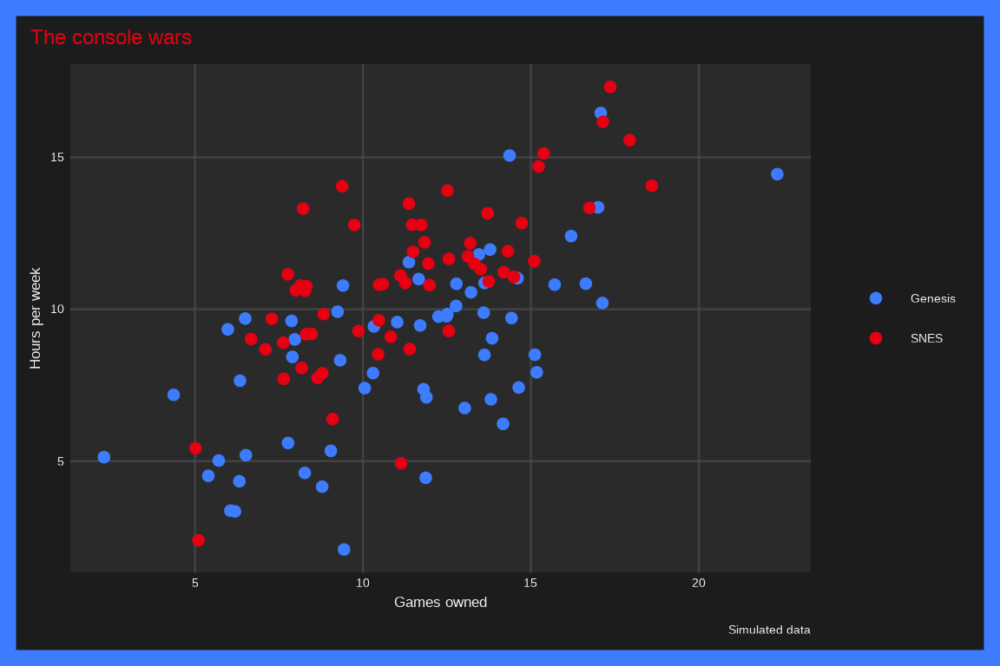

## Seinfeld

[`theme_seinfeld()`](https://mjfrigaard.github.io/fmggp2/reference/theme_seinfeld.md):
comedy club brick with the logo colors. Below we simulate laughs and
viewers for 60 episodes.

``` r

set.seed(1989)
eps <- data.frame(kramer = rgamma(60, 6, 1.5), viewers = rlnorm(60, log(20), 0.3))
eps$laughs <- 2 + 0.3 * eps$kramer + rnorm(60, 0, 0.5)
ggplot(eps, aes(x = kramer, y = laughs, size = viewers)) +
  geom_point(alpha = 1 / 2) +
  labs(title = "Seinfeld episodes", caption = "Simulated data", x = "Kramer minutes", y = "Laughs per minute", size = "Viewers") +
  theme_seinfeld(base_size = 13)
```

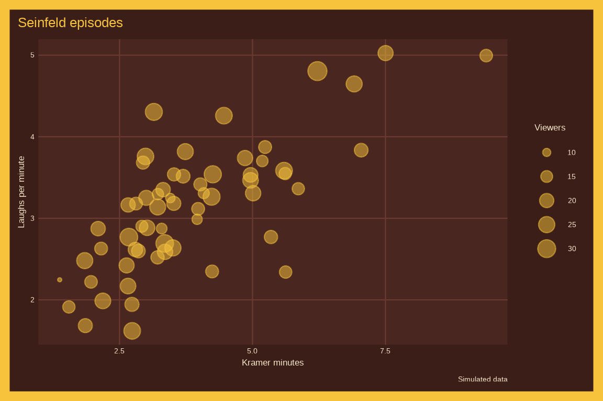

## Power Rangers

[`theme_powerrangers()`](https://mjfrigaard.github.io/fmggp2/reference/theme_powerrangers.md):
the six Ranger suits on light gray. Below we simulate putties defeated
by each Ranger.

``` r

set.seed(1993)
fights <- data.frame(ranger = factor(rep(c("Red", "Blue", "Yellow", "Pink", "Black"), each = 20), levels = c("Red", "Blue", "Yellow", "Pink", "Black")), minutes = rgamma(100, 4, 1))
fights$putties <- rpois(100, 1.6 * fights$minutes)
ggplot(fights, aes(x = minutes, y = putties, fill = ranger)) +
  geom_point(shape = 21, size = 3, color = "#000000") +
  labs(title = "Power Rangers", caption = "Simulated data", x = "Fight minutes", y = "Putties defeated", fill = NULL) +
  theme_powerrangers(base_size = 13)
```

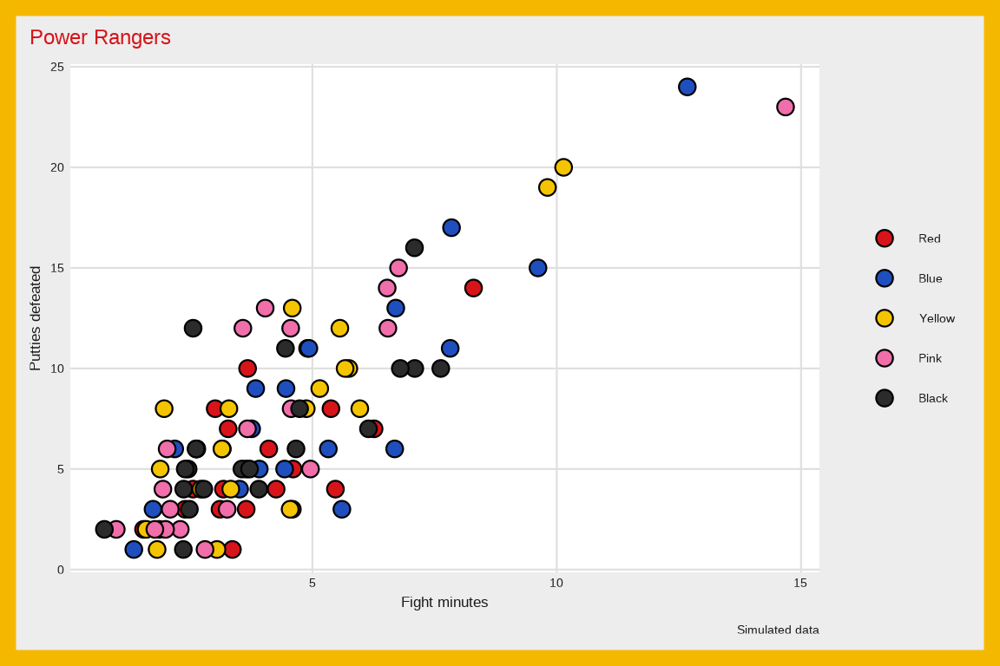

## Clueless

[`theme_clueless()`](https://mjfrigaard.github.io/fmggp2/reference/theme_clueless.md):
yellow plaid with black, red, and tartan green. Below we simulate the
styles in three cliques.

``` r

set.seed(1995)
students <- data.frame(clique = sample(c("Popular", "Skaters", "Drama"), 200, replace = TRUE))
students$style <- ifelse(students$clique == "Skaters", sample(c("Grunge", "Plaid"), 200, TRUE, c(0.8, 0.2)), sample(c("Grunge", "Plaid"), 200, TRUE, c(0.2, 0.8)))
ggplot(students, aes(x = clique, fill = style)) +
  geom_bar() +
  labs(title = "Bronson Alcott High", caption = "Simulated data", x = NULL, y = "Students", fill = NULL) +
  theme_clueless(base_size = 13)
```

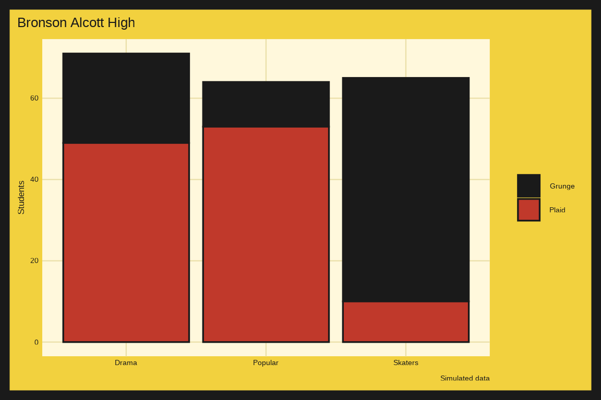

## Bop It

[`theme_bopit()`](https://mjfrigaard.github.io/fmggp2/reference/theme_bopit.md):
Bop It yellow on deep purple, with a purple to yellow continuous scale.
Below we simulate reaction times to two commands.

``` r

set.seed(1996)
players <- data.frame(bop = rnorm(300, 450, 60))
players$twist <- 60 + 0.9 * players$bop + rnorm(300, 0, 40)
ggplot(players, aes(x = bop, y = twist)) +
  geom_point(aes(color = twist), show.legend = FALSE) +
  labs(title = "Bop It reaction times", caption = "Simulated data", x = "Bop it! (ms)", y = "Twist it! (ms)") +
  theme_bopit(base_size = 13)
```

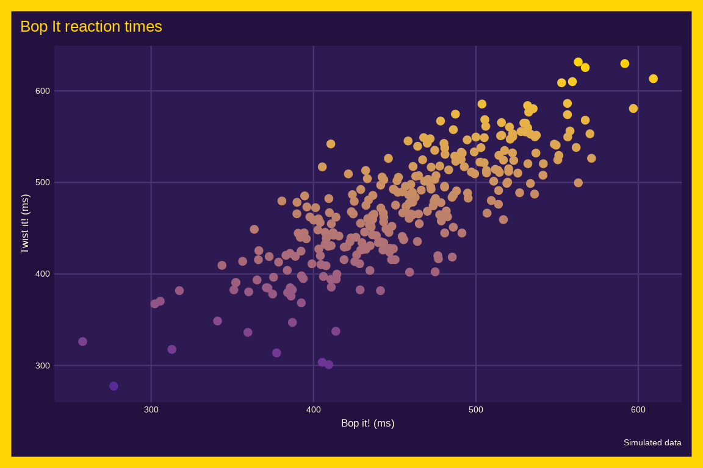

## GeoCities

[`theme_geocities()`](https://mjfrigaard.github.io/fmggp2/reference/theme_geocities.md):
lime text and a yellow Comic Sans title on a dark navy panel. Below we
simulate GeoCities page loads.

``` r

set.seed(1997)
pages <- data.frame(kb = rlnorm(2000, log(60), 0.45))
pages$seconds <- 2 + pages$kb * 8 / 44 + rnorm(2000, 0, 1.5)
ggplot(pages, aes(x = kb, y = seconds)) +
  geom_bin2d(bins = 25) +
  labs(title = "GeoCities page loads", caption = "Simulated data", x = "Page size (KB)", y = "Seconds to load") +
  theme_geocities(base_size = 13)
```

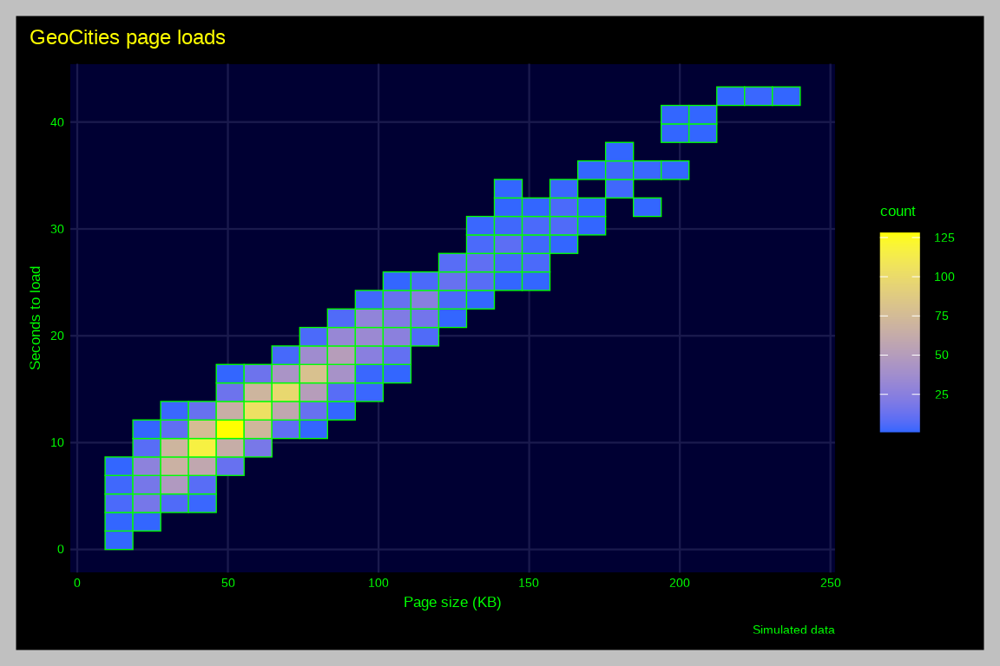

## Surge

[`theme_surge()`](https://mjfrigaard.github.io/fmggp2/reference/theme_surge.md):
Surge green on black, with a dark to bright green continuous scale.
Below we simulate cans of Surge and hours of video games.

``` r

set.seed(1996)
teens <- data.frame(cans = rgamma(2000, 2, 0.5))
teens$hours <- 3 + 1.5 * teens$cans + rnorm(2000, 0, 3)
ggplot(teens, aes(x = cans, y = hours)) +
  geom_bin2d(bins = 20) +
  labs(title = "Surge and video games", caption = "Simulated data", x = "Cans per week", y = "Gaming hours") +
  theme_surge(base_size = 13)
```

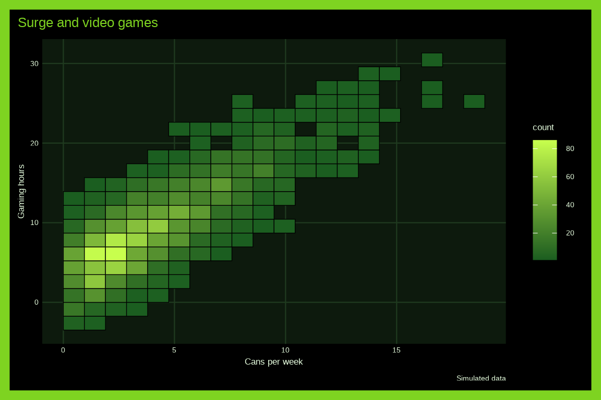

## Fonts

[`theme_gameboy()`](https://mjfrigaard.github.io/fmggp2/reference/theme_gameboy.md)
and
[`theme_tetris()`](https://mjfrigaard.github.io/fmggp2/reference/theme_tetris.md)
use Press Start 2P, which ships with `fmggp2`. The other themes use
fonts that ship with macOS and Windows.

These themes use a single font family:

- Tahoma
  ([`theme_win98()`](https://mjfrigaard.github.io/fmggp2/reference/theme_win98.md))
- Verdana
  ([`theme_napster()`](https://mjfrigaard.github.io/fmggp2/reference/theme_napster.md))
- Trebuchet MS
  ([`theme_spice()`](https://mjfrigaard.github.io/fmggp2/reference/theme_spice.md))
- Comic Sans MS
  ([`theme_beanie()`](https://mjfrigaard.github.io/fmggp2/reference/theme_beanie.md))

These themes use Arial for the body text and a display font for the
title:

- Impact
  ([`theme_blockbuster()`](https://mjfrigaard.github.io/fmggp2/reference/theme_blockbuster.md))
- Arial Black
  ([`theme_n64()`](https://mjfrigaard.github.io/fmggp2/reference/theme_n64.md)
  and
  [`theme_freshprince()`](https://mjfrigaard.github.io/fmggp2/reference/theme_freshprince.md))
- Herculanum
  ([`theme_jurassic()`](https://mjfrigaard.github.io/fmggp2/reference/theme_jurassic.md))
- Arial Rounded
  ([`theme_happymeal()`](https://mjfrigaard.github.io/fmggp2/reference/theme_happymeal.md))
- Chalkduster
  ([`theme_friends()`](https://mjfrigaard.github.io/fmggp2/reference/theme_friends.md))
- Bradley Hand
  ([`theme_pogs()`](https://mjfrigaard.github.io/fmggp2/reference/theme_pogs.md))
- DIN Condensed
  ([`theme_walkman()`](https://mjfrigaard.github.io/fmggp2/reference/theme_walkman.md))
- Georgia
  ([`theme_encarta()`](https://mjfrigaard.github.io/fmggp2/reference/theme_encarta.md))
- Times New Roman
  ([`theme_netscape()`](https://mjfrigaard.github.io/fmggp2/reference/theme_netscape.md))
- Big Caslon
  ([`theme_titanic()`](https://mjfrigaard.github.io/fmggp2/reference/theme_titanic.md))
- Chalkboard
  ([`theme_lisafrank()`](https://mjfrigaard.github.io/fmggp2/reference/theme_lisafrank.md))
- Phosphate
  ([`theme_toysrus()`](https://mjfrigaard.github.io/fmggp2/reference/theme_toysrus.md))
- Futura
  ([`theme_tamagotchi()`](https://mjfrigaard.github.io/fmggp2/reference/theme_tamagotchi.md))
- Arial Black
  ([`theme_supersoaker()`](https://mjfrigaard.github.io/fmggp2/reference/theme_supersoaker.md))
- Trattatello
  ([`theme_goosebumps()`](https://mjfrigaard.github.io/fmggp2/reference/theme_goosebumps.md))
- Chalkboard SE
  ([`theme_furby()`](https://mjfrigaard.github.io/fmggp2/reference/theme_furby.md))
- Impact
  ([`theme_trl()`](https://mjfrigaard.github.io/fmggp2/reference/theme_trl.md))
- Andale Mono
  ([`theme_oregontrail()`](https://mjfrigaard.github.io/fmggp2/reference/theme_oregontrail.md))
- Arial Rounded
  ([`theme_aim()`](https://mjfrigaard.github.io/fmggp2/reference/theme_aim.md))
- Skia
  ([`theme_magiceye()`](https://mjfrigaard.github.io/fmggp2/reference/theme_magiceye.md))
- DIN Condensed
  ([`theme_batman()`](https://mjfrigaard.github.io/fmggp2/reference/theme_batman.md))
- Arial Black
  ([`theme_snick()`](https://mjfrigaard.github.io/fmggp2/reference/theme_snick.md))
- Silom
  ([`theme_boyband()`](https://mjfrigaard.github.io/fmggp2/reference/theme_boyband.md))
- SignPainter
  ([`theme_savedbythebell()`](https://mjfrigaard.github.io/fmggp2/reference/theme_savedbythebell.md))
- Gill Sans
  ([`theme_hypercolor()`](https://mjfrigaard.github.io/fmggp2/reference/theme_hypercolor.md))
- PT Mono
  ([`theme_y2k()`](https://mjfrigaard.github.io/fmggp2/reference/theme_y2k.md))
- Marker Felt
  ([`theme_rugrats()`](https://mjfrigaard.github.io/fmggp2/reference/theme_rugrats.md))
- Impact
  ([`theme_doom()`](https://mjfrigaard.github.io/fmggp2/reference/theme_doom.md))
- Krungthep
  ([`theme_consolewars()`](https://mjfrigaard.github.io/fmggp2/reference/theme_consolewars.md))
- American Typewriter
  ([`theme_seinfeld()`](https://mjfrigaard.github.io/fmggp2/reference/theme_seinfeld.md))
- Copperplate
  ([`theme_powerrangers()`](https://mjfrigaard.github.io/fmggp2/reference/theme_powerrangers.md))
- Didot
  ([`theme_clueless()`](https://mjfrigaard.github.io/fmggp2/reference/theme_clueless.md))
- Rockwell
  ([`theme_bopit()`](https://mjfrigaard.github.io/fmggp2/reference/theme_bopit.md))
- Comic Sans MS
  ([`theme_geocities()`](https://mjfrigaard.github.io/fmggp2/reference/theme_geocities.md))
- DIN Alternate
  ([`theme_surge()`](https://mjfrigaard.github.io/fmggp2/reference/theme_surge.md))

When a font file can’t be found, the theme falls back to `"sans"`, so
the plots above still render on Linux. You can also pass any family
you’ve registered with
[`sysfonts::font_add()`](https://rdrr.io/pkg/sysfonts/man/font_add.html):

``` r

theme_win98(base_family = "sans")
```

## Using a theme for a whole chapter

Each chapter sets its theme once in the setup chunk with
[`theme_set()`](https://ggplot2.tidyverse.org/reference/get_theme.html),
so the plotting code in the chapter doesn’t need a `theme_*()` call.

``` r

ggplot2::theme_set(fmggp2::theme_win98(base_size = 15))
```
