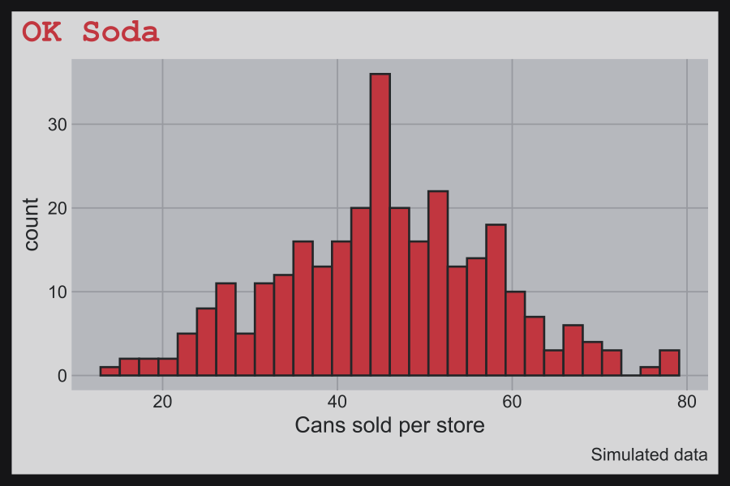
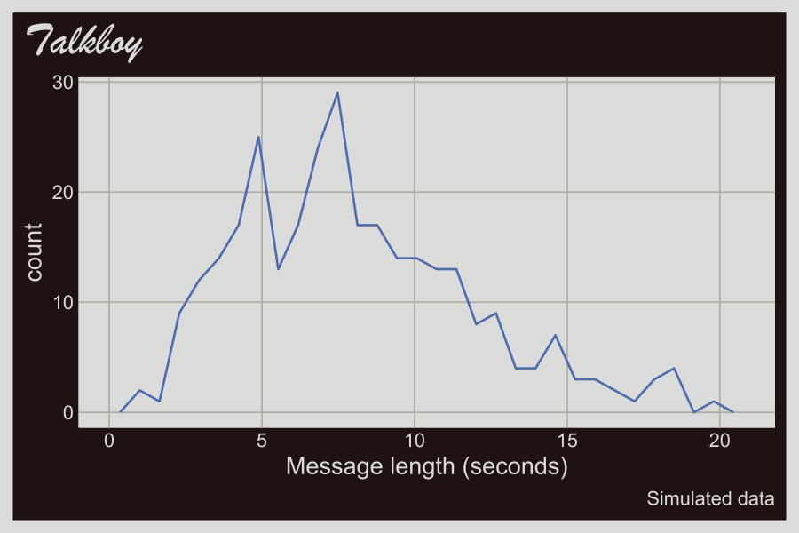

# fmggp2

`fmggp2` is the support package for [*ggplot2: field
manual*](https://mjfrigaard.github.io/fm-ggp2/). It holds the late 90s
`ggplot2` themes and the small helpers the book uses, so every chapter
loads the same tested code.

## Installation

Install the development version from GitHub:

``` r

# install.packages("pak")
pak::pak("mjfrigaard/fmggp2")
```

## Themes

Every example in the book uses simulated data with a 90s throwback, and
each dataset gets a theme to match.

| Theme | Reference | Chapter |
|----|----|----|
| [`theme_surge()`](https://mjfrigaard.github.io/fmggp2/reference/theme_surge.md) | Surge | Hexagon bins (cans vs. gaming hours) |
| [`theme_geocities()`](https://mjfrigaard.github.io/fmggp2/reference/theme_geocities.md) | GeoCities | 2D histograms (page load times) |
| [`theme_bopit()`](https://mjfrigaard.github.io/fmggp2/reference/theme_bopit.md) | Bop It | Density contours (reaction times) |
| [`theme_clueless()`](https://mjfrigaard.github.io/fmggp2/reference/theme_clueless.md) | Clueless | Parallel sets (Bronson Alcott cliques) |
| [`theme_powerrangers()`](https://mjfrigaard.github.io/fmggp2/reference/theme_powerrangers.md) | Power Rangers | Grouped bubble charts (putties defeated) |
| [`theme_seinfeld()`](https://mjfrigaard.github.io/fmggp2/reference/theme_seinfeld.md) | Seinfeld | Bubble charts (Seinfeld episodes) |
| [`theme_consolewars()`](https://mjfrigaard.github.io/fmggp2/reference/theme_consolewars.md) | Console wars | Grouped scatter plots (Sega vs. Nintendo) |
| [`theme_doom()`](https://mjfrigaard.github.io/fmggp2/reference/theme_doom.md) | Doom | Scatter plots (frame rate by CPU speed) |
| [`theme_gushers()`](https://mjfrigaard.github.io/fmggp2/reference/theme_gushers.md) | Fruit Gushers | Instance charts (lunch table trades by year) |
| [`theme_y2k()`](https://mjfrigaard.github.io/fmggp2/reference/theme_y2k.md) | Y2K | Alluvial charts (Y2K prep surveys) |
| [`theme_hypercolor()`](https://mjfrigaard.github.io/fmggp2/reference/theme_hypercolor.md) | Hypercolor | Stream plots (90s fad sales) |
| [`theme_savedbythebell()`](https://mjfrigaard.github.io/fmggp2/reference/theme_savedbythebell.md) | Saved by the Bell | Slope graphs (Bayside quiz averages) |
| [`theme_boyband()`](https://mjfrigaard.github.io/fmggp2/reference/theme_boyband.md) | Boy bands | Bump charts (weekly radio spins) |
| [`theme_snick()`](https://mjfrigaard.github.io/fmggp2/reference/theme_snick.md) | SNICK | Grouped line graphs (nightly Nickelodeon ratings) |
| [`theme_batman()`](https://mjfrigaard.github.io/fmggp2/reference/theme_batman.md) | Batman (1989) | Line graphs (weekly box office) |
| [`theme_rzone()`](https://mjfrigaard.github.io/fmggp2/reference/theme_rzone.md) | Tiger R-Zone | Raincloud plots (seconds to clear the first level) |
| [`theme_aim()`](https://mjfrigaard.github.io/fmggp2/reference/theme_aim.md) | AOL Instant Messenger | Grouped violin plots (buddy list sizes) |
| [`theme_oregontrail()`](https://mjfrigaard.github.io/fmggp2/reference/theme_oregontrail.md) | The Oregon Trail | Grouped box plots (days to reach Oregon) |
| [`theme_squeezit()`](https://mjfrigaard.github.io/fmggp2/reference/theme_squeezit.md) | Squeezit | Ridgeline plots (seconds to finish a bottle) |
| [`theme_furby()`](https://mjfrigaard.github.io/fmggp2/reference/theme_furby.md) | Furby | Overlapping and stacked densities (Furby chatter) |
| [`theme_tetris()`](https://mjfrigaard.github.io/fmggp2/reference/theme_tetris.md) | Tetris | Beeswarm plots (lines cleared by player) |
| [`theme_goosebumps()`](https://mjfrigaard.github.io/fmggp2/reference/theme_goosebumps.md) | Goosebumps books | Overlapping dot plots (books read by grade) |
| [`theme_supersoaker()`](https://mjfrigaard.github.io/fmggp2/reference/theme_supersoaker.md) | Super Soaker | Overlapping frequency polygons (range by model) |
| [`theme_tamagotchi()`](https://mjfrigaard.github.io/fmggp2/reference/theme_tamagotchi.md) | Tamagotchi | Overlapping histograms (virtual pet lifespans) |
| [`theme_toysrus()`](https://mjfrigaard.github.io/fmggp2/reference/theme_toysrus.md) | Toys”R”Us | Treemaps (1998 toy sales) |
| [`theme_koosh()`](https://mjfrigaard.github.io/fmggp2/reference/theme_koosh.md) | Koosh ball | Pie charts (Koosh ball styles) |
| [`theme_titanic()`](https://mjfrigaard.github.io/fmggp2/reference/theme_titanic.md) | Titanic (1997) | Mosaic plots (moviegoers and viewings) |
| [`theme_netscape()`](https://mjfrigaard.github.io/fmggp2/reference/theme_netscape.md) | Netscape Navigator | Stacked filled densities (modem speeds) |
| [`theme_orbitz()`](https://mjfrigaard.github.io/fmggp2/reference/theme_orbitz.md) | Orbitz | Diverging bar graphs (Orbitz vs. Surge survey) |
| [`theme_walkman()`](https://mjfrigaard.github.io/fmggp2/reference/theme_walkman.md) | Sony Walkman Sports | Cleveland dot plots (battery life by model) |
| [`theme_pogs()`](https://mjfrigaard.github.io/fmggp2/reference/theme_pogs.md) | Pogs milk caps | Waffle charts (a collection of 100 Pogs) |
| [`theme_freshprince()`](https://mjfrigaard.github.io/fmggp2/reference/theme_freshprince.md) | The Fresh Prince of Bel-Air | Heatmaps (running gags per season) |
| [`theme_friends()`](https://mjfrigaard.github.io/fmggp2/reference/theme_friends.md) | Friends (Monica’s apartment) | Overlapping bar graphs (viewers per episode) |
| [`theme_happymeal()`](https://mjfrigaard.github.io/fmggp2/reference/theme_happymeal.md) | McDonald’s Happy Meal box | Summary bar graphs (Happy Meals sold per promotion) |
| [`theme_jurassic()`](https://mjfrigaard.github.io/fmggp2/reference/theme_jurassic.md) | Jurassic Park (1993) | Grouped bar graphs (dinosaur weights per paddock) |
| [`theme_n64()`](https://mjfrigaard.github.io/fmggp2/reference/theme_n64.md) | Nintendo 64 | Box plots (Mario Kart 64 lap times) |
| [`theme_beanie()`](https://mjfrigaard.github.io/fmggp2/reference/theme_beanie.md) | Beanie Babies heart tag | Violin plots (resale prices) |
| [`theme_crystalpepsi()`](https://mjfrigaard.github.io/fmggp2/reference/theme_crystalpepsi.md) | Crystal Pepsi | Density plots (taste test ages) |
| [`theme_blockbuster()`](https://mjfrigaard.github.io/fmggp2/reference/theme_blockbuster.md) | Blockbuster Video | Dot plots (weekly rentals) |
| [`theme_gameboy()`](https://mjfrigaard.github.io/fmggp2/reference/theme_gameboy.md) | Original Game Boy screen | Bar graphs (Pokémon starters) |
| [`theme_oksoda()`](https://mjfrigaard.github.io/fmggp2/reference/theme_oksoda.md) | OK Soda | Histograms (cans sold per store) |
| [`theme_talkboy()`](https://mjfrigaard.github.io/fmggp2/reference/theme_talkboy.md) | Talkboy | Frequency polygons (recorded message lengths) |
| [`theme_fmggp2()`](https://mjfrigaard.github.io/fmggp2/reference/theme_fmggp2.md) | Original book theme | Chapters not yet converted |

``` r

library(fmggp2)
library(ggplot2)
showtext::showtext_auto()
set.seed(1014)
ok_soda_sales <- data.frame(cans = round(rnorm(300, mean = 45, sd = 12)))
ggplot(ok_soda_sales, aes(x = cans)) +
  geom_histogram(bins = 30) +
  labs(title = "OK Soda", caption = "Simulated data",
       x = "Cans sold per store") +
  theme_oksoda(base_size = 13)
```



``` r

set.seed(1999)
talkboy_clips <- data.frame(seconds = round(rgamma(300, shape = 4, rate = 0.5), 1))
ggplot(talkboy_clips, aes(x = seconds)) +
  geom_freqpoly(bins = 30) +
  labs(title = "Talkboy", caption = "Simulated data",
       x = "Message length (seconds)") +
  theme_talkboy(base_size = 13)
```



## Book helpers

| Function | What it does |
|----|----|
| [`co_box()`](https://mjfrigaard.github.io/fmggp2/reference/co_box.md) | Prints a Quarto callout box (use with `results: asis`) |
| [`status()`](https://mjfrigaard.github.io/fmggp2/reference/status.md) | Prints a chapter status callout |
| `%nin%` | The negation of `%in%` |

## How the chapters teach distributions

Each chapter simulates its data from a known distribution, then connects
that distribution to the graph in a “Distribution” section. The section
follows the concrete, pictorial, abstract sequence from [Singapore
math](https://en.wikipedia.org/wiki/Singapore_math):

1.  **Count it** (concrete): print a handful of simulated values and a
    small count table.
2.  **Draw it** (pictorial): draw a bar model (parts of a whole), then
    the graph with reference lines.
3.  **Name it** (abstract): state the generating distribution (e.g.,
    $`X \sim \text{Normal}(45, 12)`$) and show how each parameter maps
    to the graph.
